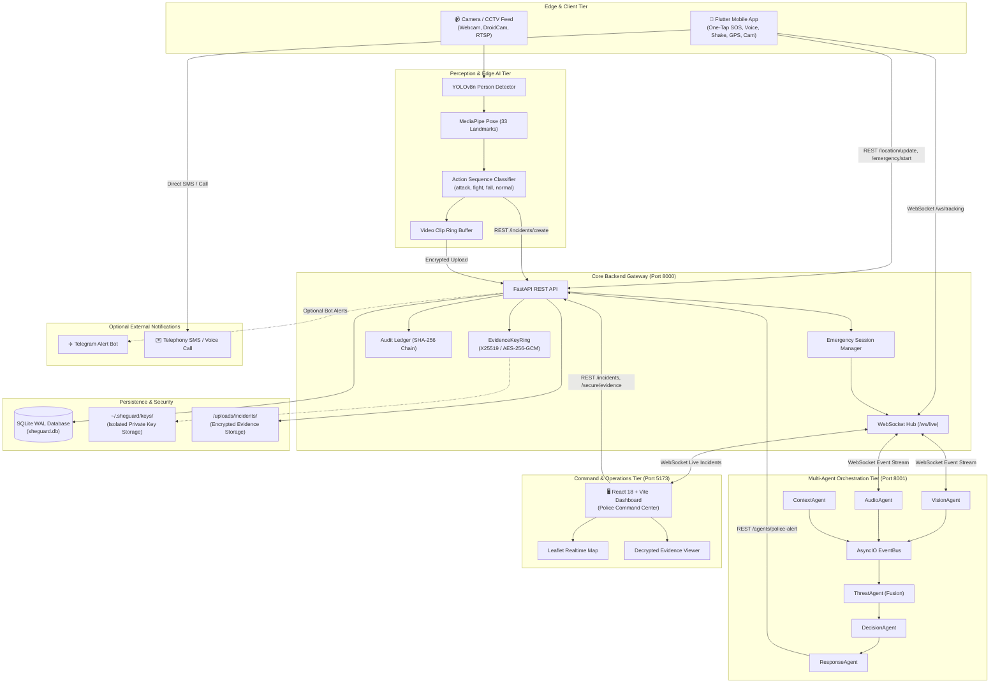
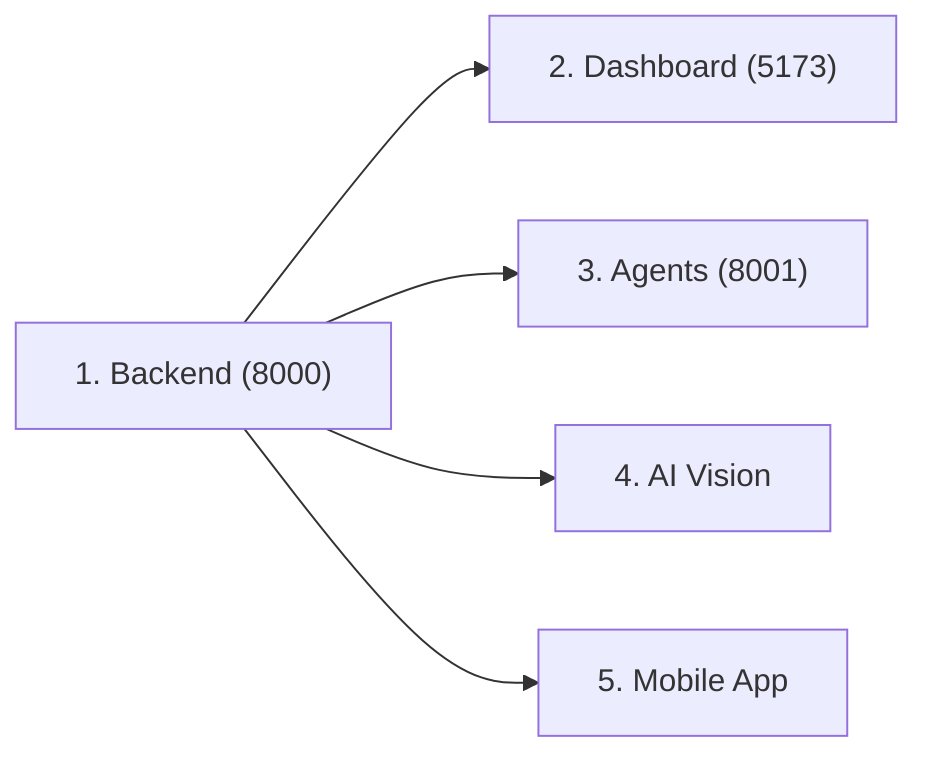
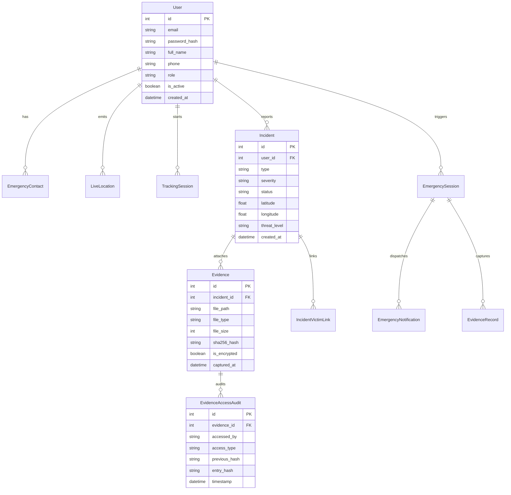

# SheGuard — AI-Powered Women's Safety & Emergency Response Ecosystem

> **A synchronized, multi-tier safety platform integrating cross-platform mobile emergency assistance, edge computer vision, multi-agent AI event orchestration, cryptographic evidence protection, and a centralized police command dashboard.**

[](https://github.com/bindudharad/SheGuard-AI.git)
[](https://flutter.dev)
[](https://fastapi.tiangolo.com)
[](https://www.python.org)
[](https://react.dev)
[](https://vitejs.dev)
[](https://ultralytics.com)
[](https://developers.google.com/mediapipe)
[](https://cryptography.io)

---

## Table of Contents

1. [Overview](#1-overview)
2. [Problem Statement](#2-problem-statement)
3. [Proposed Solution](#3-proposed-solution)
4. [Key Features](#4-key-features)
   - [SheGuard_App (Mobile Client)](#41-sheguard_app-mobile-client)
   - [SheGuard_Backend (Core Services & API)](#42-sheguard_backend-core-services-api)
   - [SheGuard_AI (Vision & Threat Analysis)](#43-sheguard_ai-vision-threat-analysis)
   - [SheGuard_Agents (Multi-Agent System)](#44-sheguard_agents-multi-agent-system)
   - [SheGuard_Dashboard (Command Center)](#45-sheguard_dashboard-command-center)
5. [System Architecture](#5-system-architecture)
6. [End-to-End Working Flow](#6-end-to-end-working-flow)
7. [Technology Stack](#7-technology-stack)
8. [Project Structure](#8-project-structure)
9. [Installation & Prerequisites](#9-installation-prerequisites)
10. [Environment Configuration](#10-environment-configuration)
11. [Running the Project Locally](#11-running-the-project-locally)
    - [Step 1: Start Backend API](#step-1-start-the-fastapi-backend)
    - [Step 2: Start Police Dashboard](#step-2-start-the-react-vite-dashboard)
    - [Step 3: Start Multi-Agent Orchestrator](#step-3-start-the-multi-agent-orchestrator)
    - [Step 4: Start AI Vision Pipeline](#step-4-start-the-ai-computer-vision-pipeline)
    - [Step 5: Launch Mobile App](#step-5-launch-the-flutter-mobile-app)
12. [API Documentation & WebSockets](#12-api-documentation-websockets)
13. [Database Architecture & Data Models](#13-database-architecture-data-models)
14. [Security Architecture & Cryptography](#14-security-architecture-cryptography)
15. [Testing & Quality Verification](#15-testing-quality-verification)
16. [Current Implementation Status](#16-current-implementation-status)
17. [Known Limitations & Future Roadmap](#17-known-limitations-future-roadmap)
18. [Screenshots & Visual Assets](#18-screenshots-visual-assets)
19. [Contributing](#19-contributing)
20. [Responsible Use & Safety Disclaimer](#20-responsible-use-safety-disclaimer)
21. [License](#21-license)
22. [Acknowledgements](#22-acknowledgements)

---

## 1. Overview

**SheGuard** is an end-to-end, modular personal safety and emergency-response ecosystem designed to bridge the gap between distressed individuals, automated sensing intelligence, and law enforcement dispatchers. 

Rather than relying on isolated panic buttons or disconnected CCTV feeds, SheGuard unifies five interoperable engineering subsystems:
* **Mobile Assistance (`SheGuard_App`)**: A Flutter smartphone client providing multi-modal SOS triggers (one-tap button, physical device shake, hands-free voice trigger `"HELP"`), background GPS breadcrumbs, discrete fake calls, and client-side encrypted audio/camera evidence capture.
* **Central Core Engine (`SheGuard_Backend`)**: A high-concurrency FastAPI service acting as the central nervous system. It orchestrates real-time incident queues, manages database persistence with SQLite WAL concurrency and foreign-key integrity, provides an authenticated WebSocket broadcast hub (`/ws/live`), enforces X25519 key-ring management, and records tamper-evident hash-chained audit trails.
* **Computer Vision Pipeline (`SheGuard_AI`)**: An edge-capable video analytics engine combining YOLOv8n object detection, MediaPipe 33-point pose estimation, Farneback optical flow feature extraction, and temporal action sequence classifiers (`attack`, `fall`, `fight`, `normal`).
* **Multi-Agent Orchestration (`SheGuard_Agents`)**: An autonomous agent collective (Vision, Audio, Context, Threat, Decision, and Response agents) communicating over an AsyncIO EventBus to fuse heterogeneous sensor streams, score situational risk, and recommend calibrated response actions.
* **Police Command Dashboard (`SheGuard_Dashboard`)**: A React 18 + Vite desktop-optimized tactical dispatch portal featuring live WebSocket incident streaming, interactive Leaflet coordinate maps, responder tracking, and secure evidence retrieval.

> [!NOTE]
> SheGuard is an assistive decision-support ecosystem. Its AI models and automated agents are engineered to accelerate verification and alert routing for authorized human operators, never to replace human judgment or official emergency dispatch services.

---

## 2. Problem Statement

Modern personal safety systems face significant operational friction across four major boundaries:

1. **High Friction in Distress Activation**: When an individual is in immediate danger or physical confrontation, unlocking a mobile phone, opening an application, and dialing an emergency number is often physically impossible.
2. **Disconnected Sensing Streams**: Traditional surveillance cameras record video passively onto local DVRs without real-time threat comprehension. At the same time, mobile safety apps only report GPS coordinates, leaving dispatchers blind to visual context, aggression dynamics, or weapon involvement.
3. **Information Overload for Responders**: Emergency control rooms are flooded with incomplete reports, false alarms, and unverified calls. Dispatchers lack automated tools to fuse spatial, temporal, auditory, and visual evidence into an objective threat score.
4. **Evidence Vulnerability & Chain of Custody**: Mobile emergency recordings and CCTV footage captured during incidents are frequently lost, tampered with, or inadmissible in judicial proceedings due to unencrypted storage, lack of verifiable timestamps, and missing cryptographic access ledgers.

---

## 3. Proposed Solution

SheGuard resolves these challenges through a coordinated, multi-tier defense architecture:

* **Zero-Friction Triggering**: The mobile client listens for multi-modal emergency indicators—physical accelerometer motion bursts (shake detection), acoustic speech recognition (spoken distress keyword `"HELP"`), or manual high-priority SOS taps—initiating immediate background tracking.
* **Automated Threat Detection**: Fixed or mobile cameras running the computer vision pipeline autonomously detect person bounding boxes, extract human skeletal poses, and classify hostile physical behaviors (`fight`, `attack`, `fall`) in real time, automatically forwarding signed incident payloads to the backend.
* **Autonomous Multi-Agent Synthesis**: Rather than executing static if-else scripts, six specialized AI agents concurrently evaluate visual aggression cues, audio keywords, environmental zone risk, and temporal patterns, dynamically synthesizing an overall incident severity.
* **Cryptographic Evidence Sealing**: When an incident is triggered, the client fetches the backend's active X25519 public key, derives a unique Data Encryption Key (DEK) via HKDF-SHA256, encrypts media with AES-256-GCM AEAD, and uploads an encrypted envelope. All subsequent access attempts are permanently written to a cryptographic SHA-256 hash-chain audit ledger.
* **Unified Tactical Command**: Police officers and emergency responders monitor a single live operational screen updating over WebSockets, with sub-second incident alerts, victim breadcrumb tracks, and decrypt-on-demand verified evidence.

---

## 4. Key Features

### 4.1 SheGuard_App (Mobile Client)
* **One-Tap Emergency SOS**: Prominent visual SOS button triggering an immediate emergency session, alerting local contacts and remote dispatchers simultaneously.
* **Hands-Free Voice Detection**: Continuous or background voice monitoring using `speech_to_text`, triggering emergency workflows when distress phrases (such as `"HELP"`) are recognized.
* **Shake-to-Alert Motion Protection**: Background accelerometer threshold monitoring (`sensors_plus`) detecting aggressive device shaking or physical struggle.
* **Live GPS Tracking & Location Freshness**: Continuous location tracking (`geolocator`) streaming coordinates, altitude, heading, speed, and accuracy to `/location/update`.
* **Automated Evidence Capture**: Camera snapshot and audio recording pipeline (`camera`, `record`) triggered on incident escalation, saving media to sandboxed secure storage.
* **Client-Side Envelope Encryption**: Interacts with backend crypto endpoints using `cryptography` to encrypt captured evidence before network transmission.
* **Discrete Fake Call**: Realistic incoming call simulator (`fake_call_screen.dart`) allowing users to gracefully disengage from uncomfortable or suspicious encounters.
* **Emergency Telephony & SMS**: Direct phone dialing (`flutter_phone_direct_caller`) and automated SMS alert dispatching (`telephony`) to designated contacts.

### 4.2 SheGuard_Backend (Core Services & API)
* **REST & WebSocket API Gateway**: FastAPI engine hosting structured REST endpoints alongside an authenticated pub/sub WebSocket hub (`/ws/live`, `/ws/tracking/{session_id}`).
* **Incident Lifecycle Management**: Full CRUD lifecycle tracking (`new` → `acknowledged` → `responding` → `resolved`) with automated session deduplication.
* **Key-Ring Management System**: Versioned cryptographic key-ring (`EvidenceKeyRing`) handling key rotation, active state lookup, and decrypt-only legacy access.
* **Tamper-Evident Audit Ledger**: SHA-256 sequential hash-chain records tracking every evidence decryption event, operator user ID, timestamp, and authorization outcome.
* **Database Hardening**: SQLite configured with `PRAGMA journal_mode=WAL` (Write-Ahead Logging) and `PRAGMA foreign_keys=ON` for concurrent multi-client read/write safety.
* **Optional Telegram Dispatcher**: Automated bot service forwarding emergency coordinates, street address, photo snapshots, and video clips to configured Telegram alert groups.

### 4.3 SheGuard_AI (Vision & Threat Analysis)
* **YOLOv8n Person Detection**: High-speed edge person localization utilizing Ultralytics YOLOv8 nano checkpoints (`yolov8n.pt`).
* **MediaPipe Pose Feature Extraction**: Extracts 33 3D skeletal landmark coordinates alongside Farneback optical flow motion vectors.
* **Multi-Class Action Classifier**: Machine learning classifier trained on feature-engineered pose vectors to detect:
  * `attack` — aggressive lunging, striking, or physical assault motions.
  * `fight` — multi-person struggle and physical confrontations.
  * `fall` — sudden loss of balance, collapse, or ground impact.
  * `normal` — routine walking, standing, or non-aggressive movement.
* **Pre/Post Event Video Clipper**: Ring-buffer video memory (`video_clipper.py`) capturing seconds before and after an alarm, assembling self-contained evidence clips.
* **Multi-Input Flexibility**: Accepts standard webcams (`--source 0`), DroidCam wireless mobile camera feeds (`--source 1`), RTSP streams, or offline MP4 video files.

### 4.4 SheGuard_Agents (Multi-Agent System)
* **VisionAgent**: Ingests camera streams, runs person tracking, evaluates proximity violations, and flags erratic body movements.
* **AudioAgent**: Processes acoustic signals, evaluates background noise levels, and detects spoken distress indicators.
* **ContextAgent**: Evaluates spatial and temporal context—time of day, known crime density zones, nearby CCTV coverage, and user historical patterns.
* **ThreatAgent**: Fuses probability distributions from Vision, Audio, and Context agents into a unified, calibrated threat score (0–100).
* **DecisionAgent**: Applies emergency policy heuristics to recommend operational escalation levels (`MONITORING`, `ELEVATED`, `HIGH_RISK`, `CRITICAL`).
* **ResponseAgent**: Executes automated alert actions—triggering backend emergency sessions, broadcasting police alerts, and logging incident telemetry.
* **EventBus Architecture**: Decoupled AsyncIO in-memory event bus guaranteeing asynchronous, non-blocking agent communication.

### 4.5 SheGuard_Dashboard (Command Center)
* **Live Incident Feed**: Real-time WebSocket table updating sub-second without manual page refreshes, sorting incidents by threat severity.
* **Interactive Leaflet Mapping**: Visualizes victim GPS breadcrumb coordinates, incident cluster pins, and active response vehicle positions (`react-leaflet`).
* **Incident Detail Inspection**: Complete operational breakdown including victim identity, emergency contacts, trigger type, and chronological event timelines.
* **Cryptographic Evidence Viewer**: In-browser evidence player displaying decrypted video clips and snapshots with verified SHA-256 checksums.
* **Tactical Analytics**: Real-time aggregation of incident trends, spatial heatmaps, and average response times (`AnalyticsPage.jsx`).
* **Role-Based Security**: Protected route boundaries ensuring only authenticated operators (`officer` or `admin`) can access investigative tools.

---

## 5. System Architecture



---

## 6. End-to-End Working Flow

SheGuard accommodates multiple independent entry vectors that converge into an integrated operational response:

```text
[Trigger Vector]             [Processing & Fusion]             [Command & Resolution]

Mobile SOS Button ──┐
Phone Shake Event ──┼──> FastAPI Backend (/emergency/start) ──> WebSocket Hub (/ws/live)
Voice "HELP" Spoken─┘          │                                       │
                               ▼                                       ▼
Camera CCTV Stream ────> SheGuard_AI Pipeline                 SheGuard_Agents System
                               │ (YOLOv8 + MediaPipe)                  │ (Threat Fusion)
                               ▼                                       ▼
                         Action Detection                      Calibrated Alert Level
                         (attack/fight/fall)                           │
                               │                                       ▼
                               └───> REST /incidents/create ───────────┴──> Police Dashboard
                                                                           │ (Sub-second Alert)
                                                                           ▼
                                                                     Officer Dispatched
                                                                     Evidence Verified
```

### Sequential Operational Walkthrough:
1. **Emergency Activation**:
   * *Mobile Path*: A user activates an SOS trigger (manual tap, physical shake, or spoken `"HELP"`). The application captures GPS coordinates, begins an audio/video buffer, and calls `POST /emergency/start`.
   * *Vision Path*: A monitored camera detects physical hostility (`fight` or `attack` with confidence $\ge 0.75$). `SheGuard_AI` automatically packages the event, writes a 5-second video clip buffer, and calls `POST /incidents/create`.
2. **Ingestion & Session Correlation**:
   * The backend receives the payload, creates an `Incident` entity, and assigns a unique `incident_id`.
   * If a mobile user's live location is within proximity of the reporting camera, `incident_linking.py` links the victim record to the video incident.
3. **Multi-Agent Evaluation**:
   * The `SheGuard_Agents` orchestrator receives the event from the WebSocket bus.
   * `VisionAgent` validates optical flow velocity; `AudioAgent` scores acoustic distress; `ContextAgent` queries historical zone risk.
   * `ThreatAgent` calculates a combined threat probability; `DecisionAgent` escalates the incident state to `CRITICAL`.
4. **Real-Time Dispatch Alerting**:
   * The backend broadcasts a JSON payload across `/ws/live`.
   * The `SheGuard_Dashboard` receives the packet sub-second: audio chime sounds, a high-severity red card appears on the dispatch table, and the Leaflet map centers on the coordinates.
5. **Cryptographic Evidence Review**:
   * The authorized officer clicks **View Evidence**. The dashboard requests `GET /secure/evidence/{incident_id}`.
   * The backend verifies officer permissions, uses the private key in `~/.sheguard/keys/` to decrypt the AES-256-GCM envelope, returns the media stream, and appends an immutable record to `evidence_access_audits` with the newly computed hash-chain entry.
6. **Resolution & Archival**:
   * The dispatch operator marks the incident `responding` and subsequently `resolved`. All telemetry is permanently indexed in SQLite for retrospective reporting.

---

## 7. Technology Stack

| Layer | Component | Technology / Library | Version | Purpose in SheGuard |
| :--- | :--- | :--- | :--- | :--- |
| **Mobile** | Framework | Flutter / Dart | `>=3.3.0 <4.0.0` | Cross-platform Android & iOS client |
| | State Management | `provider` | `^6.1.2` | Reactive application state handling |
| | Geolocation | `geolocator` | `^13.0.1` | High-accuracy GPS location tracking |
| | Sensors & Motion | `sensors_plus` | `^7.0.0` | Accelerometer shake detection |
| | Speech Recognition | `speech_to_text` | `^7.0.0` | Hands-free `"HELP"` voice trigger |
| | Secure Storage | `flutter_secure_storage` | `^9.2.2` | Keychain / Keystore token caching |
| | WebSockets | `web_socket_channel` | `^3.0.1` | Real-time bi-directional telemetry |
| **Backend** | API Gateway | FastAPI | `2.0.0` / Latest | Asynchronous REST & WebSocket server |
| | ASGI Web Server | Uvicorn | Standard | Production ASGI runtime |
| | ORM & Persistence | SQLAlchemy | `2.0+` | Database mapping & SQL abstractions |
| | Migrations | Alembic | Latest | Schema version control & migrations |
| | Environment | `python-dotenv`, `pydantic` | Latest | Configuration management |
| **Computer Vision** | Object Detection | Ultralytics YOLOv8 | `8.x` | Nano person detection (`yolov8n.pt`) |
| | Pose Estimation | Google MediaPipe | `0.10.14` | 33 3D skeletal landmark extraction |
| | Image Processing | OpenCV (`opencv-python`) | `4.x` | Video capture, drawing, optical flow |
| | ML Inference | Scikit-Learn & PyTorch | Latest | Action sequence model execution |
| **Multi-Agent** | Orchestration | Python AsyncIO | Native | Non-blocking event bus & agent loops |
| | Agent Interfaces | Pydantic v2 | `2.x` | Strict typing for inter-agent messages |
| | Agent Monitoring | FastAPI | Latest | Agent health and manual injection API |
| **Dashboard** | Frontend UI | React | `18.3.1` | Reactive dispatch user interface |
| | Build Tooling | Vite | `5.4.11` | Ultra-fast HMR and production bundling |
| | Styling | TailwindCSS | `3.4.16` | Modern utility-first tactical layout |
| | Interactive Maps | Leaflet & React-Leaflet | `1.9.4` / `4.2.1` | Tile-based GPS tracking maps |
| | Motion & Icons | Framer Motion & Lucide | `12.38` / `0.468` | Fluid UI transitions & iconography |
| **Security** | Cryptography | Python `cryptography` | `42.x+` | X25519, HKDF-SHA256, AES-256-GCM |
| | Hash Auditing | Python `hashlib` | Native | Deterministic SHA-256 hash chains |

---

## 8. Project Structure

```text
SheGuard/
├── README.md                                # Root comprehensive ecosystem documentation
├── .gitignore                               # Unified ignore manifest (secrets, DBs, builds)
├── .env.example                             # Master configuration template
├── SHEGUARD_GITHUB_PUBLISHING_REPORT.md     # Production release & deployment verification report
├── README_VERIFICATION_REPORT.md            # Technical claim verification matrix
│
├── SheGuard_App/                            # Flutter Mobile Safety Application
│   ├── pubspec.yaml                         # Flutter dependencies manifest
│   ├── assets/                              # Audio sirens, icons, graphic assets
│   ├── android/                             # Native Android configuration & Manifest
│   ├── lib/
│   │   ├── main.dart                        # Mobile entry point & theme initialization
│   │   ├── config/api_config.dart           # Backend URL & tracking link configuration
│   │   ├── models/                          # Data classes (Incident, User, Evidence)
│   │   ├── providers/                       # State providers (Auth, Safety, Location)
│   │   ├── screens/                         # UI Screens (Home, SOS, FakeCall, Contacts)
│   │   ├── services/                        # Motion, Voice, Camera, GPS, Siren services
│   │   └── widgets/                         # Custom UI widgets (SosButton, TimelineCard)
│   └── test/                                # Flutter widget and service tests
│
├── SheGuard_Backend/                        # FastAPI Production Backend & Core Gateway
│   ├── requirements.txt                     # Backend Python dependencies
│   ├── alembic.ini                          # Database migration configuration
│   ├── alembic/                             # Database migration revision scripts
│   ├── app/
│   │   ├── main.py                          # FastAPI ASGI application entry point
│   │   ├── database/session.py              # SQLite WAL configuration & SQLAlchemy engine
│   │   ├── models/entities.py               # Declarative ORM models (12 core entities)
│   │   ├── routes/                          # API route controllers
│   │   │   ├── incidents.py                 # Incident CRUD & secure evidence endpoints
│   │   │   ├── emergency.py                 # Emergency session lifecycle handlers
│   │   │   ├── locations.py                 # GPS breadcrumb updates & tracking links
│   │   │   ├── realtime.py                  # WebSocket broadcasting (/ws/live)
│   │   │   ├── agent_sync.py                # Multi-agent synchronization endpoints
│   │   │   ├── cameras.py                   # CCTV registration and status
│   │   │   └── users.py                     # Authentication and user registration
│   │   └── services/                        # Business logic & security
│   │       ├── crypto_service.py            # EvidenceKeyRing, X25519 & AES-256-GCM
│   │       ├── audit_service.py             # SHA-256 tamper-evident audit ledger
│   │       ├── realtime.py                  # In-memory WebSocket connection hub
│   │       ├── telegram_service.py          # Optional Telegram alert dispatcher
│   │       └── incident_linking.py          # Spatial victim-camera matching
│   └── tests/                               # Backend test suites (Crypto, Keyring, DB)
│
├── SheGuard_AI/                             # Computer Vision & Behavioral Analytics
│   ├── requirements.txt                     # Vision dependencies (OpenCV, YOLO, MediaPipe)
│   ├── main.py                              # Live camera analytics pipeline entry point
│   ├── action_classifier.py                 # Single-frame pose feature classifier
│   ├── action_sequence_classifier.py        # Temporal sequence classifier
│   ├── video_clipper.py                     # Pre/post incident video ring-buffer
│   ├── yolov8n.pt                           # Ultralytics YOLOv8 nano model checkpoint
│   ├── models/                              # Trained classifiers (model.joblib, scalers)
│   ├── utils/
│   │   ├── detection.py                     # YOLO person bounding-box extractor
│   │   ├── tracking.py                      # Multi-frame bounding-box tracker
│   │   └── feature_extractor.py             # MediaPipe 33-landmark pose extractor
│   └── tests/                               # Model pipeline & frame validation tests
│
├── SheGuard_Agents/                         # Multi-Agent Emergency Orchestrator
│   ├── requirements.txt                     # Multi-agent dependencies
│   ├── api/main.py                          # Agent API server entry point (Port 8001)
│   ├── core/
│   │   ├── event_bus.py                     # In-memory AsyncIO publish-subscribe bus
│   │   ├── orchestrator.py                  # Agent lifecycle & incident state tracker
│   │   └── agent.py                         # Base agent abstract interface
│   ├── agents/
│   │   ├── vision/agent.py                  # VisionAgent (aggression & proximity cues)
│   │   ├── audio/agent.py                   # AudioAgent (distress acoustics & keywords)
│   │   ├── context/agent.py                 # ContextAgent (spatial & temporal risk)
│   │   ├── threat/agent.py                  # ThreatAgent (multi-modal threat fusion)
│   │   ├── decision/agent.py                # DecisionAgent (escalation recommendations)
│   │   └── response/agent.py                # ResponseAgent (alert dispatching)
│   ├── emergency/
│   │   ├── runner.py                        # Emergency orchestration runner
│   │   └── ws_client.py                     # LiveEventClient WebSocket listener
│   └── tests/                               # Agent unit & WebSocket auth tests
│
└── SheGuard_Dashboard/                      # React 18 + Vite Police Command Center
    ├── package.json                         # Node dependencies manifest
    ├── vite.config.js                       # Vite bundler configuration
    ├── tailwind.config.js                   # Tailwind styling configuration
    ├── src/
    │   ├── main.jsx                         # React virtual DOM mount point
    │   ├── App.jsx                          # Route definitions & application layout
    │   ├── config.js                        # API & WebSocket connection settings
    │   ├── pages/                           # Primary tactical views
    │   │   ├── DashboardPage.jsx            # Live incident triage board
    │   │   ├── IncidentDetailPage.jsx       # Investigation & timeline view
    │   │   ├── TrackingPage.jsx             # Real-time GPS map tracking
    │   │   ├── EvidencePage.jsx             # Decrypted evidence vault
    │   │   └── AnalyticsPage.jsx            # Incident heatmaps & metrics
    │   ├── components/                      # UI components (DetailMap, Timeline, Badges)
    │   ├── hooks/                           # Custom React hooks (useRealtime, useIncidents)
    │   └── services/api.js                  # Axios HTTP client with auth interceptors
    └── public/                              # Static public assets
```

---

## 9. Installation & Prerequisites

Ensure the following runtimes and tools are installed on your host system:

* **Git**: `2.30+` ([Download Git](https://git-scm.com/))
* **Python**: `3.10` or `3.11` (Python 3.12+ may have compatibility issues with older MediaPipe builds).
* **Node.js & npm**: Node.js `18.x` or `20.x` LTS and npm `9.x+` ([Download Node.js](https://nodejs.org/)).
* **Flutter SDK**: `3.3.0` or higher (`channel stable`) ([Download Flutter](https://docs.flutter.dev/get-started/install)).
* **Android Studio & SDK**: (Optional, for Android compilation) Android SDK API Level 34+, Android Build Tools.
* **Camera Hardware**: Built-in webcam, external USB camera, or mobile phone with DroidCam for AI vision testing.

---

## 10. Environment Configuration

Every module provides an explicit, sanitized `.env.example` file. Never commit real `.env` files to source control.

### Setup Steps:
```powershell
# In SheGuard root:
Copy-Item .env.example .env

# In SheGuard_Backend:
Copy-Item SheGuard_Backend\.env.example SheGuard_Backend\.env

# In SheGuard_Agents:
Copy-Item SheGuard_Agents\.env.example SheGuard_Agents\.env

# In SheGuard_Dashboard:
Copy-Item SheGuard_Dashboard\.env.example SheGuard_Dashboard\.env
```

### Key Environment Variables Breakdown:

| Variable | Target Module | Default / Example Value | Description |
| :--- | :--- | :--- | :--- |
| `SHEGUARD_DATABASE_URL` | Backend | `sqlite:///sheguard.db` | SQLAlchemy database connection string |
| `SHEGUARD_CORS_ORIGINS` | Backend | `*` | Allowed CORS origins for dashboard access |
| `TELEGRAM_BOT_TOKEN` | Backend | `your_bot_token_here` | *(Optional)* Telegram Bot token for mobile alerts |
| `TELEGRAM_CHAT_ID` | Backend | `your_chat_id_here` | *(Optional)* Telegram group/channel target ID |
| `GROQ_API_KEY` | Backend / AI | `your_groq_api_key` | *(Optional)* Groq LLM key for natural-language explanations |
| `SHEGUARD_BACKEND_URL` | Agents | `http://localhost:8000` | Backend API gateway target for agents |
| `SHEGUARD_WS_URL` | Agents | `ws://localhost:8000/ws/live`| Backend live incident stream for agents |
| `VITE_API_BASE_URL` | Dashboard | `http://localhost:8000` | Backend API URL accessed by dashboard |
| `VITE_WS_BASE_URL` | Dashboard | `ws://localhost:8000` | Backend WebSocket URL for dashboard |

---

## 11. Running the Project Locally

To run the complete SheGuard ecosystem for demonstration, launch each component in a dedicated terminal window.



### Step 1: Start the FastAPI Backend
Open a terminal in `C:\Programs\codex\SheGuard\SheGuard_Backend`:
```powershell
cd C:\Programs\codex\SheGuard\SheGuard_Backend

# Activate Python virtual environment
..\.venv\Scripts\Activate.ps1

# Install dependencies if not already installed
pip install -r requirements.txt

# Launch FastAPI backend with Uvicorn
uvicorn app.main:app --host 0.0.0.0 --port 8000 --reload
```
* **API Documentation**: Open [http://localhost:8000/docs](http://localhost:8000/docs) in your browser.
* **Health Check**: Open [http://localhost:8000/](http://localhost:8000/) (returns system status and active routes).

### Step 2: Start the React + Vite Dashboard
Open a second terminal in `C:\Programs\codex\SheGuard\SheGuard_Dashboard`:
```powershell
cd C:\Programs\codex\SheGuard\SheGuard_Dashboard

# Install Node dependencies
npm install

# Start Vite development server
npm run dev
```
* **Dashboard URL**: Open [http://localhost:5173](http://localhost:5173) in your browser.
* **Default Credentials**: Role: `officer` | Email: `officer@sheguard.police.gov` (or register a local account).

### Step 3: Start the Multi-Agent Orchestrator
Open a third terminal in `C:\Programs\codex\SheGuard\SheGuard_Agents`:
```powershell
cd C:\Programs\codex\SheGuard\SheGuard_Agents
..\.venv\Scripts\Activate.ps1

# Start the Agent server on port 8001
uvicorn api.main:app --host 0.0.0.0 --port 8001 --reload
```
* **Agent Dashboard / Health**: [http://localhost:8001/docs](http://localhost:8001/docs)

### Step 4: Start the AI Computer Vision Pipeline
Open a fourth terminal in `C:\Programs\codex\SheGuard\SheGuard_AI`:
```powershell
cd C:\Programs\codex\SheGuard\SheGuard_AI
..\.venv\Scripts\Activate.ps1

# Run with local webcam (camera index 0):
python main.py --source 0 --backend-url http://127.0.0.1:8000/incidents/create

# OR run with an offline video file for demonstration:
python main.py --source "path/to/test_clip.mp4" --backend-url http://127.0.0.1:8000/incidents/create
```
* Press `q` in the OpenCV video display window to stop the vision feed.

### Step 5: Launch the Flutter Mobile App
Open a fifth terminal in `C:\Programs\codex\SheGuard\SheGuard_App`:

#### Option A: Run in Google Chrome (Desktop Web Preview)
```powershell
cd C:\Programs\codex\SheGuard\SheGuard_App
flutter run -d chrome --dart-define=SHEGUARD_API_BASE_URL=http://localhost:8000
```

#### Option B: Run on Android Emulator
When running inside an Android emulator, `localhost` points to the internal emulator loopback. Use `10.0.2.2` to communicate with the host PC:
```powershell
flutter run -d android --dart-define=SHEGUARD_API_BASE_URL=http://10.0.2.2:8000
```

#### Option C: Run on Physical Android Phone (over Wi-Fi)
Determine your PC's local network IP (`ipconfig`, e.g. `192.168.1.15`):
```powershell
flutter run -d <DEVICE_ID> --dart-define=SHEGUARD_API_BASE_URL=http://192.168.1.15:8000
```

### How to Stop Components
In each PowerShell terminal, press `Ctrl + C` to gracefully terminate the running server or script.

---

## 12. API Documentation & WebSockets

The FastAPI backend automatically generates interactive OpenAPI/Swagger documentation accessible at:
* **Interactive Swagger UI**: `http://localhost:8000/docs`
* **Raw OpenAPI Specification**: `http://localhost:8000/openapi.json`

### Core REST Endpoints:

| Category | HTTP Method | Path | Description |
| :--- | :--- | :--- | :--- |
| **Authentication** | `POST` | `/register` | Register a new mobile user or police dispatcher |
| | `POST` | `/login` | Authenticate and obtain a JWT bearer token |
| | `GET` | `/profile/{user_id}` | Retrieve profile metadata and assigned role |
| **Incidents** | `POST` | `/incidents/create` | Ingest an automated incident alert from AI pipeline |
| | `GET` | `/incidents` | Fetch paginated incident list with filtering |
| | `GET` | `/incidents/{incident_id}` | Retrieve detailed incident data and victim link |
| | `DELETE` | `/incidents/{incident_id}` | Soft-delete or archive an incident record |
| **Emergency** | `POST` | `/emergency/start` | Trigger an active SOS emergency session |
| | `GET` | `/emergency/session/{id}` | Check status of an ongoing emergency session |
| | `POST` | `/emergency/session/{id}/resolve`| Mark emergency session resolved by responders |
| **Locations** | `POST` | `/location/update` | Ingest real-time GPS coordinates from mobile app |
| | `GET` | `/location/live/{user_id}` | Retrieve latest coordinates and battery level |
| | `GET` | `/tracking/history/{session_id}` | Retrieve sequential GPS breadcrumb trail |
| **Evidence & Crypto**| `GET` | `/evidence/public-key` | Fetch active X25519 public key and key ID |
| | `POST` | `/evidence/upload` | Upload encrypted evidence envelope |
| | `GET` | `/secure/evidence/{id}` | Authenticated evidence decryption with audit log |
| **Agent Sync** | `POST` | `/agents/police-alert` | Ingest high-priority escalation from multi-agent system |
| | `GET` | `/agents/live` | Retrieve current agent status and health |

### WebSocket Real-Time Protocols:
* **`ws://localhost:8000/ws/live`**: Primary event bus for dispatchers and agents. Broadcasts `incident.created`, `incident.updated`, `police_alert`, `tracking_update`, and `emergency_resolved`.
* **`ws://localhost:8000/ws/tracking/{session_id}`**: High-frequency GPS stream broadcasting real-time lat/long updates for a specific victim session.

---

## 13. Database Architecture & Data Models

SheGuard employs SQLAlchemy 2.0 declarative models. By default, it targets a hardened SQLite database (`sheguard.db`) with enterprise-grade concurrency primitives:

* **Write-Ahead Logging (WAL)**: Initialized via `PRAGMA journal_mode=WAL`, permitting unlimited simultaneous readers while a writer commits transactions without locking contention.
* **Foreign-Key Integrity**: Enforced per-connection via `PRAGMA foreign_keys=ON`.
* **Performance Indexing**: Explicit database B-Tree indexes created on `incidents(threat_level)`, `incidents(status)`, `live_locations(session_id, timestamp)`, and `evidence_records(incident_id)`.



---

## 14. Security Architecture & Cryptography

Evidence handling in SheGuard follows strict cryptographic isolation principles:

```text
[Mobile App / Camera]                                       [Backend Key-Ring]
          │                                                          │
   1. Requests Active Public Key ───────────────────────────────────>│
          │ <────────────────── Returns Key ID & Public Key (X25519) ─│
          │
   2. Generates Ephemeral X25519 Key Pair
   3. Computes Shared Secret via ECDH
   4. Derives 256-bit DEK via HKDF-SHA256
   5. Encrypts Media with AES-256-GCM (96-bit nonce)
   6. Uploads Sealed Envelope:
      {
        "key_id": "sheguard-v2-x25519",
        "ephemeral_public_key": "...",
        "nonce": "...",
        "ciphertext": "..."
      }
                                                            [Authorized Officer]
                                                                     │
   7. Officer Requests Decryption ──────────────────────────────────>│
                                                                     │ Checks Role & Key Ring
                                                                     │ Resolves Private Key
                                                                     │ Computes SHA-256 Hash-Chain
                                                                     ▼
                                                          [Tamper-Evident Ledger]
```

### Cryptographic Implementation Specifics:
1. **Asymmetric Key Exchange**: Uses Curve25519 (`X25519`) for non-interactive key agreements.
2. **Key Derivation Function**: `HKDF-SHA256` derives a single-use Data Encryption Key (DEK) from the shared ECDH secret.
3. **Authenticated Encryption (AEAD)**: `AES-256-GCM` encrypts binary payloads with a 12-byte random initialization vector (nonce) and Additional Authenticated Data (AAD) containing incident metadata, guaranteeing both confidentiality and ciphertext integrity.
4. **Key-Ring Isolation**: The backend master private key is stored exclusively in `~/.sheguard/keys/` outside the workspace and public web directories. The key-ring maintains versioned keys in three explicit states:
   * `active`: Used for all incoming encryption and authorized decryptions.
   * `decrypt_only`: Retained strictly for historical incident reviews.
   * `revoked`: Closed; rejected immediately upon access attempts.
5. **Tamper-Evident Hash-Chain Ledger**: All evidence access attempts (successful or rejected) append a record to `EvidenceAccessAudit`. Each entry calculates:
   $$\text{Entry Hash} = \text{SHA-256}(\text{Version} \parallel \text{Previous Hash} \parallel \text{Record ID} \parallel \text{User ID} \parallel \text{Event} \parallel \text{Timestamp})$$
   Any retroactive database alteration corrupts the cryptographic chain from that point forward.

> [!IMPORTANT]
> SheGuard's evidence cryptography is an engineered custom envelope construction utilizing X25519 and AES-256-GCM. It is not an RFC 9180 HPKE standard implementation. The hash-chain audit log provides verifiable tamper evidence, not absolute immutability (which requires decentralized external anchoring).

---

## 15. Testing & Quality Verification

All primary modules are equipped with automated test suites verifying API contracts, cryptographic stability, database locking, and frontend compilation.

### Run Backend Test Suite:
```powershell
cd C:\Programs\codex\SheGuard\SheGuard_Backend
..\.venv\Scripts\Activate.ps1

# 1. Crypto & Envelope Encryption Tests (6/6 passing)
pytest tests/test_phase4b_crypto.py -v

# 2. Key-Ring Lifecycle & Tamper-Evident Audit Tests (13/13 passing)
pytest tests/test_phase6b_keyring_audit.py -v

# 3. Database Hardening & WAL Concurrency Tests (12/12 passing)
python -m pytest tests/test_phase3_db_hardening.py -v
```

### Run Multi-Agent Test Suite:
```powershell
cd C:\Programs\codex\SheGuard\SheGuard_Agents
..\.venv\Scripts\Activate.ps1

# Test WebSocket Auth & Event Dispatching (7/7 passing)
python -m pytest tests/test_phase2_ws_auth.py -p no:asyncio -v
```

### Run Flutter Unit & Widget Tests:
```powershell
cd C:\Programs\codex\SheGuard\SheGuard_App

# Run Flutter tests (6/6 passing)
flutter test

# Run Flutter static analysis
flutter analyze
```

### Verify Dashboard Production Build:
```powershell
cd C:\Programs\codex\SheGuard\SheGuard_Dashboard

# Execute Vite production bundle build (2,113 modules transformed, 0 errors)
npm run build
```

---

## 16. Current Implementation Status

| Capability / Module | Implementation State | Verification Status | Operational Requirements |
| :--- | :--- | :--- | :--- |
| **Mobile One-Tap SOS** | Implemented | Verified locally | Standard Android / Web |
| **Mobile Accelerometer Shake** | Implemented | Verified with `sensors_plus` | Physical device hardware |
| **Mobile Voice "HELP" Trigger**| Implemented | Verified with `speech_to_text` | Microphone permission & speech engine |
| **GPS Breadcrumb Tracking** | Implemented | Verified in app & backend | Device GPS hardware |
| **Fake Call Screen** | Implemented | Verified in Flutter client | Standard display |
| **FastAPI REST & WebSockets**| Implemented | Verified with Pytest | Python 3.10+ runtime |
| **SQLite WAL Concurrency** | Implemented | 12/12 tests passing | Local disk storage |
| **Evidence KeyRing (X25519)**| Implemented | 19/19 tests passing | Isolated directory `~/.sheguard/` |
| **Audit Hash-Chain Ledger** | Implemented | 13/13 tests passing | SQLite database |
| **YOLOv8 Person Detection** | Implemented | Verified on webcam & video | Ultralytics model checkpoint |
| **MediaPipe Pose Extraction** | Implemented | Verified on test frames | MediaPipe 0.10.14 |
| **6-Agent Orchestration Bus** | Implemented | 7/7 tests passing | Python AsyncIO event bus |
| **React Real-Time Dashboard** | Implemented | Verified (`npm run build` code 0) | Modern desktop web browser |
| **Telegram Alert Dispatcher**| Implemented | Functional when credentials set | Optional `TELEGRAM_BOT_TOKEN` |

---

## 17. Known Limitations & Future Roadmap

* **RFC 9180 Standard HPKE**: The current cryptographic engine employs a robust custom X25519-HKDF-AES256GCM construction. The next major milestone will adopt RFC 9180 Hybrid Public Key Encryption (HPKE) for standardized cross-platform interoperability.
* **Hardware Security Modules (HSM)**: In development, private keys reside in `~/.sheguard/keys/`. Production deployments should bind the root key to an external Cloud KMS (AWS KMS, Google Cloud KMS) or physical PKCS#11 HSM.
* **Immutable Audit Anchoring**: To elevate the tamper-evident SHA-256 ledger to legally unalterable evidence, periodical Merkle root hashes will be anchored to a public decentralized timestamping authority.
* **Edge Neural Quantization**: YOLOv8n and sequence classifiers currently execute via PyTorch and OpenCV. Quantizing weights to TensorRT and ONNX runtime will lower inference latency on constrained edge hardware.
* **Production Reverse Proxy & TLS**: Local instances run via HTTP/WS. Production deployments require an Nginx or Caddy reverse proxy terminating TLSv1.3 and providing rate limiting against denial-of-service attempts.

---

## 18. Screenshots & Visual Assets

> [!NOTE]
> To comply with strict privacy policies and avoid committing mock graphic binaries to Git packfiles, UI screenshots are hosted externally. When deploying locally, explore the live interfaces across:
> * **Police Dashboard**: [http://localhost:5173](http://localhost:5173)
> * **FastAPI Interactive Docs**: [http://localhost:8000/docs](http://localhost:8000/docs)
> * **Agent API Gateway**: [http://localhost:8001/docs](http://localhost:8001/docs)

### Recommended Visual Walkthrough (Available in Local Deployment):
1. **Dispatcher Incident Board**: Shows real-time incident cards color-coded by severity, auto-updating via WebSockets.
2. **Tactical GPS Tracking Screen**: Displays victim movement paths on interactive satellite/street Leaflet tiles.
3. **Evidence Inspection Portal**: Demonstrates authenticated decryption of video clips alongside SHA-256 audit verification badges.
4. **Mobile Emergency Screen**: Features the tactile SOS button, active tracking indicator, and one-tap siren toggle.

---

## 19. Contributing

We welcome contributions from safety engineers, computer vision researchers, and full-stack developers.

1. **Fork the Repository**:
   ```bash
   git clone https://github.com/bindudharad/SheGuard-AI.git
   cd SheGuard-AI
   ```
2. **Create a Scoped Feature Branch**:
   ```bash
   git checkout -b feature/enhanced-audio-detection
   ```
3. **Execute Relevant Test Suites**:
   Always verify that existing automated test suites pass before submitting changes:
   ```bash
   pytest SheGuard_Backend/tests/
   npm test --prefix SheGuard_Dashboard/
   ```
4. **Submit a Pull Request**:
   Provide a detailed PR description detailing the specific problem addressed, test evidence, and architectural impact.

---

## 20. Responsible Use & Safety Disclaimer

* **Assistive Technology**: SheGuard is engineered as an assistive decision-support framework. Computer vision classifiers, pose estimations, and multi-agent confidence scores are probabilistic and can produce false positives or false negatives.
* **Not a Replacement for Emergency Services**: This software must never be relied upon as the exclusive mechanism for life safety or emergency communication in unmonitored development environments. Always contact official emergency response services (such as 911, 112, or local police) in real-world crisis situations.
* **Privacy & Consent**: Deploying automated video surveillance and audio monitoring systems must strictly adhere to local laws, public surveillance regulations, and data privacy mandates (e.g., GDPR, CCPA).
* **Vulnerability Reporting**: If you discover a security vulnerability or potential key-management flaw, please report it privately to the maintainers rather than opening a public issue.

---

## 21. License

This repository does not currently contain an explicit open-source license file (`LICENSE`). All rights are reserved by the project author. Explicit permission must be granted before commercial reuse, redistribution, or modification.

---

## 22. Acknowledgements

The SheGuard ecosystem builds upon the outstanding open-source contributions of the global engineering community:
* [FastAPI](https://fastapi.tiangolo.com) — High-performance Python web framework by Sebastián Ramírez.
* [Ultralytics YOLOv8](https://github.com/ultralytics/ultralytics) — Real-time object detection and tracking.
* [Google MediaPipe](https://developers.google.com/mediapipe) — On-device machine learning solutions for body pose.
* [Flutter](https://flutter.dev) — Multi-platform UI toolkit by Google.
* [React & Vite](https://vitejs.dev) — Fast, modern frontend build ecosystem.
* [PyCA Cryptography](https://cryptography.io) — Cryptographic recipes and primitives for Python.
* [Leaflet](https://leafletjs.com) — Open-source interactive mobile-friendly mapping.

---
*Maintained with dedicated engineering care for the safety and protection of women worldwide.*
