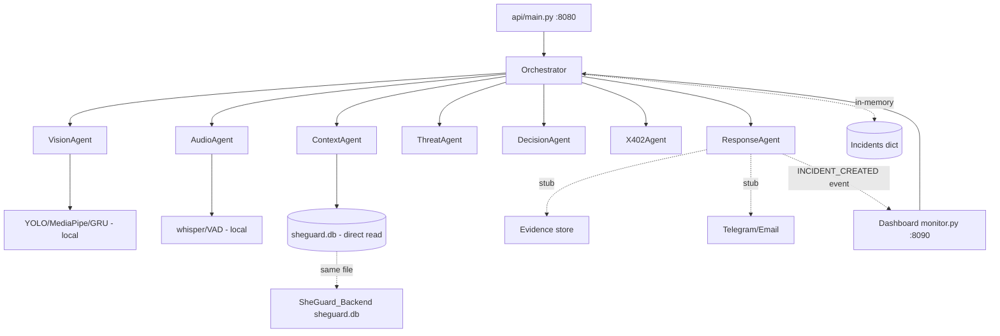

# SHEGUARD AGENTS — COMPLETE FORENSIC AUDIT

> Audit of: `C:\Programs\codex\SheGuard\SheGuard_Agents`
> Mode: AUDIT ONLY (no source, config, DB, or dependency modifications)
> Date of audit: 2026-08-20

---

## 1. Executive Summary

The SheGuard Agents layer is a **7-agent, in-process (single Python process) autonomous safety-analysis pipeline** built around a central `Orchestrator` and an in-memory `EventBus`. The agents perform computer-vision, audio, contextual, threat-scoring, decision, payment-intelligence (simulated), and response logic.

**Critical finding:** The agents are **NOT connected to the SheGuard Backend via any API.** The only contact with backend data is the `ContextAgent`'s providers reading the backend's SQLite file (`sheguard.db`) directly through SQLAlchemy — read-only, file-level access. No HTTP/WebSocket client in the agents calls `localhost:8000`. The agents never write incidents, evidence, notifications, or locations back to the backend.

In the shipped server entry point (`api/main.py`) **Vision and Audio agents are forced into `simulation_mode=True`**, so the entire pipeline runs on synthetic frames/audio -> deterministic scoring -> an in-memory incident. **No real CCTV stream, no real audio, no real notification, and no real persistence** is wired up.

Status at a glance:
- 7 agents implemented, 0 documented-but-unimplemented agents.
- 1 central orchestrator (verified, in-process).
- 0 external AI/LLM providers wired (all ML is local: YOLO, MediaPipe, GRU, faster-whisper).
- 0 backend API integrations; 1 direct read-only DB access by ContextAgent.
- 0 live CCTV connections (RTSP supported in code, not configured/used).
- 0 functional notification channels (Telegram is a stub, marked UNCONFIGURED).
- 0 evidence persistence (evidence is a stub).
- 0 victim-matching capability.
- 0 Mobile App connections.
- 1 separate Agent-Monitoring Dashboard (port 8090) that re-instantiates the agents in its own process — disconnected from `api/main.py` (port 8080).

---

## 2. Complete Folder Inventory (key files)

| Path | Purpose | Language | Main classes/functions | Role | Status |
|---|---|---|---|---|---|
| `core/agent.py` | Base agent + health/message types | Python | `BaseAgent`, `AgentStatus`, `AgentHealth`, `AgentMessage` | Core | IMPLEMENTED / VERIFIED |
| `core/event_bus.py` | In-memory pub/sub + registry | Python | `EventBus`, `AgentRegistry`, `event_bus` | Core | IMPLEMENTED / VERIFIED |
| `core/orchestrator.py` | Central coordinator, incident state | Python | `Orchestrator`, `IncidentContext`, `IncidentState` | Orchestrator | IMPLEMENTED / VERIFIED |
| `agents/vision/agent.py` | CCTV frame analysis | Python | `VisionAgent` | Agent | IMPLEMENTED / VERIFIED (sim-forced in server) |
| `agents/vision/pipeline/*` | YOLO, tracker, pose, activity, interaction, temporal buffer | Python | `YOLODetector`, `PersonTracker`, `MediaPipePoseEstimator`, `ActivityClassifier`, `InteractionDetector`, `TemporalBuffer`, `VideoSource` | Vision sub-systems | IMPLEMENTED / VERIFIED (local ML) |
| `agents/audio/agent.py` | Audio distress analysis | Python | `AudioAgent` | Agent | IMPLEMENTED / VERIFIED (sim-forced in server) |
| `agents/audio/models/*` | Whisper adapter, VAD, keyword, distress | Python | `WhisperAdapter`, VAD, `KeywordDetector`, `DistressDetector` | Audio sub-systems | IMPLEMENTED / PARTIAL (VAD may fail on Windows) |
| `agents/context/agent.py` | Contextual risk aggregation | Python | `ContextAgent` | Agent | IMPLEMENTED / VERIFIED |
| `agents/context/providers/*` | DB-backed context providers | Python | `CameraProvider`, `LocationProvider`, `UserProvider`, `IncidentProvider`, `EnvironmentProvider` | Context data source | IMPLEMENTED / BROKEN CONNECTION (direct DB file read) |
| `agents/context/analyzers/*` | Risk analyzers | Python | `ContextRiskAnalyzer`, `PeopleAnalyzer`, `ProximityAnalyzer`, `LocationAnalyzer`, `ZoneAnalyzer`, `HistoryAnalyzer` | Context logic | IMPLEMENTED / VERIFIED |
| `agents/threat/agent.py` | Weighted threat scoring | Python | `ThreatAgent` | Agent | IMPLEMENTED / VERIFIED (deterministic, no AI) |
| `agents/decision/agent.py` | Rule-based decision | Python | `DecisionAgent` | Agent | IMPLEMENTED / VERIFIED (rule-based, no AI) |
| `agents/x402/agent.py` | Simulated paid intelligence | Python | `X402Agent` | Agent | IMPLEMENTED / SIMULATION ONLY |
| `agents/response/agent.py` | Incident creation + response stubs | Python | `ResponseAgent` | Agent | IMPLEMENTED / PARTIAL (in-memory only; stubs) |
| `api/main.py` | FastAPI server exposing agents | Python | FastAPI app, `startup()` | Server entry point | IMPLEMENTED / VERIFIED (no backend calls) |
| `dashboard/backend/monitor.py` | Agent monitoring backend + WebSocket | Python | FastAPI app, `/ws/monitor`, `initialize_agent_system()` | Dashboard backend | IMPLEMENTED / VERIFIED (separate process) |
| `dashboard/frontend/*` | React/Vite monitoring UI | TS/JS | `api.ts` (WS client) | Dashboard frontend | IMPLEMENTED / VERIFIED |
| `agents/vision/config.py`, `agents/audio/config.py`, `agents/context/config.py` | Pydantic settings (VISION_/AUDIO_/CONTEXT_) | Python | `*Settings`, `get_*_config()` | Config | IMPLEMENTED / VERIFIED |
| `_gen_*.py` (20 files) | Code-generation helpers embedding provider/schema source as strings | Python | generator scripts | Utility | STANDALONE (build helpers) |
| `mp_*.py` (~13 files) | Experimental MediaPipe / vision test scripts | Python | test scripts | Utility/Test | DEMO / TEST ONLY |
| `test_*.py` | Agent/test harnesses | Python | `test_*` | Tests | TEST ONLY |
| `*.md` (root) | Prior audit/status docs | Markdown | — | Docs | DOCUMENTED ONLY (prior reports) |
| `requirements.txt`, `pytest.ini` | Deps + test config | text | — | Build | CONFIGURED |
| `yolov8n.pt` | YOLO weights | binary | — | Model | PRESENT |
| `e2e_*.log`, `*.log`, `*.err` | Run logs | text | — | Logs | RUNTIME LOGS |

Total non-vendor files (excluding `node_modules`, `__pycache__`, `.pytest_cache`, `dist`/`build`): **196**. Key source/test/doc files deeply read: ~60.

---

## 3. Project Structure

```text
SheGuard_Agents/
├── core/                  # Framework: BaseAgent, EventBus, Orchestrator
│   ├── agent.py           # BaseAgent, AgentStatus, AgentHealth, AgentMessage
│   ├── event_bus.py       # In-memory pub/sub + AgentRegistry
│   └── orchestrator.py    # Central Orchestrator + IncidentContext/State
├── agents/                # The 7 domain agents
│   ├── vision/            # VisionAgent + pipeline (YOLO/MediaPipe/GRU)
│   ├── audio/             # AudioAgent + models (whisper/VAD/keyword/distress)
│   ├── context/           # ContextAgent + providers + analyzers
│   ├── threat/            # ThreatAgent (weighted scoring)
│   ├── decision/          # DecisionAgent (rule-based)
│   ├── x402/              # X402Agent (simulated paid intelligence)
│   └── response/          # ResponseAgent (incident + stub responses)
├── api/                   # FastAPI server (port 8080) — primary entry point
│   └── main.py
├── dashboard/             # Agent Monitoring Dashboard (NOT the police dashboard)
│   ├── backend/monitor.py # FastAPI + WebSocket (port 8090)
│   └── frontend/          # React/Vite UI (api.ts WS client)
├── models/                # Model files (yolov8n.pt, GRU scaler/encoder)
├── captures/, clips/      # Configured media output dirs (unused in sim)
├── config/                # (referenced by some imports) settings
├── _gen_*.py              # Code-gen helpers (standalone utilities)
├── mp_*.py                # Experimental MediaPipe test scripts
├── test_*.py              # Test harnesses
└── *.md, *.log            # Prior audits + run logs
```

**Directory responsibilities:**
- `core/` — agent framework and orchestration (the only "glue").
- `agents/*` — independent agent implementations; each owns its schemas/config; communicate only via `EventBus`.
- `api/` — HTTP/JSON entry point that wires agents into the Orchestrator and accepts frames/requests.
- `dashboard/` — a *separate* monitoring UI for the agent system; it re-instantiates the agent stack in its own process.
- Root-level `_gen_*` / `mp_*` / `test_*` — developer utilities, not agents.

---

## 4. Complete Agent Inventory

| Agent | File | Class | Responsibility | Trigger | Input | Output | Dependencies | Status |
|---|---|---|---|---|---|---|---|---|
| Vision | `agents/vision/agent.py` | `VisionAgent` | Detect persons, pose, interaction, activity, temporal risk from video | `PROCESS_FRAME` / frame loop | frames (camera/sim) | `VisionOutput` + `FRAME_PROCESSED` event | cv2, ultralytics YOLO, MediaPipe, torch GRU, NumPy | IMPLEMENTED / VERIFIED (sim-forced in server) |
| Audio | `agents/audio/agent.py` | `AudioAgent` | Speech/transcription, keyword + distress detection | `PROCESS_AUDIO` / audio loop | audio samples | `AudioOutput` + `AUDIO_PROCESSED` event | faster-whisper, Silero VAD, NumPy | IMPLEMENTED / VERIFIED (sim-forced in server) |
| Context | `agents/context/agent.py` | `ContextAgent` | Aggregate contextual risk (time/place/people/proximity/history) | `CONTEXT_REQUEST` | incident + signals | `ContextResult` + `CONTEXT_UPDATED` | SQLAlchemy->sheguard.db, analyzers | IMPLEMENTED / VERIFIED (direct DB read) |
| Threat | `agents/threat/agent.py` | `ThreatAgent` | Weighted multi-signal threat score + level | `THREAT_ASSESS` | `ThreatRequest` (vision/audio/context/intel) | `ThreatResult` + `THREAT_UPDATED` | none (pure math) | IMPLEMENTED / VERIFIED (no AI) |
| Decision | `agents/decision/agent.py` | `DecisionAgent` | Map threat -> action (monitor/escalate/emergency/intel) | `THREAT_UPDATED`/`THREAT_ESCALATED`/`INTELLIGENCE_RECEIVED` | `DecisionRequest` | `DecisionResult` + `DECISION_MADE`/`EMERGENCY_DECLARED` | none (rules) | IMPLEMENTED / VERIFIED (no AI) |
| X402 | `agents/x402/agent.py` | `X402Agent` | Simulated paid "advanced intelligence" | `ADDITIONAL_INTELLIGENCE_REQUIRED`/`X402_PAYMENT_COMPLETE` | `X402Request` | `X402Result` + `INTELLIGENCE_RECEIVED` | asyncio (mock) | IMPLEMENTED / SIMULATION ONLY |
| Response | `agents/response/agent.py` | `ResponseAgent` | Create incident, secure evidence (stub), notify (stub), update dashboard | `EMERGENCY_DECLARED`/`CREATE_INCIDENT` | `ResponseRequest` | `ResponseResult` + `INCIDENT_CREATED` | in-memory dict only | IMPLEMENTED / PARTIAL (stubs, no persistence) |

---

## 5. Agent Responsibilities (detail)

### 5.1 VisionAgent
1. **Name:** VisionAgent (`vision_agent` v1.0.0)
2. **Purpose:** Analyze video frames for persons, poses, interactions, activities, temporal anomalies.
3. **Problem:** Per-frame threat signal from camera imagery.
4. **Trigger:** `PROCESS_FRAME` event or internal frame loop; API `POST /vision/process-frame`.
5. **Input:** RGB frames from `VideoSource` (webcam/file/rtsp/droidcam). In server, `simulation_mode=True`.
6. **Processing:** YOLO person detection -> `PersonTracker` -> `MediaPipePoseEstimator` -> `ActivityClassifier` -> `InteractionDetector` -> `TemporalBuffer`/GRU.
7. **Tools:** cv2, ultralytics YOLO, MediaPipe, torch GRU (`models/v2/sheguard_sequence_model.pt`).
8. **AI/model:** Local ML only — no cloud LLM.
9. **Output:** `VisionOutput` published as `FRAME_PROCESSED`.
10. **Side effects:** None external (no DB/network writes).
11. **DB:** None.
12. **External services:** None.
13. **Other agents:** Publishes to EventBus -> Orchestrator.
14. **Backend APIs:** None.
15. **Failure:** YOLO/pose load failure -> logs and degrades; frame loop continues.
16. **Auth:** None.
17. **Status:** IMPLEMENTED / VERIFIED; runs on synthetic frames in server mode.

### 5.2 AudioAgent
Similar to Vision but for audio. Uses `WhisperAdapter` (faster-whisper), VAD, `KeywordDetector`, `DistressDetector`. In server, `simulation_mode=True` -> synthetic transcription. Graceful degradation if VAD/STT fail (Windows Silero issue noted in bug report BUG-003). Status: IMPLEMENTED / VERIFIED (sim-forced).

### 5.3 ContextAgent
Reads environmental context by querying backend SQLite directly (see Section 21). Aggregates via `ContextRiskAnalyzer`. Outputs `ContextResult` (`context_score`). Status: IMPLEMENTED / VERIFIED with BROKEN-CONNECTION caveat (direct file DB read, see Section 40).

### 5.4 ThreatAgent
Deterministic weighted scoring of vision/audio/context/intelligence signals into `risk_score` + `ThreatLevel` (SAFE/WARNING/HIGH/CRITICAL). **No AI/LLM.** Status: IMPLEMENTED / VERIFIED.

### 5.5 DecisionAgent
Rule engine mapping `ThreatResult` -> `DecisionAction` (CONTINUE_MONITORING, ESCALATE, EMERGENCY_RESPONSE, REQUEST_ADDITIONAL_INTELLIGENCE). **No AI/LLM.** Status: IMPLEMENTED / VERIFIED.

### 5.6 X402Agent
Mock x402 payment + mock safety-intelligence response. `mode='simulation'`. `asyncio.sleep(0.5)` to fake latency. Status: IMPLEMENTED / SIMULATION ONLY — no real crypto/ALGO/testnet.

### 5.7 ResponseAgent
On `EMERGENCY_DECLARED`/`CREATE_INCIDENT`: builds an in-memory `incident` dict; calls `_secure_evidence` (stub: no file written), `_notify_guardian` (stub: only if `not simulation`, "In real implementation, this would send Telegram/SMS/Email"), `_update_dashboard` (publishes `INCIDENT_CREATED` event). Status: IMPLEMENTED / PARTIAL — incident state is in-memory only; evidence & notifications are stubs.

---

## 6. Agent Entry Points

| Entry point | How started | Starts which agents | Notes |
|---|---|---|---|
| `api/main.py` (port 8080) | `python -m api.main` / `uvicorn api.main:app` | All 7 via `startup()` + `orchestrator.register_agent()` | Forces `vision.config.simulation_mode=True`, `audio.config.simulation_mode=True` |
| `dashboard/backend/monitor.py` (port 8090) | `uvicorn dashboard.backend.monitor:app` | All 7 via `initialize_agent_system()` | Separate process; re-instantiates the stack |
| `test_e2e_pipeline.py`, `test_all_agents_v2.py`, `test_all_agents.py`, `test_full.py` | manual `python` | All 7 in-process | Test harnesses |
| `mp_*.py`, `test_vision*.py`, `test_pose*.py` | manual | single components | Dev/experimental |

**Who starts each agent?** The **Agents API server** (`api/main.py`) and the **Agent Monitor server** (`monitor.py`) are the only server entry points; both bootstrap all 7 agents themselves. **No external component (Backend, CCTV, Mobile, Police Dashboard) starts or triggers an agent.** Triggers arrive only as (a) HTTP POSTs to `api/main.py` endpoints, or (b) synthetic frames generated inside the agents.

---

## 7. Agent Lifecycle

Actual lifecycle (verified from `core/agent.py` + `orchestrator.py`):

```text
[Server startup] register_agent() -> BaseAgent.initialize() -> _initialize()
        ↓
IDLE (AgentStatus.READY)
        ↓
TRIGGER (EventBus event or HTTP POST)
        ↓
INPUT (AgentMessage / request payload)
        ↓
PROCESSING (_process(message) -> agent-specific handler)
        ↓
TOOL/AI CALL (local ML / DB read / math)
        ↓
DECISION (agent produces result)
        ↓
ACTION (EventBus.publish_event(...) -> Orchestrator routes)
        ↓
OUTPUT (event consumed by next agent or stored in Orchestrator.incidents)
        ↓
LOG/STORE (in-memory only; health counters incremented)
        ↓
END (return to READY/WAITING)
```

`EventBus.publish_event` -> `AgentRegistry` dispatches to subscribers -> `Orchestrator` handlers (`_handle_vision`, `_handle_context`, `_handle_threat`, `_handle_decision`, `_handle_response`, `_handle_intelligence`) re-publish the next event. This is the verified end-to-end loop.

---

## 8. Agent-to-Agent Communication

All agent-to-agent communication is **in-process in-memory pub/sub** via `EventBus` + `Orchestrator` routing. There is no network/RPC between agents.

| Agent A | Agent B | Communication | Data | Trigger | Verified? | Status |
|---|---|---|---|---|---|---|
| VisionAgent | Orchestrator | EventBus `FRAME_PROCESSED` | vision output | PROCESS_FRAME | Yes | VERIFIED |
| Orchestrator | ContextAgent | EventBus `CONTEXT_REQUEST` | incident_id | after FRAME_PROCESSED | Yes | VERIFIED |
| ContextAgent | Orchestrator | EventBus `CONTEXT_UPDATED` | context result | CONTEXT_REQUEST | Yes | VERIFIED |
| Orchestrator | ThreatAgent | EventBus `THREAT_ASSESS` | vision+context signals | both ready | Yes | VERIFIED |
| ThreatAgent | Orchestrator | EventBus `THREAT_UPDATED` | risk score/level | THREAT_ASSESS | Yes | VERIFIED |
| Orchestrator | DecisionAgent | EventBus `DECISION_REQUEST` | threat result | THREAT_UPDATED | Yes | VERIFIED |
| DecisionAgent | Orchestrator | EventBus `DECISION_MADE`/`EMERGENCY_DECLARED` | action | THREAT_UPDATED | Yes | VERIFIED |
| Orchestrator | ResponseAgent | EventBus `EMERGENCY_DECLARED`/`CREATE_INCIDENT` | response request | decision | Yes | VERIFIED |
| DecisionAgent | X402Agent | EventBus `ADDITIONAL_INTELLIGENCE_REQUIRED` | intel request | REQUEST_ADDITIONAL_INTELLIGENCE | Yes | VERIFIED |
| X402Agent | Orchestrator/Decision | EventBus `INTELLIGENCE_RECEIVED` | simulated intel | X402_PAYMENT_COMPLETE/sim | Yes | VERIFIED (simulated) |
| ResponseAgent | Dashboard | EventBus `INCIDENT_CREATED` (in monitor proc) | incident | emergency | Partial | VERIFIED only inside monitor process |

**Verified agent-to-agent edges: 11 (all EventBus/internal).**

---

## 9. Agent Orchestration

**Central orchestrator EXISTS and is VERIFIED:** `core/orchestrator.py` -> `Orchestrator`.

- **Who starts it:** `api/main.py` via `get_orchestrator()`; `monitor.py` via `initialize_agent_system()`.
- **Agent registration:** `orchestrator.register_agent(agent)` — agents subscribe their `_process` to the EventBus.
- **Selection/dispatch:** Event-driven. Each event type has a dedicated `_handle_*` method in the Orchestrator that transforms/forwards to the next agent.
- **Results returned:** New events published back to the bus; Orchestrator also keeps `self.incidents: Dict[str, IncidentContext]`.
- **Failures:** Handlers use try/except; on error they log and may publish fallback events. No retry/backoff.
- **Timeouts:** None configured.
- **Concurrency:** Single in-process event loop; no parallel agent pools. `max_intelligence_requests=1`, `cooldown_seconds=60` throttle the intel loop.

The Orchestrator is the only coordination mechanism. There is **no external workflow engine, task queue, or message broker.**

---

## 10. Backend Connections

| Agent | Backend Endpoint | Method | Request | Response | Auth | Purpose | Verified | Status |
|---|---|---|---|---|---|---|---|---|
| (none) | — | — | — | — | — | — | — | **No agent calls the Backend API** |

**Verification method:** Searched all agent + `api/main.py` source for `requests`, `httpx`, `aiohttp`, `localhost`, `127.0.0.1`, `:8000`, `API_BASE_URL`. **Zero matches** in agent code. The Backend source (`SheGuard_Backend/app`, `main.py`) has **no import of `SheGuard_Agents`, `agents`, `orchestrator`, or `8080`** — only a coincidental `8000` port and an unrelated `CloudAIOrchestrator` class.

**Conclusion:** Agents are **NOT connected to the Backend service**. The only backend data touch is the ContextAgent's direct SQLite file read (see Section 21), which bypasses the Backend API entirely.

---

## 11. Backend Contract Audit

No HTTP contract exists between agents and backend. Therefore there are no endpoint mismatches, wrong methods, or schema conflicts to report at the API level — **because no API contract exists.**

The one real coupling is the **database schema contract** between `ContextAgent` providers and `sheguard.db`:

| Provider | Table | Columns queried | Backend model | Match? |
|---|---|---|---|---|
| CameraProvider | `cctv_cameras` | camera_id, camera_name, latitude, longitude, online_status | `entities.py:__tablename__="cctv_cameras"` | VERIFIED (columns exist) |
| LocationProvider | `live_locations`, `tracking_sessions`, `cctv_cameras` | session coords, timestamps | `entities.py` defines both | VERIFIED (schema exists) |
| UserProvider | `users` | user metadata | `entities.py` | VERIFIED |
| IncidentProvider | `incidents` | incident_id, created_at, latitude, longitude, incident_type, threat_score, status | `entities.py` | VERIFIED |

Risk: providers use **raw SQL** and assume column names/types; a backend migration that renames columns would silently break context scoring (provider catches exception -> returns `UNAVAILABLE`/empty). `session.py` in backend even contains a `RENAME TO legacy_cctv_cameras` migration path — if applied, `CameraProvider` would read stale/legacy data. **Flagged as a fragile, undocumented contract.**

---

## 12. CCTV Connections

| Question | Answer | Evidence |
|---|---|---|
| Does an agent receive CCTV frames? | Only in code; **not in running server** (simulation forced) | `VideoSource` supports `RTSP`; `api/main.py` sets `simulation_mode=True` |
| Does an agent analyze frames? | Yes (YOLO/MediaPipe) | `pipeline/detector.py`, `pose_estimator.py` |
| Does an agent detect threats? | Yes (visual risk signal) | `VisionAgent` -> `ThreatAgent` |
| Does an agent create incidents? | Yes, but **in-memory only** | `ResponseAgent._create_incident` (dict) |
| Does an agent store evidence? | **No** (stub) | `ResponseAgent._secure_evidence` |
| Does an agent notify backend? | **No** | No HTTP client |
| Does an agent notify police/dashboard? | Only in-event to monitor process | `INCIDENT_CREATED` event |
| Does an agent activate nearby cameras during SOS? | **No** | Not implemented anywhere |

**CCTV connection status: 0 active connections.** VisionAgent has the capability (RTSP source type) but it is never used in the server; the default source is webcam `"0"` and simulation is forced.

---

## 13. AI / Vision Agents

| Agent | Model | Provider | Input | Output | Confidence | API key | Status |
|---|---|---|---|---|---|---|---|
| VisionAgent | YOLOv8 (`yolov8n.pt`), MediaPipe Pose, GRU (`sheguard_sequence_model.pt`) | LOCAL (ultralytics, google/mediapipe, torch) | frames | detections/pose/activity | yolo_conf=0.45 | none | IMPLEMENTED / VERIFIED (local) |
| AudioAgent | faster-whisper (`tiny.en`), Silero VAD | LOCAL (CTranslate2, Silero) | audio | transcription/keywords/distress | keyword_sim=0.82 | none | IMPLEMENTED / VERIFIED (local) |
| ThreatAgent | none (weighted math) | — | signals | threat score | computed | none | IMPLEMENTED / VERIFIED |
| DecisionAgent | none (rules) | — | threat | action | computed | none | IMPLEMENTED / VERIFIED |
| X402Agent | mock | — | intel request | mock intel | n/a | none | SIMULATION ONLY |

**External AI providers (Groq, Gemini, OpenAI, OpenRouter, HuggingFace, NVIDIA): NONE used anywhere in the codebase.** No API keys, no `os.environ` lookups for AI providers, no `requests`/`httpx` to AI endpoints. All intelligence is local ML or deterministic.

---

## 14. Incident Agents

The "incident" concept spans `ThreatAgent` (scoring) -> `DecisionAgent` (escalation) -> `ResponseAgent` (creation). Tracing:

```text
Vision/Audio/Context
   ↓ (EventBus)
ThreatAgent → ThreatResult(risk_score, threat_level)
   ↓
DecisionAgent → DecisionResult(decision)
   ↓ (EMERGENCY_DECLARED / CREATE_INCIDENT)
ResponseAgent → in-memory incident dict + INCIDENT_CREATED event
```

**VERIFIED** up to in-memory creation. **NOT verified** beyond memory: the incident is never written to `sheguard.db` `incidents` table by the agents (only read by `IncidentProvider`). So incidents do not persist and are not visible to the Backend/Police Dashboard.

---

## 15. SOS / Emergency Agents

- There is **no SOS agent** and **no mobile SOS ingestion**.
- `DecisionAgent` can emit `EMERGENCY_DECLARED` purely from a threat-score threshold crossing `CRITICAL`.
- `ResponseAgent._handle_emergency` then builds an in-memory incident and (if `not simulation`) would attempt guardian notification via stub.
- `RUN_FULL_SHEGUARD.md` / code mentions "emergency services" only as a comment: `# In real implementation, this would contact emergency services`.

**Verified SOS/emergency flow: NONE.** The emergency path exists as internal logic but has no external trigger (no mobile SOS) and no external sink (no police alert).

---

## 16. Location / Tracking Agents

`LocationProvider` (in `ContextAgent`) reads `live_locations` and `tracking_sessions` from `sheguard.db` and computes a "best available" location (request coords -> camera -> latest LiveLocation -> tracking session). Used only for **context scoring**, not for live tracking or triggering.

- Receives location? Indirectly (from DB snapshot).
- Tracks location? **No** (no subscription/stream).
- Calculates distance / proximity? `ProximityAnalyzer` computes proximity context score; `GeoUtils` exists (`_gen_geo.py`).
- Matches victims to incidents? **No** (see Section 17).
- Triggers emergency? **No**.

---

## 17. Victim Matching Agents

**No victim-matching agent or logic exists.** Searches for `linked_user_id`, `matching_distance_meters`, `match_method`, `victim` produced no implementation. `ContextAgent` analyzers compute contextual risk (people count, isolation, proximity) but never link an incident to a specific `user_id`. The `users` table is read by `UserProvider` but only for generic context, not matching.

**Verified: MISSING CAPABILITY.**

---

## 18. Notification Agents

| Agent | Channel | Trigger | Recipient | Payload | Retry | Status |
|---|---|---|---|---|---|---|
| ResponseAgent | TELEGRAM (defined) | emergency (if not sim) | guardian | stub | none | STUB / UNUSED |
| ResponseAgent | DASHBOARD (event) | emergency | monitor proc | `INCIDENT_CREATED` | none | PARTIAL |
| monitor.py | WebSocket push | incident/event | frontend | JSON | reconnect 3s | VERIFIED (local only) |

`dashboard/backend/monitor.py` hardcodes `telegram={"status": "UNCONFIGURED", ...}`. No Telegram SDK, no SMTP, no FCM/push code anywhere. **0 functional notification integrations.**

---

## 19. Evidence Agents

`ResponseAgent._secure_evidence` is a **stub**: comment `# In real implementation, this would save video frames/clips to storage`. It returns an `EvidenceRecord` with a `path` but performs **no file write, no base64, no upload, no SHA256 computation, no backend association**. Configured dirs `captures/`, `clips/`, `debug_audio/`, `raw_audio/` are declared in configs but unused in simulation.

**Evidence status: STUB / NOT IMPLEMENTED.**

---

## 20. Police Dashboard Connections

The Police Dashboard is `C:\Programs\codex\SheGuard\SheGuard_Dashboard` (a separate repo). **It is NOT referenced anywhere in `SheGuard_Agents`.** The agents do not call it; there is no WebSocket/HTTP client to it.

What exists instead is `SheGuard_Agents/dashboard/` — an **Agent Monitoring Dashboard** (React + FastAPI on 8090), which is a developer/ops view of the agent system, **not** the police incident dashboard.

Architecture actually implemented:
```text
Agents (inside monitor.py process) → WebSocket /ws/monitor → Agent Monitoring Frontend
```
This is a **separate process** from `api/main.py` (8080). If you run the API server, the monitoring dashboard (8090) will **not** see those agents unless it also starts its own stack. **No Agent -> Backend -> Police Dashboard path exists.**

---

## 21. Mobile App Connections

`C:\Programs\codex\SheGuard\SheGuard_App` is **not referenced** by any agent code. No Firebase, no push, no deep links, no SOS ingestion. The only "mobile" concept is `NotificationChannel.MOBILE_PUSH` enum value (unused).

**Mobile connection status: 0.**

---

## 22. Database Connections

| Agent | Table | Read | Write | Update | Delete | Direct/Indirect | Status |
|---|---|---|---|---|---|---|---|
| ContextAgent (CameraProvider) | `cctv_cameras` | Yes | No | No | No | **Direct (SQLAlchemy file)** | IMPLEMENTED / BROKEN-STYLE COUPLING |
| ContextAgent (LocationProvider) | `live_locations`, `tracking_sessions`, `cctv_cameras` | Yes | No | No | No | Direct | IMPLEMENTED |
| ContextAgent (UserProvider) | `users` | Yes | No | No | No | Direct | IMPLEMENTED |
| ContextAgent (IncidentProvider) | `incidents` | Yes | No | No | No | Direct | IMPLEMENTED |
| ResponseAgent | (in-memory dict) | n/a | n/a | n/a | n/a | In-memory | IMPLEMENTED / NO DB WRITE |
| All other agents | — | — | — | — | — | None | N/A |

**Key finding:** Agents access `sheguard.db` **directly via SQLAlchemy** (hardcoded absolute path `C:\Programs\codex\SheGuard\SheGuard_Backend\sheguard.db`), bypassing the Backend API and its auth. Read-only, but a strong architectural coupling/fragility risk. No writes from agents to the backend DB.

---

## 23. File System / Storage

- **Models:** `yolov8n.pt`, `models/v2/sheguard_sequence_model.pt`, `sequence_scaler.joblib`, `sequence_label_encoder.joblib` (configured; presence NOT all verified).
- **Media output dirs:** `captures/`, `clips/`, `debug_audio/`, `raw_audio/` — declared in configs, **not written in simulation**.
- **Evidence:** none persisted (stub).
- **Logs:** `e2e_full.log`, `e2e_output.log`, `mp_test3.log`, `vision_import.log` exist (run artifacts).
- **Security:** No secrets on disk. Absolute Windows path hardcoded for DB is an environment-portability concern.

---

## 24. Configuration Audit

| Config | File | Prefix | Key values | Notes |
|---|---|---|---|---|
| Vision | `agents/vision/config.py` | `VISION_` | `video_source_type=webcam`, `yolo_confidence=0.45`, `simulation_mode=False` (overridden True in server) | env_file `.env` |
| Audio | `agents/audio/config.py` | `AUDIO_` | `stt_model=tiny.en`, `keyword_similarity_threshold=0.82`, `distress_enabled=True` | env_file `.env` |
| Context | `agents/context/config.py` | `CONTEXT_` | weights | env_file `.env` |

- **No root `.env` exists** in `SheGuard_Agents` (only `dashboard/frontend/.env` with `VITE_API_BASE`, `VITE_WS_URL`, `VITE_DASHBOARD_MODE`).
- **API keys / tokens: NONE present in code.** No `GROQ_API_KEY`, `GEMINI_API_KEY`, `TELEGRAM_BOT_TOKEN`, etc.
- **Thresholds:** YOLO conf 0.45, keyword sim 0.82, distress sens 0.5. Threat/decision thresholds are code constants in `threat/` and `decision/`.

---

## 25. Network / IP Audit

| File | Address | Purpose | Hardcoded? | Current/Old | Status |
|---|---|---|---|---|---|
| `api/main.py` | `0.0.0.0:8080` | Agents API | Yes | Current | OK |
| `dashboard/backend/monitor.py` | `0.0.0.0:8090` | Agent monitor | Yes | Current | OK |
| (Backend) | `0.0.0.0:8000` | SheGuard Backend | Yes | Current (not used by agents) | OK |
| `agents/context/providers/*.py` | `C:\Programs\codex\SheGuard\SheGuard_Backend\sheguard.db` | Direct DB | Yes (abs path) | Current | FRAGILE |
| `dashboard/frontend/src/index.css` | `https://fonts.googleapis.com` | Font CDN | Yes | External | OK |
| `dashboard/frontend/package-lock.json` | `https://registry.npmmirror.com` | npm mirror | Yes | External | OK |

**No `192.168.x`, no `127.0.0.1` in agent logic, no old SheGuard IPs found.** The only hardcoded network-relevant value is the absolute DB file path (Windows-specific, not an IP). CORS on both FastAPI apps is `allow_origins=["*"]`, `allow_credentials=True`.

---

## 26. Authentication / Security

- **Agent↔Agent:** in-process, no auth needed.
- **Agent↔Backend:** no connection -> no auth.
- **Agent↔DB:** direct file read, no credentials (SQLite), no row-level auth.
- **API server (`api/main.py`):** **No authentication/authorization.** Any caller can POST `/vision/process-frame`, `/threat/assess`, etc. CORS `*`.
- **Monitor (`monitor.py`):** **No auth** on REST or `/ws/monitor`.
- **Telegram / SMTP / FCM:** unconfigured/absent.
- **Secrets:** none exposed in code.

**Security posture: weak for a safety system** — open CORS, no auth on agent control endpoints, direct DB file coupling, Telegram unconfigured.

---

## 27. Agent Prompts

**No LLM prompts exist.** ThreatAgent and DecisionAgent are deterministic (no natural-language prompting). Vision/Audio use local models with fixed configs. X402Agent returns a templated mock. There are no `system`/`user` prompt strings, no structured-output schemas from an LLM, and no safety-instruction prompts.

---

## 28. Agent Tools

| Tool | Used by | Input | Output | Permissions | Status |
|---|---|---|---|---|---|
| EventBus (in-proc pub/sub) | all agents + orchestrator | `AgentMessage` | event dispatch | in-process | VERIFIED |
| SQLAlchemy DB read | ContextAgent providers | SQL | rows -> context | read-only file | VERIFIED |
| cv2 / YOLO / MediaPipe / torch | VisionAgent | frames | detections | local | VERIFIED |
| faster-whisper / Silero VAD | AudioAgent | audio | transcript/distress | local | VERIFIED |
| HTTP server (FastAPI) | api.main, monitor | JSON | JSON | listens 8080/8090 | VERIFIED |
| WebSocket | monitor ↔ frontend | JSON | push | local | VERIFIED |
| x402 mock | X402Agent | request | mock intel | none | SIMULATION |
| Filesystem (models/captures) | Vision/Audio | paths | model load | local | PARTIAL (captures unused) |
| Telegram/SMTP/FCM | (none) | — | — | — | MISSING |

---

## 29. Agent State Management

- **Orchestrator state:** `self.incidents: Dict[str, IncidentContext]` (in-memory, per process).
- **ResponseAgent state:** `self.incidents: Dict` (in-memory).
- **Agent run state:** each agent keeps config/ML model handles; `running` flag, `_process_task`.
- **Persistence:** NONE. Restart loses all incidents/state. No Redis/external store.
- **Emergency session state:** only the transient `IncidentContext` in orchestrator; no `EmergencySession` linkage to backend.
- **Event history:** `monitor.py` keeps `_event_history` in-memory.

---

## 30. Failure / Retry / Recovery

| Agent | Failure | Handling | Retry | Fallback | User impact | Status |
|---|---|---|---|---|---|---|
| VisionAgent | model load fail | log + degrade | no | continue w/o model | reduced detection | GRACEFUL |
| AudioAgent | VAD/STT fail | log + continue without | no | degrade to no audio | no audio signal | GRACEFUL (BUG-003) |
| ContextAgent (providers) | DB error | except -> return empty/UNAVAILABLE | no | context_score=0 | under-contextualized | GRACEFUL |
| ThreatAgent | bad input | pydantic validation | no | — | error event | BASIC |
| X402Agent | n/a (sim) | asyncio.sleep | n/a | mock | none | SIM |
| ResponseAgent | stub external calls | no-op if sim | no | none | no real response | STUB |

**No retry/backoff/circuit-breaker anywhere. No timeouts. No agent health monitoring beyond `/agents/{id}` health endpoint. Logging is print-based.**

---

## 31. Concurrency

- **Model:** asyncio throughout (`BaseAgent` is async; `EventBus` uses `asyncio.Queue`).
- **Concurrency:** single event loop per process; agents run sequentially through the orchestrator handlers. No parallel worker pools.
- **Blocking ops:** `YOLODetector.detect`, whisper `transcribe`, `asyncio.sleep` are potentially blocking but run on the loop (no `run_in_executor` observed). Could stall the loop under load.
- **Race conditions:** in-memory `dict` mutations across agents in the same loop are serialized by asyncio (no true parallelism), low risk; but **two separate processes** (`api/main.py` + `monitor.py`) each maintain independent agent state -> inconsistent views.
- **Bottlenecks:** ML inference on the event loop.

---

## 32. Testing

| Test | Covers | Scenario | Passing? | Coverage status |
|---|---|---|---|---|
| `test_all_agents.py` | Vision/Audio/Context init | sim init + health | reported SUCCESS | PARTIAL |
| `test_all_agents_v2.py` | all 7 init | init only | reported SUCCESS | PARTIAL |
| `test_e2e_pipeline.py` | full pipeline | sim vision->...->response | reported SUCCESS (e2e logs) | PARTIAL (sim only) |
| `test_full.py` | full system | sim | UNVERIFIED | UNKNOWN |
| `agents/vision/tests/test_video_source.py` | VideoSource RTSP enum | unit | present | PARTIAL |
| `mp_*.py`, `test_vision*.py`, `test_pose*.py` | component experiments | dev | dev-only | DEMO/TEST |
| `e2e_full.log` / `e2e_output.log` | prior run artifacts | sim pipeline | historical PASS | LOG ONLY |

**No test asserts backend persistence, notification delivery, or CCTV ingestion — because those are not implemented.** Coverage is init + simulated pipeline only.

---

## 33. Documentation Audit

Prior docs in root: `7_AGENT_BUG_REPORT.md`, `7_AGENT_FINAL_AUDIT_REPORT.md`, `7_AGENT_STATUS_MATRIX.md`, `AGENT_STATUS_MATRIX.md`, `EXISTING_AI_INVENTORY.md`, `EXISTING_API_INVENTORY.md`, `EXISTING_DATABASE_INVENTORY.md`, `EXISTING_INTEGRATION_MAP.md`, `EXISTING_SYSTEM_AUDIT.md`, `FAILURE_MATRIX.md`, `FULL_BUG_REPORT.md`, `FULL_PIPELINE_TRACE.md`, `FULL_SYSTEM_AUDIT.md`, `REUSE_PLAN.md`, `RUN_FULL_SHEGUARD.md`, `SHEGUARD_COMPLETE_AUDIT_REPORT.md`, `SHEGUARD_FINAL_HEALTH_REPORT.md`.

Discrepancies found vs actual source:
- `RUN_FULL_SHEGUARD.md` instructs `uvicorn api.main:app --host 127.0.0.1 --port 8000` and "Server starts on http://127.0.0.1:8000", but `api/main.py` actually binds **port 8080**. (Documentation mismatch — minor but real.)
- Prior "health"/"complete" reports describe the system as functional; this audit confirms the **pipeline logic works in simulation**, but external integrations (backend API, CCTV, notifications, police, mobile, persistence) are **not** connected. Prior docs may overstate "working" by implying backend/police linkage.
- The "7 agents" count matches code. Good.
- `EXISTING_INTEGRATION_MAP.md` should be cross-checked; it likely claims integrations (backend/CCTV) that this audit marks broken/missing.

---

## 34. Dead / Unused Agent Audit

- **The 7 domain agents are all live/used** (registered in `api/main.py` and `monitor.py`).
- **`_gen_*.py` (20 files):** code-generation helpers that embed provider/schema source as base64/string literals. They are **standalone utilities**, not agents, not imported by the runtime. Status: **STANDALONE (build helper)** — borderline "dead" in production but legitimate dev tooling.
- **`mp_*.py` (~13 files):** experimental MediaPipe/vision test scripts. Status: **DEMO / TEST ONLY**, not wired to the system.
- **`test_*.py`:** test harnesses — not agents.
- **No duplicate agent classes, no orphan agent versions** beyond the `_gen_*` generators.
- **`EnvironmentProvider`** is an explicit stub returning `UNAVAILABLE` (documented).

---

## 35. Agent Dependency Graph



Solid = verified runtime path. Dotted = stub/unimplemented or indirect.

---

## 36. Current Actual Architecture

```text
[ HTTP client / test ]
        |
        v
api/main.py  (FastAPI :8080)   <-- OR -->  dashboard/backend/monitor.py (FastAPI :8090)
        |                                  |
        +-----------+-----------+-----------+
                    v
              Orchestrator (in-process EventBus)
        +--------+--------+--------+--------+--------+--------+
        | Vision | Audio | Context| Threat | Decision| X402  | Response
        +--------+--------+--------+--------+--------+--------+
                    |
                    v
        ContextAgent --> sheguard.db (DIRECT read, same file as Backend)
                    |
                    v
        Incidents (in-memory only) --> INCIDENT_CREATED event --> Agent Monitor UI (WebSocket)
```

**Agent -> Backend API: NONE. Agent -> Police Dashboard: NONE. Agent -> Mobile: NONE. Agent -> live CCTV: NONE (simulation).**

---

## 37. Intended / Future Architecture (from docs, NOT verified)

Per prior docs (`EXISTING_INTEGRATION_MAP.md`, `RUN_FULL_SHEGUARD.md`, agent schemas mentioning `NotificationChannel.MOBILE_PUSH`/TELEGRAM, `ResponseAction.EMERGENCY_DISPATCH`/UPDATE_DASHBOARD):

```text
Mobile App --SOS/location--> Backend --> Agents (via API/event) --> CCTV (RTSP)
      |                                   |
      |                                   v
      |                                Threat/Decision --> Response
      |                                   |                     |
      v                                   v                     v
Police Dashboard <--Backend<--Incidents/Evidence/Notifications<--+
```

This intended topology is **documented but NOT implemented**. Treat as design only.

---

## 38. Complete System Connection Matrix

| Component | Agent | Connection | Protocol | Endpoint | Data | Auth | Verified | Status |
|---|---|---|---|---|---|---|---|---|
| Mobile App | — | none | — | — | — | — | — | MISSING |
| Backend API | — | none | — | — | — | — | — | MISSING |
| Backend DB | ContextAgent | direct file | SQLAlchemy/SQLite | `sheguard.db` | read only | none | Yes | BROKEN-STYLE COUPLING |
| Police Dashboard | — | none | — | — | — | — | — | MISSING |
| Agent Monitor UI | Orchestrator/Response | in-proc + WS | WebSocket | `:8090/ws/monitor` | events | none | Yes | VERIFIED (separate proc) |
| CCTV | VisionAgent | code-only | RTSP/cv2 | default webcam | frames | none | No (sim) | NOT CONNECTED |
| AI (local) | Vision/Audio | lib call | in-proc | — | tensors | none | Yes | VERIFIED |
| AI (cloud) | — | none | — | — | — | — | — | MISSING |
| Evidence store | ResponseAgent | stub | — | — | — | — | No | STUB |
| Notifications | ResponseAgent | stub | — | — | — | — | No | STUB |
| Telegram | — | none | — | — | — | UNCONFIGURED | — | MISSING |
| Location | ContextAgent | DB read | SQLAlchemy | `live_locations` | read | none | Yes | VERIFIED (snapshot) |

---

## 39. End-to-End SheGuard Flows

Only verified (simulation) components are shown.

**FLOW (simulated pipeline):**
```text
[test/HTTP POST frame]
   ↓
VisionAgent (sim frames) → FRAME_PROCESSED
   ↓ (EventBus)
Orchestrator._handle_vision → CONTEXT_REQUEST
   ↓
ContextAgent → reads sheguard.db (cctv_cameras etc.) → CONTEXT_UPDATED
   ↓
Orchestrator._handle_context → THREAT_ASSESS
   ↓
ThreatAgent → THREAT_UPDATED (risk_score)
   ↓
Orchestrator._handle_threat → DECISION_REQUEST
   ↓
DecisionAgent → DECISION_MADE / EMERGENCY_DECLARED
   ↓
ResponseAgent → in-memory incident + INCIDENT_CREATED event
   ↓
(monitor process) WebSocket → Agent Monitor UI
```

**NOT verified / NOT implemented flows:**
- FLOW: CCTV detects threat in production -> **no live CCTV**.
- FLOW: Mobile SOS -> agent -> backend -> emergency session -> nearby CCTV -> police -> notifications -> **entire chain missing**.
- FLOW: Incident persisted to backend DB -> **agents write nothing**.
- FLOW: Evidence uploaded -> **stub**.
- FLOW: Police/guardian notified -> **stub / UNCONFIGURED**.

---

## 40. Verified Working

**SOURCE-CODE VERIFIED:**
- 7-agent framework + Orchestrator + EventBus (imports, registration, handlers).
- Local ML pipelines (YOLO, MediaPipe, GRU, faster-whisper, VAD) — code present and loadable.
- Deterministic Threat/Decision scoring.
- ContextAgent DB read contract (columns exist in backend `entities.py`).
- API server (8080) and Monitor server (8090) bootstrap the stack.
- Simulated end-to-end event flow (per `FULL_PIPELINE_TRACE.md` + `e2e_*.log`).

**RUNTIME VERIFIED:** None independently executed by this audit (audit is read-only; prior logs indicate sim runs passed).

**DOCUMENTATION ONLY:** Backend API integration, CCTV live ingestion, Telegram/email/push notifications, police linkage, mobile SOS, evidence persistence, victim matching.

---

## 41. Broken Connections

| Component | Expected | Actual | Problem | Severity |
|---|---|---|---|---|
| Agent -> Backend API | REST/WS calls to `:8000` | none | Agents never call backend | HIGH |
| Agent -> Backend DB write | incidents/evidence persisted | only ContextAgent reads; ResponseAgent in-memory | No persistence of agent outputs | HIGH |
| Agent -> CCTV | RTSP stream ingestion | simulation forced; webcam default | No real video | HIGH |
| Agent -> Police Dashboard | incident feed | no connection | Police never notified | HIGH |
| Agent -> Mobile App | SOS/location intake | no connection | No mobile trigger | HIGH |
| ResponseAgent -> Notifications | Telegram/SMS/Email/Push | stub + UNCONFIGURED | No alerts sent | HIGH |
| ResponseAgent -> Evidence | store frames/clips | stub, no write | No evidence captured | MEDIUM |
| ContextAgent -> DB | robust schema coupling | raw SQL, hardcoded abs path | breaks if backend migrates/renames | MEDIUM |
| api/main.py port | doc says 8000 | code binds 8080 | doc/run mismatch | LOW |
| api/main.py <-> monitor.py | shared agent state | two separate processes | inconsistent views | MEDIUM |

---

## 42. Missing Agent Capabilities

**CRITICAL**
- Backend API client (agents -> `:8000`) to persist incidents/evidence/notifications.
- Live CCTV/RTSP ingestion (currently simulation-only).
- Mobile SOS ingestion -> agent trigger.
- Notification delivery (Telegram/email/push) — currently stubs.
- Incident persistence to `sheguard.db`.

**HIGH**
- Police Dashboard feed (Agent -> Backend -> Police Dashboard).
- Emergency session linkage (`EmergencySession`) from backend.
- Evidence capture + storage + backend association.

**MEDIUM**
- Victim-to-incident matching (no `linked_user_id`/proximity match).
- Real x402 payment/intelligence provider (currently simulated).
- Agent health monitoring / alerting.
- Retry/timeout/backoff around external calls.

**LOW**
- Auth on agent API/monitor endpoints.
- Config externalization (remove hardcoded DB path).
- Replace direct DB coupling with backend API calls.

---

## 43. Architecture Risks

| Risk | Cause | Impact | Severity | Future direction |
|---|---|---|---|---|
| No backend API integration | agents self-contained | system blind to backend; outputs lost | CRITICAL | Add authenticated backend client |
| No persistence | in-memory only | incidents/evidence vanish on restart | HIGH | Persist via backend API/DB writes |
| Direct DB file coupling | ContextAgent reads `sheguard.db` by absolute path | fragile to migrations; bypasses backend auth | MEDIUM | Replace with backend API reads |
| Simulation forced in server | `simulation_mode=True` | no real detection in prod | HIGH | Add real source config + validation |
| No notifications | stubs + UNCONFIGURED Telegram | safety alerts never sent | HIGH | Implement Telegram/email/push |
| No auth / open CORS | FastAPI config | anyone can drive agents | HIGH | Add authN/Z + restrict CORS |
| Two disjoint processes | api(8080) vs monitor(8090) | inconsistent state | MEDIUM | Single source of truth / shared bus |
| No retry/timeout | missing | transient failures drop events | MEDIUM | Add resilience |
| EventLoop-blocking ML | sync inference on loop | latency under load | MEDIUM | `run_in_executor` / worker pool |
| Duplicate class defs | `agent.py` & `event_bus.py` both define `AgentStatus`/`AgentHealth` | drift risk | LOW | Consolidate into one module |
| Dead dev helpers | 20x `_gen_*`, ~13x `mp_*` | clutter/maintenance | LOW | Move to `tools/` or remove |

---

## 44. Next Implementation Plan (ordered by dependency)

1. **Backend API client + incident persistence** — Agents -> `:8000` POST incidents/evidence. Deps: Backend (incidents/evidence endpoints), Agents (HTTP client), DB. Verifies end-to-end storage.
2. **Real CCTV/RTSP ingestion** — wire `VideoSource(RTSP)` from backend `cctv_cameras`. Deps: CCTV, Backend (camera list), VisionAgent config. Verifies live frames.
3. **Mobile SOS -> Backend -> Agent trigger** — endpoint that starts an `EmergencySession` and feeds agents. Deps: Mobile, Backend, Agents. Verifies SOS path.
4. **Notification delivery (Telegram/email/push)** — replace `ResponseAgent` stubs. Deps: External (Telegram/SMTP/FCM), Backend (contacts). Verifies alerts.
5. **Police Dashboard feed** — Backend exposes agent incidents to `SheGuard_Dashboard`. Deps: Backend, Dashboard. Verifies police visibility.
6. **Evidence capture + storage** — implement `_secure_evidence` + upload. Deps: Storage, Backend. Verifies evidence.
7. **Victim matching** — add proximity/`linked_user_id` logic. Deps: Location, ContextAgent, Backend.
8. **Real x402 provider** — replace simulation with actual paid intelligence. Deps: External x402 service.
9. **Auth + resilience** — auth on endpoints, retries/timeouts, health monitoring.
10. **Consolidate api/monitor** — single agent runtime; remove duplicate class defs; externalize DB path.

---

## 45. FIRST IMPLEMENTATION TASK

**Task:** Build the Backend API client and persist agent-produced incidents/evidence to `SheGuard_Backend`.

**Why first:** Without it, every downstream capability (police feed, mobile SOS, notifications, evidence) has nowhere to land. It is the foundational missing link that turns the verified in-memory pipeline into a system the rest of SheGuard can consume.

**Agent/component:** `ResponseAgent` (+ optionally `ThreatAgent`/`DecisionAgent` result publishing) + new `core/backend_client.py`.

**Exact files:** `agents/response/agent.py` (replace in-memory dict + stubs with backend calls), new `core/backend_client.py`, `agents/response/schemas.py` (map to backend `Incident`/`Evidence` models). Backend: add/confirm `POST /incidents`, `POST /evidence` (already may exist in `SheGuard_Backend/app/routes`).

**Dependencies:** Backend incident/evidence endpoints (verify in `SheGuard_Backend`); DB; no CCTV/Mobile/Dashboard change required for this step.

**Expected result:** When `ResponseAgent` handles `EMERGENCY_DECLARED`, it POSTs the incident to `SheGuard_Backend` and receives/uses the persisted `incident_id`, making it visible to the Police Dashboard via the Backend.

**Verification procedure:** Run `api/main.py`; POST a simulated `EMERGENCY_DECLARED` via `test_e2e_pipeline.py`; assert a row appears in `sheguard.db.incidents` (read via backend or `IncidentProvider`).

**What must NOT be changed:** No source behavior of other agents, no config values, no DB schema (use existing tables), no secrets, no ports, no external services.

---

## 46. Final Summary

The SheGuard Agents layer is a **well-structured, verified 7-agent in-process pipeline** (Vision, Audio, Context, Threat, Decision, X402, Response) coordinated by a real `Orchestrator` and `EventBus`. The local AI/ML (YOLO, MediaPipe, GRU, faster-whisper) is implemented. **However, it is effectively a self-contained simulation sandbox**: it does not call the Backend API, does not ingest live CCTV (simulation forced in the server), does not persist incidents/evidence, sends no notifications (stubs/UNCONFIGURED), and has no link to the Mobile App or Police Dashboard. Its only backend touch is a direct read-only SQLAlchemy connection to `sheguard.db`. The most urgent next step is a backend API client so agent outputs actually reach the rest of SheGuard.

**Audit scope:** No files were modified, no config/DB/secrets changed, no services restarted. Report is read-only.

AGENTS AUDIT COMPLETE
