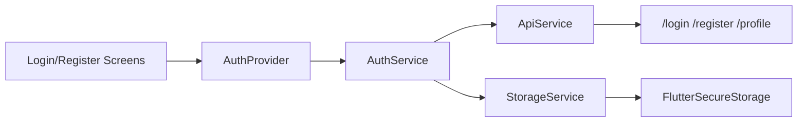
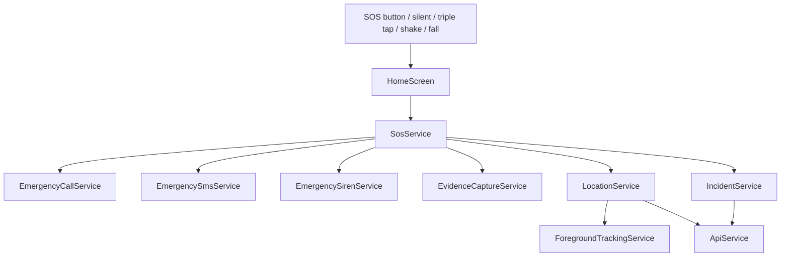
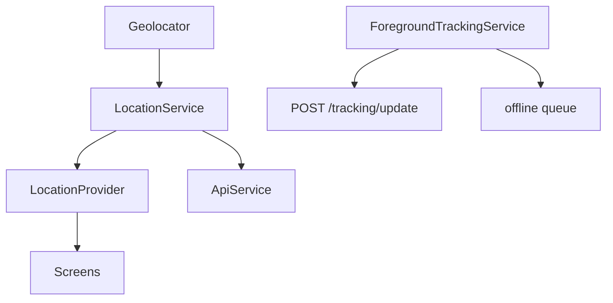
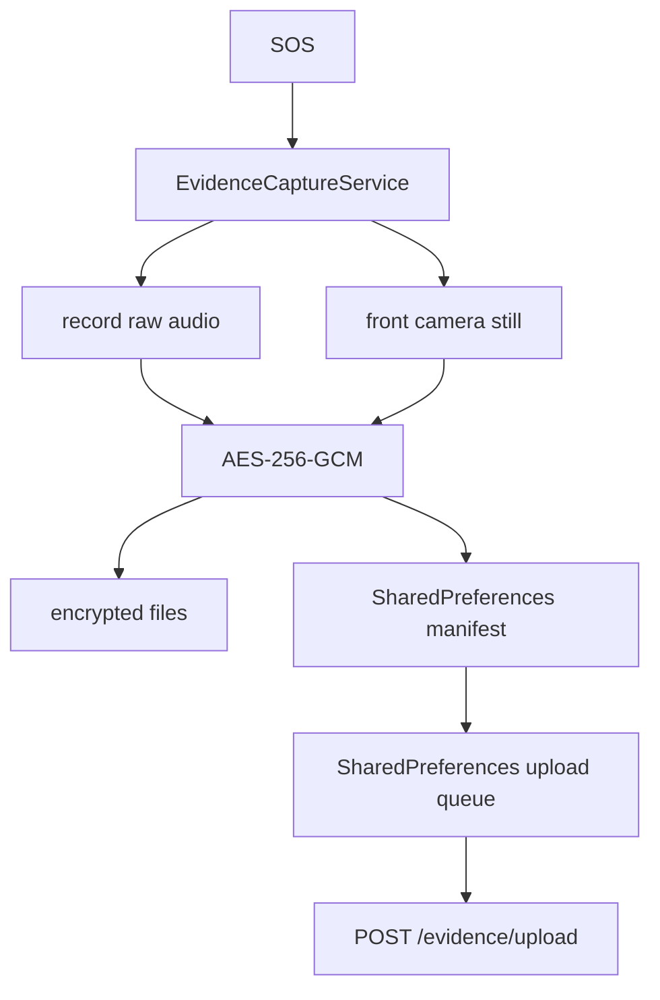
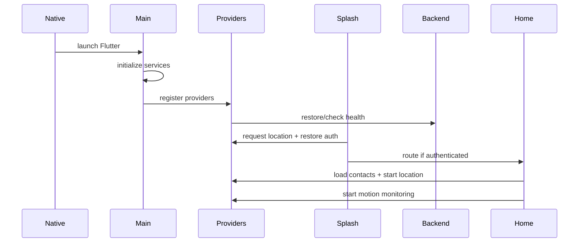

# SheGuard App - Architecture Report

Audit date: 2026-05-12

## Architecture Summary

The project is a layered Flutter app:

```text
UI screens/widgets
  -> Provider state objects
    -> Services
      -> ApiService / platform plugins / local storage
        -> External SheGuard_AI backend
```

This is a good MVP architecture: dependencies are passed through constructors, HTTP is centralized, and models isolate backend payloads. The main architectural weakness is contract drift between the Flutter client and backend documentation, plus platform configuration drift in Android.

## Main Application Composition

File: `lib/main.dart`

Responsibilities:

- Initializes Flutter bindings.
- Initializes notifications.
- Creates `ApiService`, `StorageService`, `ContactService`, `ForegroundTrackingService`, `LocationService`, `IncidentService`, `EvidenceCaptureService`, emergency call/siren/SMS/SOS services.
- Creates provider graph:
  - `AuthProvider`
  - `ContactProvider`
  - `LocationProvider`
  - `IncidentProvider`
  - `SafetyProvider`
  - `SettingsProvider`
  - service providers for SOS/call/siren/motion
- Configures routes.

Strengths:

- Clear manual dependency injection.
- Services are testable in principle because many accept injected dependencies.

Problems:

- Composition root is growing.
- No app environment/flavor abstraction.
- `AuthProvider.restore()` and `SafetyProvider.initialize()` start immediately during provider creation; this can make startup ordering harder to reason about.

## Layer Breakdown

### Core Layer

Files:

- `lib/core/api_config.dart`
- `lib/core/app_config.dart`
- `lib/core/app_routes.dart`
- `lib/core/app_theme.dart`
- `lib/core/localhost.dart`
- `lib/core/safety_types.dart`

Role:

- Static config, route constants, theme, safety enums.

Issues:

- `AppRoutes` is unused because screens define route constants.
- `localhost.dart` only re-exports `api_config.dart` and appears obsolete.
- `ApiConfig.publicTrackingBaseUrl` is unused.
- `AppConfig.baseUrl` defaults to empty and relies on discovery.

### Models Layer

Files:

- `camera_source.dart`
- `emergency_contact.dart`
- `evidence.dart`
- `incident.dart`
- `location_freshness.dart`
- `location_update.dart`
- `user.dart`

Role:

- API/local DTOs and derived labels.

Issues:

- `User.fromJson` force-casts `user_id` and can crash on malformed auth/profile response.
- `CameraSource` is not wired to UI.
- Models do not implement equality, which limits test precision.
- No serialization validation library or generated schemas.

### Providers Layer

Files:

- `auth_provider.dart`
- `contact_provider.dart`
- `incident_provider.dart`
- `location_provider.dart`
- `safety_provider.dart`
- `settings_provider.dart`

Role:

- UI-facing state and orchestration.

Strengths:

- Simple `ChangeNotifier` approach is understandable.
- State is separated by domain.

Issues:

- Providers expose mutable public fields instead of immutable state snapshots.
- `IncidentProvider.triggerSos()` duplicates older SOS flow but is not the active path.
- `LocationProvider` does geocoding on update callbacks, which mixes presentation enrichment with tracking.
- No disposal of `LocationService` from provider `dispose`; `HomeScreen` manually stops.

### Services Layer

Files:

- `api_service.dart`
- `auth_service.dart`
- `backend_health_service.dart`
- `camera_service.dart`
- `connectivity_service.dart`
- `contact_service.dart`
- `emergency_call_service.dart`
- `emergency_siren_service.dart`
- `emergency_sms_service.dart`
- `evidence_capture_service.dart`
- `foreground_tracking_service.dart`
- `incident_service.dart`
- `local_contact_metadata_service.dart`
- `location_service.dart`
- `motion_protection_service.dart`
- `notification_service.dart`
- `sos_service.dart`
- `storage_service.dart`

Role:

- REST API, platform integrations, emergency orchestration, persistence.

Strengths:

- `SosService` isolates the emergency workflow.
- `ApiService` centralizes auth header and HTTP errors.
- Evidence content encryption is properly separated.

Issues:

- Several service methods target undocumented backend endpoints.
- Some services are tightly coupled to plugins, limiting tests without wrappers.
- Background tracking service uses raw `http` instead of `ApiService`, so auth headers are not sent in background tracking updates.
- Local persistence keys are scattered across services.

### UI Layer

Files:

- Screens in `lib/screens`
- Widgets in `lib/widgets`

Role:

- User flows and presentation.

Strengths:

- UI is feature-rich for an MVP.
- Reusable visual widgets exist.

Issues:

- `HomeScreen` is too large and owns emergency dialog/timers/motion setup/logout/developer panel/nav.
- Some reusable widgets appear unused.
- No golden/widget tests for actual app screens.

## Module Architecture

### Authentication



Main risk:

- No auth-expiration handling. The token is restored and sent forever until logout.

### SOS/Emergency



Main risk:

- SOS success is defined as orchestration start, not completion of contact alerting/backend incident creation.

### Location/Realtime



Main risk:

- There is no real realtime protocol; the app uses periodic HTTP and provider state.

### Evidence



Main risk:

- Upload endpoint is missing from documented backend.

## API Architecture

`ApiService`:

- Maintains optional `_authToken`.
- Adds `Content-Type: application/json`.
- Adds `Authorization: Bearer <token>` if present.
- Builds URI from resolved base URL.
- Handles socket/timeout/client errors.
- Attempts LAN discovery through `NetworkInfo`.

Limitations:

- No HTTPS/staging support unless URL is local HTTP.
- No endpoint-specific timeout.
- No refresh-token flow.
- No structured error classes beyond `ApiException`.
- Background service bypasses `ApiService` and does not send auth header.

## Data Architecture

Remote entities inferred:

- User: `user_id`, `full_name`, `phone_number`, `profile_photo`
- Emergency contact: `contact_id`, `user_id`, `contact_name`, `relation`, `phone_number`
- Location update: `user_id`, `session_id`, `latitude`, `longitude`, `speed`, `accuracy`, `battery`, `timestamp`
- Incident: `incident_id`, `user_id`, `incident_type`, `confidence`, `threat_score`, `ai_summary`, `latitude`, `longitude`, `created_at`, `threat_level`, `kidnap_suspicion_score`, `ai_provider`, `explanation`, `camera_id`, `evidence_available`
- Evidence: `evidence_id`, `incident_id`, `image_path`, `video_path`, `cctv_source`, `created_at`, `confidence`, `threat_score`
- Camera source: `camera_id`, `camera_name`, `ip_address`, `rtsp_url`, `latitude`, `longitude`, `online_status`

Local-only entities:

- Contact metadata overlay.
- Settings.
- Emergency session record.
- Offline tracking queue.
- Evidence manifest/upload queue.

## Platform Architecture

### Android

Key files:

- `android/app/src/main/AndroidManifest.xml`
- `android/app/build.gradle`
- `android/settings.gradle`
- `android/app/src/main/kotlin/com/sheguard/app/MainActivity.kt`

Capabilities:

- Fine/coarse/background location.
- Internet/network state.
- SEND_SMS and CALL_PHONE.
- Camera and microphone.
- Notifications.
- Foreground service location.
- Battery optimization bypass.
- Wake lock/vibration.

Problems:

- Cleartext HTTP enabled.
- Release debug signing.
- Duplicate/ignored Gradle files.
- Duplicate `MainActivity` packages.

### iOS

Key files:

- `ios/Runner/Info.plist`
- `ios/Runner/GeneratedPluginRegistrant.m`

Capabilities:

- Plugin registration exists.
- Location usage strings exist.

Problems:

- Missing camera and microphone usage descriptions.
- Background modes not configured.
- SMS direct-send and direct-call assumptions do not map cleanly to iOS.

## Import Relationships

```text
main.dart
|-- core/app_theme.dart
|-- providers/*
|-- screens/*
`-- services/*

screens/*
|-- providers/*
|-- widgets/*
|-- services/SosService or platform services in HomeScreen
`-- models where needed

providers/*
|-- services/*
`-- models/*

services/*
|-- api_service.dart
|-- models/*
`-- platform plugin packages

models/*
`-- mostly standalone; incident.dart imports evidence.dart
```

Circular dependencies:

- No obvious Dart import cycles.

High-coupling areas:

- `HomeScreen` imports five providers, four services, four screens, and several widgets.
- `SosService` imports seven services and two models.

## Current Execution Flow



## Architectural Scores

- Layering: 7/10
- Dependency management: 6/10
- Platform configuration: 4/10
- API contract discipline: 4/10
- Testability: 5/10
- Emergency workflow design: 7/10 for MVP, 5/10 for production
- Overall: 6/10

## Recommended Target Architecture

```text
lib/
|-- app/                 # app bootstrap, environment, routes
|-- features/
|   |-- auth/
|   |-- contacts/
|   |-- sos/
|   |-- tracking/
|   |-- incidents/
|   |-- evidence/
|   `-- settings/
|-- shared/
|   |-- api/
|   |-- storage/
|   |-- platform/
|   |-- theme/
|   `-- widgets/
`-- main.dart
```

Key changes:

- Introduce `EnvironmentConfig` with debug/staging/prod base URLs.
- Create `ApiClient` + typed endpoint repositories.
- Make `EmergencySessionController` durable and observable.
- Move local storage keys to one storage namespace.
- Add platform capability service wrappers for testability.
- Split Android configs and remove ignored files.
