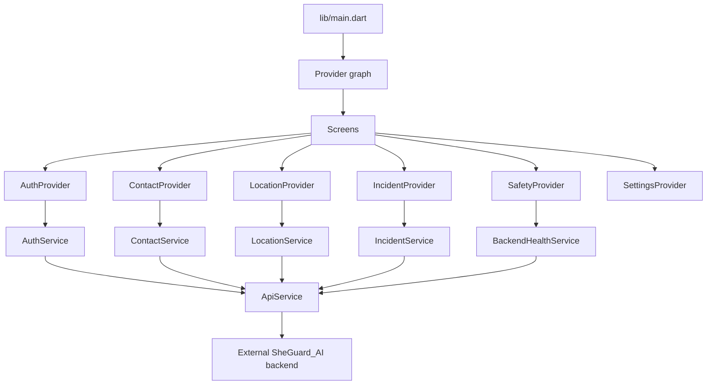
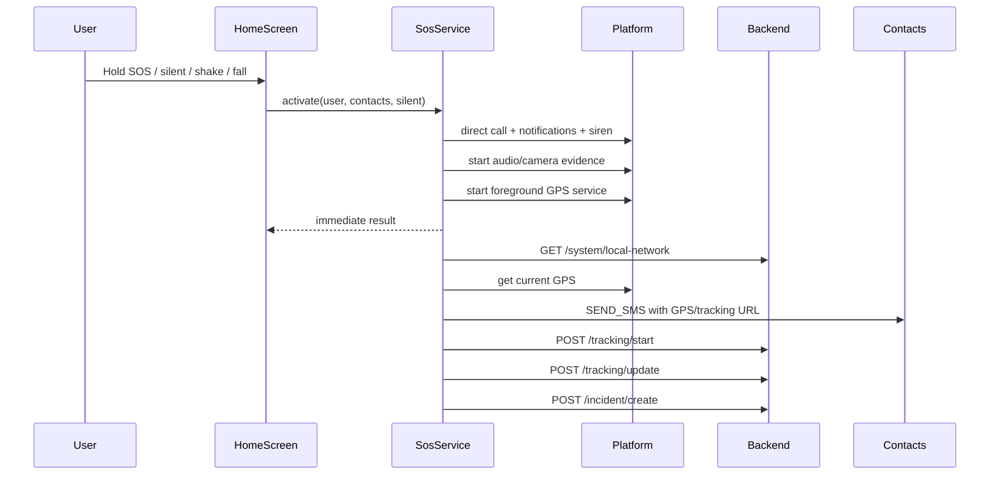
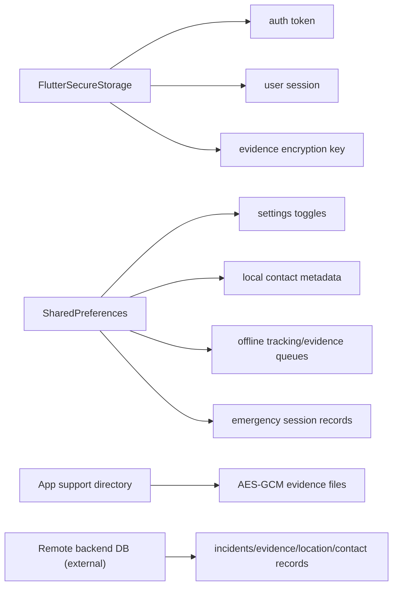
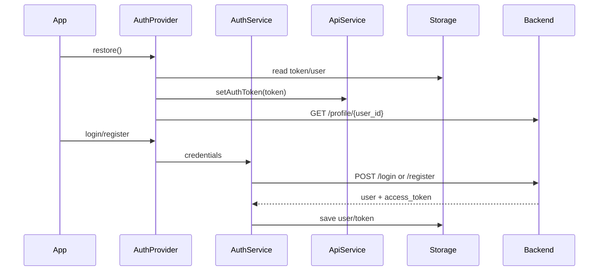
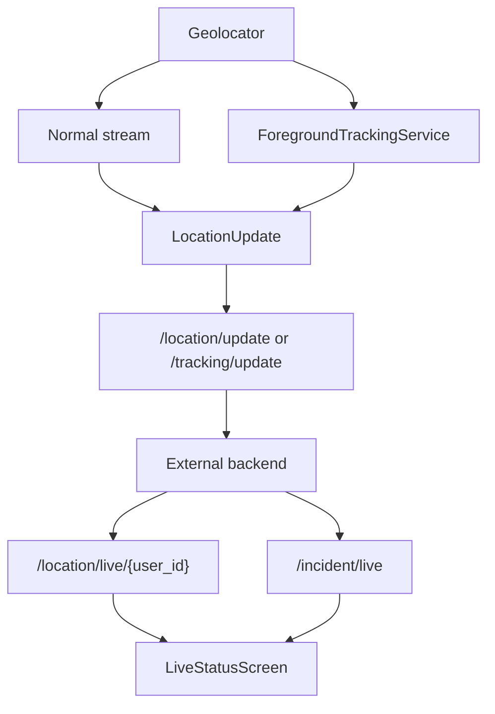

# SheGuard App - Complete Technical Project Report

Audit date: 2026-05-12
Workspace: `C:\Programs\codex\SheGuard\SheGuard_App`

## 1. PROJECT OVERVIEW

- Project name: `sheguard_app`
- Main goal: Flutter mobile safety client for an existing `SheGuard_AI` backend. The app supports login/register, emergency contacts, SOS, silent SOS, live GPS, incident history, local evidence capture, motion-based protection, and backend health monitoring.
- Project type: Flutter mobile application with native Android/iOS plugin integrations and a vendored SMS plugin.
- Platforms supported by repository: Android and partial iOS. Android is the actively configured target; iOS has plugin registrant and limited `Info.plist` permissions but is missing several production permission descriptions.
- Backend ownership: backend is external. This repository does not contain the FastAPI backend, database schema, admin dashboard, model server, CCTV pipeline, or Firebase/Supabase project.
- Technologies detected: Flutter, Dart, Provider, HTTP REST, SharedPreferences, FlutterSecureStorage, Geolocator, background service, Telephony/SMS, direct calling, local notifications, camera, microphone recording, AES-GCM encryption, Android Gradle/Kotlin, iOS plist/plugin registrant.
- Languages used: Dart, Kotlin, Groovy Gradle, Kotlin Gradle DSL, XML, plist XML, Markdown, PowerShell/Bash scripts in `.github/java-upgrade`.

## 2. COMPLETE FOLDER STRUCTURE

The workspace contains authored files plus generated build/cache files. `rg --files -uu` found 8,620 file paths. The important authored tree is:

```text
SheGuard_App/
|-- .dart_tool/                         # generated Flutter/Dart cache; should not be committed
|-- .github/
|   `-- java-upgrade/
|       |-- .gitignore
|       `-- hooks/scripts/
|           |-- recordToolUse.ps1
|           `-- recordToolUse.sh
|-- .idea/
|   |-- libraries/
|   |   |-- Dart_SDK.xml
|   |   `-- KotlinJavaRuntime.xml
|   |-- runConfigurations/main_dart.xml
|   |-- modules.xml
|   `-- workspace.xml
|-- android/
|   |-- .gradle/                        # generated Gradle cache
|   |-- .kotlin/errors/                 # generated Kotlin error logs
|   |-- app/
|   |   |-- build.gradle                # active Groovy app build file
|   |   |-- build.gradle.kts            # ignored/conflicting Kotlin DSL app build file
|   |   `-- src/
|   |       |-- debug/AndroidManifest.xml
|   |       |-- profile/AndroidManifest.xml
|   |       `-- main/
|   |           |-- AndroidManifest.xml
|   |           |-- java/io/flutter/plugins/GeneratedPluginRegistrant.java
|   |           |-- kotlin/com/sheguard/app/MainActivity.kt
|   |           |-- kotlin/com/sheguard/sheguard_app/MainActivity.kt
|   |           `-- res/
|   |               |-- drawable/launch_background.xml
|   |               |-- drawable/sheguard_icon.xml
|   |               |-- drawable-v21/launch_background.xml
|   |               |-- mipmap-*/ic_launcher.png
|   |               |-- values/styles.xml
|   |               `-- values-night/styles.xml
|   |-- build/                          # generated Android build output
|   |-- gradle/wrapper/
|   |   |-- gradle-wrapper.jar
|   |   `-- gradle-wrapper.properties
|   |-- .gitignore
|   |-- build.gradle                    # active Groovy root build file
|   |-- build.gradle.kts                # conflicting Kotlin DSL root build file
|   |-- gradle.properties
|   |-- gradlew
|   |-- gradlew.bat
|   |-- local.properties                # local SDK paths; should not be committed
|   |-- settings.gradle                 # active settings file
|   |-- settings.gradle.kts             # ignored by Flutter because settings.gradle exists
|   `-- sheguard_app_android.iml
|-- assets/
|   `-- README.md                       # only declared asset; no image/model bundles present
|-- build/                              # generated Flutter/Android outputs
|-- ios/
|   |-- Flutter/
|   |   |-- Generated.xcconfig          # generated
|   |   |-- flutter_export_environment.sh
|   |   `-- ephemeral/                  # generated
|   `-- Runner/
|       |-- GeneratedPluginRegistrant.h
|       |-- GeneratedPluginRegistrant.m
|       `-- Info.plist
|-- lib/
|   |-- core/
|   |   |-- api_config.dart
|   |   |-- app_config.dart
|   |   |-- app_routes.dart
|   |   |-- app_theme.dart
|   |   |-- localhost.dart
|   |   `-- safety_types.dart
|   |-- models/
|   |   |-- camera_source.dart
|   |   |-- emergency_contact.dart
|   |   |-- evidence.dart
|   |   |-- incident.dart
|   |   |-- location_freshness.dart
|   |   |-- location_update.dart
|   |   `-- user.dart
|   |-- providers/
|   |   |-- auth_provider.dart
|   |   |-- contact_provider.dart
|   |   |-- incident_provider.dart
|   |   |-- location_provider.dart
|   |   |-- safety_provider.dart
|   |   `-- settings_provider.dart
|   |-- screens/
|   |   |-- contacts_screen.dart
|   |   |-- fake_call_screen.dart
|   |   |-- home_screen.dart
|   |   |-- incident_history_screen.dart
|   |   |-- live_status_screen.dart
|   |   |-- login_screen.dart
|   |   |-- register_screen.dart
|   |   |-- settings_screen.dart
|   |   `-- splash_screen.dart
|   |-- services/
|   |   |-- api_service.dart
|   |   |-- auth_service.dart
|   |   |-- backend_health_service.dart
|   |   |-- camera_service.dart
|   |   |-- connectivity_service.dart
|   |   |-- contact_service.dart
|   |   |-- emergency_call_service.dart
|   |   |-- emergency_siren_service.dart
|   |   |-- emergency_sms_service.dart
|   |   |-- evidence_capture_service.dart
|   |   |-- foreground_tracking_service.dart
|   |   |-- incident_service.dart
|   |   |-- local_contact_metadata_service.dart
|   |   |-- location_service.dart
|   |   |-- motion_protection_service.dart
|   |   |-- notification_service.dart
|   |   |-- sos_service.dart
|   |   `-- storage_service.dart
|   |-- widgets/
|   |   |-- emergency_action_panel.dart
|   |   |-- empty_state.dart
|   |   |-- metric_tile.dart
|   |   |-- premium_ui.dart
|   |   |-- safety_status_banner.dart
|   |   |-- sos_button.dart
|   |   |-- status_tile.dart
|   |   `-- timeline_card.dart
|   `-- main.dart
|-- test/
|   |-- model_payload_test.dart
|   `-- widget_test.dart
|-- third_party/
|   `-- telephony/                      # vendored Flutter SMS plugin
|       |-- android/src/main/kotlin/com/shounakmulay/telephony/...
|       |-- ios/Classes/...
|       |-- lib/
|       |   |-- constants.dart
|       |   |-- filter.dart
|       |   `-- telephony.dart
|       |-- test/
|       |-- example/
|       |-- CHANGELOG.md
|       |-- LICENSE
|       |-- pubspec.yaml
|       `-- README.md
|-- .flutter-plugins-dependencies       # generated; should not be committed
|-- .gitignore
|-- .metadata
|-- analysis_options.yaml
|-- ARCHITECTURE.md
|-- PROJECT_STATUS.md
|-- pubspec.lock
|-- pubspec.yaml
|-- README.md
`-- sheguard_app.iml
```

Generated directory details:

- `.dart_tool/`: package config, package graph, Flutter build intermediates, compiled `app.dill`, native asset metadata.
- `build/`: Flutter APK outputs and plugin build intermediates for `app`, `camera_android_camerax`, `geolocator_android`, `flutter_background_service_android`, `flutter_local_notifications`, `shared_preferences_android`, `permission_handler_android`, `record_android`, `wakelock_plus`, and others.
- `android/.gradle/`, `android/build/`, `android/.kotlin/`: Gradle cache, reports, Kotlin errors, intermediate outputs.
- `ios/Flutter/ephemeral/`: generated Flutter iOS helper files.

These generated folders were inspected as present and materially important because they reveal debug/release build outputs in the workspace. They should be excluded from version control and regenerated locally.

## 3. TECH STACK ANALYSIS

- Frontend framework: Flutter Material app.
- State management: `provider` with `ChangeNotifier` providers in `lib/main.dart`.
- Backend framework expected: external FastAPI service named `SheGuard_AI`; no backend code is in this repository.
- Database: no local SQL database. Local persistence uses `SharedPreferences` and `FlutterSecureStorage`. Remote DB is inferred behind the external backend from user/contact/incident/location APIs.
- APIs: REST over JSON through `http`.
- Authentication: phone/password login/register; token stored in secure storage and sent as `Authorization: Bearer <token>` by `lib/services/api_service.dart`.
- AI/ML: no local ML model. AI fields are parsed from backend responses (`ai_summary`, `ai_provider`, `threat_score`, `kidnap_suspicion_score`, `confidence`). Local "smart" detection is sensor threshold logic, not ML.
- Cloud services: none configured in this repo. No Firebase, Supabase, AWS, or Google services config files.
- Maps/location: `geolocator`, `geocoding`, Google Maps URL in SMS text.
- Notifications: `flutter_local_notifications` plus Android foreground-service notifications.
- Background services: `flutter_background_service`, `wakelock_plus`, `battery_plus`, Android foreground service.
- Camera/audio: `camera`, `record`, `permission_handler`, local AES-GCM encryption through `cryptography`.
- Build tools: Flutter, Android Gradle Plugin, Kotlin, Gradle wrapper. The active Android build files are Groovy because `settings.gradle` wins over `settings.gradle.kts`.
- Deployment configs: no CI workflow, no Play signing config, release uses debug signing in `android/app/build.gradle` and `android/app/build.gradle.kts`.

## 4. ENTRY POINT ANALYSIS

- Main entry file: `lib/main.dart`.
- Native Android entry: active package is `com.sheguard.app.MainActivity` from `android/app/src/main/kotlin/com/sheguard/app/MainActivity.kt` because active Groovy Gradle sets `namespace` and `applicationId` to `com.sheguard.app`.
- Conflicting Android entry: `android/app/src/main/kotlin/com/sheguard/sheguard_app/MainActivity.kt` matches the ignored Kotlin DSL build, but is not the active package.
- App startup:
  1. `main()` calls `WidgetsFlutterBinding.ensureInitialized()`.
  2. `NotificationService.initialize()` creates local notification plugin.
  3. Core services are constructed manually: `ApiService`, `StorageService`, `ContactService`, `ForegroundTrackingService`, `LocationService`, `IncidentService`, `EvidenceCaptureService`, emergency call/siren/SMS/SOS services.
  4. `ForegroundTrackingService.initialize()` configures background service callbacks.
  5. `SheGuardApp` registers providers and routes.
  6. `SplashScreen` runs boot checks and navigates to `HomeScreen` or `LoginScreen`.
- Routing: `MaterialApp.routes` in `lib/main.dart`; route constants also exist in `lib/core/app_routes.dart`, but screens define their own route constants and `AppRoutes` is unused.
- Dependency injection: manual constructor injection inside `main.dart`; no service locator.
- Middleware/interceptors: no HTTP interceptor package. `ApiService` centralizes token headers, timeout, error normalization, and base URL discovery.

## 5. FEATURE ANALYSIS

### Authentication

- Files: `lib/screens/login_screen.dart`, `lib/screens/register_screen.dart`, `lib/providers/auth_provider.dart`, `lib/services/auth_service.dart`, `lib/services/storage_service.dart`, `lib/models/user.dart`.
- Status: implemented, test coverage minimal.
- Logic: login/register POST credentials to backend, parse `User`, extract `access_token` or `token`, store session in secure storage, restore on startup, fetch `/profile/{user_id}`.
- Backend flow: `POST /register`, `POST /login`, `GET /profile/{user_id}`.
- Issues: no password rules beyond UI validation, no token refresh, no forced logout on 401, no secure transport enforcement because cleartext HTTP is enabled.

### Emergency Contacts

- Files: `lib/screens/contacts_screen.dart`, `lib/providers/contact_provider.dart`, `lib/services/contact_service.dart`, `lib/services/local_contact_metadata_service.dart`, `lib/models/emergency_contact.dart`.
- Status: implemented for add/list; edit/delete/favorite are local-only.
- Logic: backend list/add syncs contacts; local metadata overlays hidden/favorite/edited fields.
- Backend flow: `GET /contacts/{user_id}`, `POST /contacts/add`.
- Issues: local hide/edit diverges from backend, no server update/delete endpoints, contact metadata stored unencrypted in SharedPreferences.

### SOS And Silent SOS

- Files: `lib/screens/home_screen.dart`, `lib/widgets/sos_button.dart`, `lib/widgets/emergency_action_panel.dart`, `lib/services/sos_service.dart`, `lib/services/emergency_sms_service.dart`, `lib/services/emergency_call_service.dart`, `lib/services/emergency_siren_service.dart`, `lib/services/notification_service.dart`.
- Status: implemented.
- Logic: hold SOS, long press, triple-tap, shake, or fall escalation call `SosService.activate()`. SOS starts call, notifications, siren if enabled, evidence capture, foreground tracking, SMS, backend incident creation, and session persistence.
- Backend flow: `POST /incident/create`; undocumented `POST /tracking/start`, `POST /tracking/update`, `GET /system/local-network`.
- Issues: `SosActivationResult` returns before SMS/backend work finishes, so UI reports `0 contacts` even while background SMS may later succeed. Missing backend endpoints can make public tracking fail silently.

### Live Location And Tracking

- Files: `lib/providers/location_provider.dart`, `lib/services/location_service.dart`, `lib/services/foreground_tracking_service.dart`, `lib/models/location_update.dart`, `lib/models/location_freshness.dart`.
- Status: implemented but backend contract mismatch for session tracking.
- Logic: foreground normal tracking posts `/location/update`; emergency tracking uses Android foreground background service and posts `/tracking/update` every 5 seconds.
- Backend flow: documented `POST /location/update`, `GET /location/live/{user_id}`; undocumented `/tracking/start` and `/tracking/update`.
- Issues: Android background permission is declared but only generic geolocator permission request is used; iOS background tracking is incomplete.

### Incident History And Live Status

- Files: `lib/screens/incident_history_screen.dart`, `lib/screens/live_status_screen.dart`, `lib/providers/incident_provider.dart`, `lib/services/incident_service.dart`, `lib/models/incident.dart`, `lib/models/evidence.dart`.
- Status: implemented for backend-provided incidents/evidence.
- Logic: history fetches incidents by user; live screen fetches global live incidents; evidence lazy-loads by incident ID.
- Backend flow: `GET /incident/history/{user_id}`, `GET /incident/live`, `GET /evidence/{incident_id}`.
- Issues: `GET /incident/live` appears global and not user-scoped; no pagination; no auth/role separation in client.

### Evidence Capture

- Files: `lib/services/evidence_capture_service.dart`, `lib/models/evidence.dart`.
- Status: local capture/encryption implemented; upload expects missing endpoint.
- Logic: starts audio recording and one front-camera photo during SOS. On stop, encrypts raw files with AES-256-GCM and stores encrypted files in app support directory. Manifest and upload queue use SharedPreferences; key uses FlutterSecureStorage.
- Backend flow: undocumented `POST /evidence/upload`; documented read-only `GET /evidence/{incident_id}`.
- Issues: upload endpoint is not documented; evidence audio only encrypts on explicit stop; app crash during recording can leave raw file temporarily on disk.

### Motion Protection

- Files: `lib/services/motion_protection_service.dart`, `lib/screens/home_screen.dart`, `lib/providers/settings_provider.dart`.
- Status: implemented threshold-based detection.
- Logic: user accelerometer shake threshold triggers SOS; accelerometer impact plus stillness triggers fall safety check dialog.
- Issues: no calibration per device, no false-positive analytics, no background sensor service after app kill.

### Settings

- Files: `lib/screens/settings_screen.dart`, `lib/providers/settings_provider.dart`.
- Status: implemented.
- Logic: toggles notifications, silent mode, privacy guard, tracking, shake SOS, fall detection, sensitivity, auto calling, siren, developer mode.
- Issues: privacy guard is persisted but not meaningfully enforced in evidence/location/API flows.

### Backend Health

- Files: `lib/services/backend_health_service.dart`, `lib/providers/safety_provider.dart`, `lib/services/connectivity_service.dart`.
- Status: implemented.
- Logic: checks `GET /incident/live?limit=1` because there is no health endpoint.
- Issues: health check has side effects/semantics of incident API; no dedicated `/health`.

### Camera Source/CCTV

- Files: `lib/models/camera_source.dart`, `lib/services/camera_service.dart`.
- Status: stub/incomplete; not wired to UI or providers.
- Backend flow: `POST /camera/register`, `GET /camera/list`, both undocumented in README.
- Issues: dead/unreachable feature surface in mobile app.

### Dashboard/Admin

- Status: not present.
- Files: none.
- Notes: README and project status explicitly say admin dashboard requires a separate dashboard project and backend admin APIs.

## 6. MODULE ANALYSIS

### Core

- Files: `lib/core/api_config.dart`, `app_config.dart`, `app_theme.dart`, `safety_types.dart`, `app_routes.dart`, `localhost.dart`.
- Architecture: constants and enums.
- Problems: `AppRoutes` and `localhost.dart` are unused; `ApiConfig.publicTrackingBaseUrl` is unused; default `ApiConfig.baseUrl` is empty, forcing LAN discovery.
- Improvements: centralize routes by using `AppRoutes`; honor `publicTrackingBaseUrl`; document required `--dart-define` values.

### API Module

- File: `lib/services/api_service.dart`.
- Architecture: central client with JSON encode/decode, token header, LAN discovery, local URL persistence.
- Problems: only allows local HTTP URLs, not HTTPS or domain staging; scans a WiFi subnet from the client; no retry/backoff except discovery; no 401 handling; no client close/dispose.
- Improvements: support configured HTTPS base URLs, add auth-expired callback, shorter endpoint-specific timeouts, and a typed API contract.

### Auth Module

- Architecture: `AuthProvider` wraps `AuthService` and secure session.
- Problems: missing token refresh, missing backend error mapping, weak validation, `User.fromJson` throws if `user_id` missing.
- Improvements: robust DTO parsing and auth state machine.

### Emergency Module

- Architecture: `SosService` orchestrates platform services and backend services.
- Problems: fire-and-forget background sync hides SMS/backend results from UI; duplicate throttling is in-memory only; no durable emergency state restoration after app restart.
- Improvements: make emergency session a first-class provider/state object, emit progress events, persist active session immediately.

### Location Module

- Architecture: normal stream for foreground tracking and background service for SOS tracking.
- Problems: undocumented tracking endpoints; background location permission flow incomplete for Android 10+; iOS not production-ready.
- Improvements: align backend endpoints, add permission education flow, add replay tests for queued updates.

### Evidence Module

- Architecture: local capture -> encrypt -> manifest -> optional upload queue.
- Problems: raw files exist until encryption; upload endpoint not documented; manifest is unencrypted; no retention/delete controls.
- Improvements: add backend endpoint or remove upload attempts; encrypt manifest; add retention policy.

### Dashboard Module

- Not implemented. No web app, admin routes, charting libraries, user management, or analytics views exist.

## 7. API & DATABASE ANALYSIS

### Documented endpoints used

| Method | Endpoint | Caller |
|---|---|---|
| POST | `/register` | `lib/services/auth_service.dart` |
| POST | `/login` | `lib/services/auth_service.dart` |
| GET | `/profile/{user_id}` | `lib/services/auth_service.dart` |
| GET | `/contacts/{user_id}` | `lib/services/contact_service.dart` |
| POST | `/contacts/add` | `lib/services/contact_service.dart` |
| POST | `/location/update` | `lib/services/location_service.dart` |
| GET | `/location/live/{user_id}` | `lib/services/location_service.dart` |
| POST | `/incident/create` | `lib/services/incident_service.dart` |
| GET | `/incident/history/{user_id}` | `lib/services/incident_service.dart` |
| GET | `/incident/live` | `lib/services/incident_service.dart`, `BackendHealthService` |
| GET | `/evidence/{incident_id}` | `lib/services/incident_service.dart` |

### Undocumented endpoints used by code

| Method | Endpoint | Caller | Risk |
|---|---|---|---|
| GET | `/system/local-network` | `ApiService.publicTrackingUrl()` | Not in README contract; tracking link discovery may fail. |
| GET | `/track/{session_id}` | SMS link construction | Not in README contract; public tracking page absent in repo. |
| POST | `/tracking/start` | `LocationService.startTrackingSession()` | Not in README contract. |
| POST | `/tracking/update` | `LocationService`, `ForegroundTrackingService` | Not in README contract; core emergency tracking depends on it. |
| POST | `/evidence/upload` | `EvidenceCaptureService` | README says evidence upload is not implemented. |
| POST | `/camera/register` | `CameraService` | Undocumented and unused. |
| GET | `/camera/list` | `CameraService` | Undocumented and unused. |

### Local storage

- Secure storage: `sheguard_user`, `sheguard_auth_token`, `sheguard_evidence_key_v1`.
- SharedPreferences: settings toggles, `contact_metadata`, `offline_tracking_queue`, `encrypted_evidence_manifest`, `encrypted_evidence_upload_queue`, `emergency_sessions`, `sheguard_local_base_url`.
- Local files: encrypted evidence files under application support directory `/evidence`.

## 8. DEPENDENCY ANALYSIS

Direct dependencies in `pubspec.yaml`: `http`, `provider`, `shared_preferences`, `geolocator`, `permission_handler`, `flutter_secure_storage`, `flutter_local_notifications`, `connectivity_plus`, vendored `telephony`, `sensors_plus`, `record`, `camera`, `path_provider`, `cryptography`, `url_launcher`, `battery_plus`, `flutter_background_service`, `wakelock_plus`, `flutter_phone_direct_caller`, `network_info_plus`, `geocoding`.

Potentially unused or underused:

- `CameraService` and `CameraSource` are not wired to UI/providers.
- `AppRoutes`, `localhost.dart`, `MetricTile`, `StatusTile`, and `TimelineCard` appear unused.
- `ApiConfig.publicTrackingBaseUrl` is unused.
- `IncidentProvider.triggerSos()` duplicates older SOS creation logic but `HomeScreen` uses `SosService.activate()` instead.

Outdated packages from `flutter pub outdated`:

- Direct: `camera`, `connectivity_plus`, `flutter_local_notifications`, `flutter_secure_storage`, `geolocator`, `network_info_plus`, `permission_handler`, `shared_preferences`, `wakelock_plus`, `flutter_lints`.
- Transitive discontinued package: `js 0.6.7`.
- Heavy packages affecting APK/runtime: `camera`, `record`, `flutter_background_service`, `geolocator`, `geocoding`, `flutter_local_notifications`, `network_info_plus`.

## 9. BUG & ERROR DETECTION

- `flutter analyze`: one warning in `lib/screens/splash_screen.dart:107`, deprecated `withOpacity`.
- `flutter test`: all 5 tests pass.
- `flutter build apk --debug`: succeeds, but warns that both `settings.gradle` and `settings.gradle.kts` exist and `settings.gradle.kts` is ignored.
- Android identity conflict: Groovy build uses `com.sheguard.app`; Kotlin DSL uses `com.sheguard.sheguard_app`; two `MainActivity.kt` files exist.
- API contract mismatch: code uses multiple endpoints not documented or stated as not implemented.
- UI result mismatch: SOS returns immediately before SMS result is known.
- Generated artifacts are present despite `.gitignore`: `.dart_tool/`, `build/`, `android/.gradle/`, generated iOS files, generated plugin registrant.
- `android/local.properties` is present and contains machine-specific SDK paths.
- Release signing uses debug signing.
- iOS permission config is incomplete for camera/microphone/background location/direct telephony-equivalent flows.

## 10. PERFORMANCE ANALYSIS

- `HomeScreen` is large (708 lines) and watches several providers, making rebuild scope broad.
- `ApiService._discoverSameWifiBackend()` probes up to 253 LAN hosts, in batches of 32, each up to 700 ms. This can delay first network use and drains battery/network on mobile.
- Reverse geocoding runs after location updates in `LocationProvider`; if tracking is frequent, this can be expensive.
- Emergency foreground tracking interval is 5 seconds, high accuracy, best-for-navigation. This is correct for emergency mode but heavy for normal monitoring.
- Evidence capture starts audio and camera in parallel. Camera initialization during SOS can be slow and battery-heavy.
- SharedPreferences queues are rewritten as full string lists on every tracking enqueue; acceptable at 200-300 entries but not scalable.

## 11. SECURITY ANALYSIS

- No hardcoded API secrets were found.
- Auth token is stored in `FlutterSecureStorage`, good.
- Evidence encryption key is stored in `FlutterSecureStorage`, good.
- Android `usesCleartextTraffic="true"` permits HTTP traffic. This is convenient for LAN testing but not production safe.
- App scans local subnet for backend discovery, which may trigger privacy/network concerns.
- SMS includes user name and precise GPS/tracking links in plaintext.
- Contact metadata and emergency session history are stored unencrypted in SharedPreferences.
- Evidence manifest and upload queue metadata are unencrypted, though evidence content is encrypted.
- `SEND_SMS`, `CALL_PHONE`, `RECORD_AUDIO`, `CAMERA`, `ACCESS_BACKGROUND_LOCATION`, battery optimization bypass, and wake lock are powerful permissions and need a production privacy policy/UX.
- No Firebase/Supabase security rules exist because those services are not used in this repo.

## 12. AI/ML ANALYSIS

- No local AI model, TensorFlow Lite, ONNX, OpenCV, MediaPipe, YOLO, or model assets are present.
- AI output is backend-provided and parsed in `Incident.fromJson`.
- Sensor-based detection in `MotionProtectionService` is deterministic threshold logic:
  - shake: user accelerometer magnitude threshold with 4 hits and 45-second cooldown
  - fall: accelerometer impact >= 29.0 plus stillness <= 1.8 within 3 seconds
- Missing: calibration, false-positive feedback, local wake-word engine, offline/background AI inference, model tests.

## 13. LOCATION & REALTIME ANALYSIS

- GPS flow: permission check -> current/stream position -> `LocationUpdate` model -> backend POST -> provider state -> UI freshness.
- Background tracking: Android foreground service via `flutter_background_service`.
- Realtime backend: no WebSocket, Socket.IO, Firebase Realtime Database, or Firestore. Live data is HTTP polling/manual refresh.
- Map rendering: no in-app map widget. SMS uses Google Maps URL.
- Permissions: Android declares fine/coarse/background location and foreground service location. iOS has basic location usage text but not complete background mode configuration.
- Missing: geofencing, location history endpoint, live tracking public page implementation, background tracking after reboot.

## 14. DASHBOARD ANALYSIS

- No admin dashboard exists in this workspace.
- No web framework, charting library, admin auth, analytics tables, role management, or dashboard API client is present.
- Mobile live status screen is not an admin dashboard; it shows backend/GPS state and live incidents.
- `CameraService` hints at future CCTV/admin camera APIs but is not connected to screens.

## 15. PROJECT EXECUTION FLOW

1. Run `flutter pub get`.
2. Configure backend using `--dart-define=SHEGUARD_API_BASE_URL=http://<lan-ip>:8000` or let `ApiService` discover a local LAN backend.
3. Run app with `flutter run`.
4. `main()` initializes notifications, foreground tracking service, services, providers, and routes.
5. `SplashScreen` restores secure session, checks backend, requests location permission, and routes user.
6. Login/register posts credentials, stores token, and opens `HomeScreen`.
7. `HomeScreen.initState()` loads contacts, starts normal location tracking, sets monitoring, and starts motion detection.
8. SOS trigger calls `SosService.activate()`.
9. Emergency call starts immediately, notifications appear, optional siren starts, evidence capture starts, foreground tracking starts.
10. Background SOS sync resolves tracking URL, gets GPS, sends SMS, starts tracking session, uploads initial GPS, creates backend incident, and stores local session.
11. Incident screens fetch history/live incidents and evidence from backend.
12. Settings toggles update SharedPreferences and affect future flows.

## 16. ARCHITECTURE DIAGRAMS

### App architecture



### SOS/API flow



### Database/local storage flow



### Authentication flow



### Realtime/location flow



## 17. FILE IMPORT RELATIONSHIP

- `lib/main.dart` is the composition root and imports all providers, screens, and services.
- Screens depend on providers and widgets; screens do not call HTTP directly.
- Providers depend on services and models.
- Services depend on `ApiService`, platform plugins, and models.
- Models are leaf nodes except `Incident` imports `Evidence`.
- Circular dependencies: no source-level Dart import cycles were detected from imports.
- Unused modules likely:
  - `lib/core/app_routes.dart`
  - `lib/core/localhost.dart`
  - `lib/services/camera_service.dart`
  - `lib/models/camera_source.dart`
  - `lib/widgets/metric_tile.dart`
  - `lib/widgets/status_tile.dart`
  - `lib/widgets/timeline_card.dart`
  - `IncidentProvider.triggerSos()`

## 18. CLEANUP SUGGESTIONS

- Remove generated/cached folders from version control: `.dart_tool/`, `build/`, `android/.gradle/`, `android/build/`, `android/.kotlin/`, `ios/Flutter/ephemeral/`, generated plugin registrants if they are not intended as source.
- Remove `android/local.properties` from repo.
- Choose one Android Gradle style. Keep either Groovy or Kotlin DSL, not both.
- Resolve Android package identity: `com.sheguard.app` vs `com.sheguard.sheguard_app`.
- Align backend contract: add or remove `/tracking/*`, `/evidence/upload`, `/system/local-network`, `/track/{session_id}`, `/camera/*`.
- Split `HomeScreen` into smaller components/controllers.
- Introduce typed API DTOs and repository layer for better testing.
- Add integration tests with mocked `ApiService`.
- Encrypt contact metadata/session/evidence manifest or move sensitive metadata to secure storage.

## 19. MISSING FEATURES

- Backend implementation, database schema, migrations, and auth enforcement.
- Dedicated `/health` endpoint.
- Token refresh and 401 logout flow.
- Backend contact update/delete.
- Evidence upload endpoint or explicit offline-only evidence UX.
- Public live tracking page and session/location history endpoint.
- Admin dashboard and role-based access control.
- Local wake-word detection.
- In-app map.
- iOS parity for camera/audio permissions, background location, SMS/calling alternatives.
- Production signing, release flavors, CI/CD, environment configs.
- Privacy policy/onboarding for sensitive permissions.

## 20. FINAL PROJECT HEALTH REPORT

- Architecture score: 7/10. Clear layers and service injection, but large `HomeScreen`, endpoint drift, and duplicated platform configs.
- Security score: 5/10. Good secure storage and evidence encryption; weak production transport posture and sensitive metadata in SharedPreferences.
- Scalability score: 5/10. Good modular start; missing backend contract versioning, typed repositories, and durable emergency state.
- Code quality score: 7/10. Builds and tests pass; mostly readable; some dead code and duplicated legacy surfaces.
- Maintainability score: 6/10. Providers/services are understandable, but generated files and Gradle duplication will slow future work.
- Performance score: 6/10. Emergency mode is intentionally heavy; LAN scanning, geocoding, and broad rebuilds need tuning.

Top critical issues:

1. Backend contract mismatch for tracking/evidence/public tracking endpoints.
2. Android Gradle/package duplication.
3. Cleartext HTTP and local network scanning are not production-safe.
4. Generated build/cache artifacts are present in the workspace.
5. iOS permissions/background behavior are incomplete.

Top recommended fixes:

1. Freeze and document a single backend API contract, then update code or backend to match.
2. Clean Android configs and package names.
3. Remove generated artifacts and enforce `.gitignore`.
4. Add production HTTPS configuration and release signing.
5. Convert SOS into a durable state machine with progress reporting.

Best next steps:

1. Fix Android Gradle duplication and package identity.
2. Add backend endpoints or remove client calls for undocumented APIs.
3. Add integration tests for auth, SOS, location, and evidence upload failure paths.
4. Harden permissions/security before production testing.
5. Build a separate dashboard project only after admin backend APIs exist.
