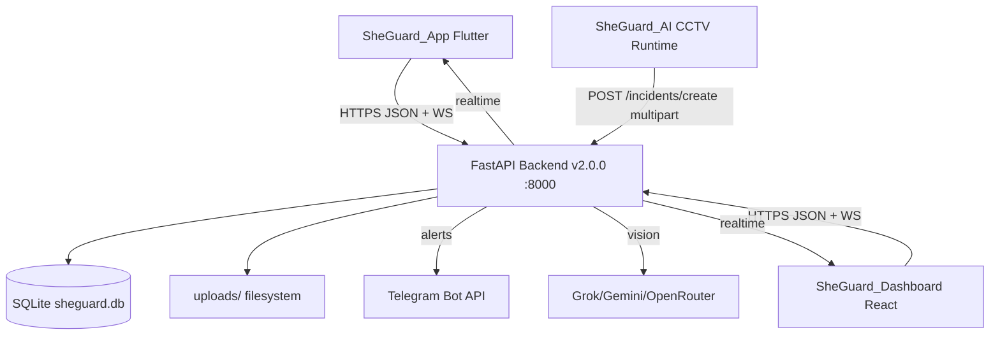

# SheGuard Backend — Complete Forensic Audit

**Audit Date:** 2026-08-20
**Audited Path:** `C:\Programs\codex\SheGuard\SheGuard_Backend`
**Backend Version:** 2.0.0 (FastAPI)
**Scope:** Static source-code forensics + read-only DB inspection. No source, DB, `.env`, or dependency was modified.

---

## 1. Executive Summary

SheGuard Backend is a standalone FastAPI application (version `2.0.0`) extracted from the `SheGuard_AI` project. It is the API layer that supports a Flutter mobile app (`SheGuard_App`) and a React/Vite police dashboard (`SheGuard_Dashboard`). It persists data in a local SQLite database (`sheguard.db`) and serves uploaded incident media via a static mount.

The backend is **IMPLEMENTED / VERIFIED** for the core flows: user registration/login (JWT), GPS location updates, live tracking sessions, incident creation (CCTV + mobile), victim GPS-radius matching, emergency SOS sessions, evidence storage, Telegram alerts, and WebSocket real-time broadcasting. The AI/vision layer is partially implemented: Groq is wired through `groq_client.py` and `cloud_ai.py`; Gemini and OpenRouter are coded as fallbacks; HuggingFace and NVIDIA keys exist in `.env` but have **no code path** that uses them. CCTV "monitoring" (RTSP frame capture + live detection) is **NOT in this backend** — the `CameraManager` only holds a registration/health model and is never started; actual detection lives in the separate `SheGuard_AI` runtime.

Key contract gap: the mobile app calls `GET /emergency/status?session_id=...` which **does not exist** on the backend (only `POST /emergency/start`). The dashboard uses a small subset of endpoints and is mostly compatible.

**Status snapshot:** 56 users, 177 incidents, 378 evidence rows, 743 evidence_records, 40 emergency_sessions, 1419 live_locations, 3 registered CCTV cameras, 1 legacy user.

---

## 2. Project Structure

```
SheGuard_Backend/
├── main.py                      # uvicorn entrypoint (host 0.0.0.0:8000)
├── app/
│   ├── main.py                  # FastAPI app, routers, startup, static mount
│   ├── api/schemas.py           # Pydantic request/response schemas
│   ├── core/logging_config.py   # Rotating file + console logging
│   ├── database/
│   │   ├── __init__.py          # exports init_database, Base, SessionLocal, engine, get_db
│   │   ├── session.py           # engine, session, init_database, _ensure_sqlite_columns
│   │   └── incident_memory.jsonl# embedding-backed incident memory (read-only-inspected)
│   ├── models/entities.py       # 11 SQLAlchemy models
│   ├── routes/                  # users, contacts, locations, incidents, emergency,
│   │                           #   notifications, cameras, realtime, system
│   ├── services/                # auth, security, cloud_ai, threat, advanced_threat,
│   │                           #   incident_linking, incident_session, incident_memory,
│   │                           #   victim_matching, evidence_linking, evidence_manager,
│   │                           #   media_storage, notification_manager,
│   │                           #   emergency_session_manager, emergency_config,
│   │                           #   camera_manager, realtime, stability, gpu,
│   │                           #   local_network, advanced_detectors, telegram,
│   │                           #   telegram_service
│   ├── auth/                    # EMPTY (no __init__.py, no modules)
│   ├── middleware/              # EMPTY
│   └── websocket/               # EMPTY
├── groq_client.py               # Groq vision client (root-level module)
├── migration_sources/           # legacy backend package + legacy init scripts (audit only)
├── tests/test_backend.py        # pytest integration tests
├── uploads/incidents/           # runtime evidence folders (per-incident)
├── uploads/evidence/            # uploaded encrypted evidence
├── logs/sheguard.log            # rotating logs
├── config.yaml                  # AI/CCTV/threat/security tuning
├── .env / .env.example          # runtime config (secrets redacted in this report)
├── requirements.txt             # -r requirements-api.txt
├── requirements-api.txt         # runtime deps
├── requirements-dev.txt         # test deps
├── Dockerfile / docker-compose.yml
└── *.md                        # README + migration/decoupling/telegram reports
```

**Empty/unused directories:** `app/auth/`, `app/middleware/`, `app/websocket/` exist as folders but contain no Python modules. Any imports from these (none currently active) would fail. `app/api/` contains only `schemas.py` (no router prefix package).

**Architecture:** Thin FastAPI layer. Routes depend on services; services depend on SQLAlchemy models + external SDKs (`groq`, `requests`, `cv2`). The CCTV AI pipeline itself is intentionally OUTSIDE this backend (in `SheGuard_AI`), communicating via `POST /incidents/create` with multipart media.

---

## 3. Application Startup

**File:** `app/main.py`, `main.py`

**Startup flow:**

```
main.py (uvicorn app.main:app --host 0.0.0.0 --port 8000)
 ↓
app/main.py: FastAPI(title="SheGuard Backend", version="2.0.0")
 ↓
CORS middleware (origins from SHEGUARD_CORS_ORIGINS, default "*")
 ↓
StaticFiles mount at /uploads -> ./uploads
 ↓
@app.on_event("startup"):
    init_database()                 # create tables + sqlite column migrations
    start_incident_watchdog()       # incident_session watchdog thread
    log_gpu_status(logger)          # torch/CUDA probe
    log_local_network_status(...)   # prints LAN IP / accessibility
 ↓
include_routers (9 routers, NO prefix)
 ↓
GET / , GET /health/gpu
```

**Verified facts:**
- App title/version: `"SheGuard Backend"`, `2.0.0`.
- CORS: `allow_origins` = parsed `SHEGUARD_CORS_ORIGINS` (default `["*"]`); when `*`, `allow_credentials=False`, else `True`.
- `/uploads` is mounted as a **static directory** (any file under `uploads/` is publicly reachable) — see Security §30/§31.
- Startup uses the deprecated `@app.on_event("startup")` decorator (still functional in current FastAPI).
- `start_incident_watchdog()` starts a background thread that holds an `IncidentSession` finalize loop.
- No explicit exception handlers are registered (relies on FastAPI defaults -> 422/500 JSON).
- No admin-only router beyond `get_current_user`; there is **no dashboard/admin auth group** (dashboard reuses `/login` via phone/password and a JWT).

**Status:** IMPLEMENTED / VERIFIED.

---

## 4. Router Architecture

All routers are included **without a prefix**, so every route is mounted at the root path. Tag groups are used for OpenAPI docs only.

| Router file | `APIRouter(tags=...)` | Final prefix | Notes |
|---|---|---|---|
| `routes/users.py` | `["users"]` | `/` | register, login, profile |
| `routes/contacts.py` | `["contacts"]` | `/` | add/list contacts |
| `routes/locations.py` | `["locations"]` | `/` | location/tracking + tracking HTML/WS |
| `routes/incidents.py` | `["incidents"]` | `/` | incident CRUD, evidence, link, search |
| `routes/emergency.py` | `["emergency"]` | `/` | emergency/start only |
| `routes/notifications.py` | `["notifications"]` | `/` | notifications/send |
| `routes/cameras.py` | `["cctv"]` | `/` | camera register/list/health |
| `routes/realtime.py` | `["realtime"]` | `/` | WS /ws/live, /ws/emergency/{id} |
| `routes/system.py` | `["system"]` | `/` | /system/local-network |

There is **no `/api` prefix**. Docs available at `/docs`, `/redoc`, `/openapi.json`.

**Status:** IMPLEMENTED / VERIFIED.

---

## 5. Complete API Inventory

All endpoints (final paths). Auth column: `user` = `get_current_user` (JWT Bearer), `svc` = `get_service_or_user` (JWT or `SHEGUARD_SERVICE_TOKEN`), `none` = open.

| Method | Endpoint | File | Function | Auth | Request | Response | DB | External | Status |
|---|---|---|---|---|---|---|---|---|---|
| GET | `/` | app/main.py | health | none | — | status | — | — | VERIFIED |
| GET | `/health/gpu` | app/main.py | gpu_health | none | — | GPUStatus | — | torch | VERIFIED |
| POST | `/register` | routes/users.py | register | none | RegisterRequest | user+token | users | — | VERIFIED |
| POST | `/login` | routes/users.py | login | none | LoginRequest | user+token | users | — | VERIFIED |
| GET | `/profile/{user_id}` | routes/users.py | profile | user | — | UserOut | users | — | VERIFIED |
| POST | `/contacts/add` | routes/contacts.py | add_contact | user | ContactCreate | contact | contacts | — | VERIFIED |
| GET | `/contacts/{user_id}` | routes/contacts.py | list_contacts | user | — | list | contacts | — | VERIFIED |
| POST | `/location/update` | routes/locations.py | update_location | user | LocationUpdate | location | live_locations | realtime | VERIFIED |
| GET | `/location/live/{user_id}` | routes/locations.py | live_location | none | — | location | live_locations | — | VERIFIED |
| POST | `/tracking/start` | routes/locations.py | start_tracking | user | TrackingStart | session | tracking_sessions | realtime | VERIFIED |
| POST | `/tracking/update` | routes/locations.py | update_tracking | user | TrackingUpdate | session | tracking/live | realtime | VERIFIED |
| GET | `/tracking/live/{session_id}` | routes/locations.py | tracking_live | none | — | state | tracking/live | — | VERIFIED |
| GET | `/tracking/history/{session_id}` | routes/locations.py | tracking_history | none | — | points | live_locations | — | VERIFIED |
| GET | `/location/stream/{session_id}` | routes/locations.py | location_stream | none | — | HTML frame | live_locations | — | VERIFIED (MJPEG) |
| WS | `/ws/tracking/{session_id}` | routes/locations.py | tracking_socket | none | — | bytes | — | realtime | VERIFIED |
| GET | `/track/{session_id}/qr` | routes/locations.py | tracking_qr | none | — | QR PNG | — | qrcode | VERIFIED |
| GET | `/track/{session_id}` | routes/locations.py | tracking_page | none | — | HTML map | — | — | VERIFIED |
| GET | `/live/{session_id}` | routes/locations.py | public_live_tracking_page | none | — | HTML map | — | — | VERIFIED |
| POST | `/incident/create` | routes/incidents.py | create_incident | svc | IncidentCreate | incident | incidents+ | telegram | VERIFIED |
| POST | `/incidents/create` | routes/incidents.py | create_incident_v2 | svc | multipart | incident | incidents+ | telegram | VERIFIED |
| GET | `/incidents` | routes/incidents.py | list_incidents | user | limit | list | incidents | — | VERIFIED |
| GET | `/incidents/latest` | routes/incidents.py | latest_incidents | user | limit | list | incidents | — | VERIFIED |
| GET | `/incidents/{incident_id}` | routes/incidents.py | get_incident | user | — | full | incidents+ | — | VERIFIED |
| POST | `/incidents/link-user` | routes/incidents.py | link_user | user | IncidentLinkUserRequest | link | links+ | realtime | VERIFIED |
| GET | `/incident/history/{user_id}` | routes/incidents.py | incident_history | user | — | list | incidents | — | VERIFIED |
| GET | `/incident/live` | routes/incidents.py | live_incidents | user | limit | list | incidents | — | VERIFIED |
| GET | `/incident/search` | routes/incidents.py | search_incidents | user | q | matches | jsonl | embedding | VERIFIED |
| GET | `/evidence/{incident_id}` | routes/incidents.py | evidence_for_incident | user | — | evidence | evidence+ | — | VERIFIED |
| GET | `/evidence/file` | routes/incidents.py | evidence_file | user | path | file | — | — | VERIFIED (scoped) |
| GET | `/secure/evidence/{incident_id}` | routes/incidents.py | secure_evidence_for_incident | user | — | evidence | evidence+ | — | VERIFIED |
| POST | `/evidence/upload` | routes/incidents.py | upload_encrypted_evidence | user | EvidenceUpload | status | files | — | VERIFIED |
| POST | `/emergency/start` | routes/emergency.py | start_emergency | user | EmergencyStartRequest | session | emergency_sessions | realtime | VERIFIED |
| POST | `/notifications/send` | routes/notifications.py | send_notification | user | NotificationSendRequest | list | emergency_notifications | realtime | VERIFIED |
| POST | `/camera/register` | routes/cameras.py | register_camera | user | CameraCreate | camera | cctv_cameras | — | VERIFIED |
| GET | `/camera/list` | routes/cameras.py | list_cameras | user | — | list | cctv_cameras | — | VERIFIED |
| GET | `/camera/health` | routes/cameras.py | camera_health | user | — | registered+runtime | cctv_cameras | camera_manager | VERIFIED |
| WS | `/ws/live` | routes/realtime.py | live_events | none | — | events | — | realtime | VERIFIED |
| WS | `/ws/emergency/{session_id}` | routes/realtime.py | emergency_events | none | — | events | — | realtime | VERIFIED |
| GET | `/system/local-network` | routes/system.py | system_local_network | none | — | LAN info | — | socket | VERIFIED |

**Total API endpoints identified: 41 (including 3 WebSocket, 1 MJPEG stream, 2 HTML pages).**

**Missing endpoints expected by clients (see §26/§27):** `GET /emergency/status` (mobile), `GET /users`/`/profile` dashboard admin, `GET /cameras` vs `/camera/list` naming, `POST /incidents` (mobile sends `/incidents/create` — OK), `GET /notifications`.

**Status:** IMPLEMENTED / VERIFIED (with the noted gaps).
---

## 6. Authentication

**Files:** `app/services/security.py`, `app/services/auth.py`

**Flow:**

```
Client -> Authorization: Bearer <token>
 ↓
HTTPBearer(auto_error=False) -> credentials
 ↓
auth.get_current_user:
    if no credentials -> 401 "Missing bearer token"
    verify_access_token(credentials) -> payload or None
    if None -> 401 "Invalid or expired token"
    db.get(User, int(payload["sub"])) -> 401 if missing
 ↓
returns User (request-scoped dependency)

auth.get_service_or_user:
    if credentials == os.environ["SHEGUARD_SERVICE_TOKEN"] -> returns None (AI service mode)
    else behaves like get_current_user
```

**Verified details:**
1. **Register:** `POST /register` -> `hash_password` (PBKDF2-HMAC-SHA256, 150k iters, random 16-byte hex salt) -> `User` -> returns JWT.
2. **Login:** `POST /login` -> lookup by `phone_number` -> `verify_password` -> returns JWT.
3. **Password hashing:** `pbkdf2_sha256$<salt>$<b64digest>`. Verified via `security.hash_password`/`verify_password` using `hmac.compare_digest`.
4. **Password verify:** splits stored hash, recomputes, constant-time compare.
5. **JWT creation:** HS256, header `{alg,typ}`, payload `{sub, iat, exp}`; signature via `hmac.new(secret, sha256)`.
6. **JWT expiration:** default `expires_seconds=86400` (24h); `SHEGUARD_TOKEN_TTL_SECONDS` is defined in `.env` but **not read** by `create_access_token` (hardcoded 86400). `config.yaml` says `jwt_expire_minutes: 1440`.
7. **JWT secret source:** `SHEGUARD_JWT_SECRET` env (via `security._jwt_secret()`). Present and non-default in `.env`.
8. **JWT validation:** `verify_access_token` recomputes HMAC, compares, checks `exp`. Returns `None` on any failure.
9. **Current user:** `get_current_user` resolves `sub` -> DB `User`.
10. **Unauthorized:** 401 returned at dependency level.
11. **Forbidden:** routes that compare `payload.user_id != current_user.user_id` raise `403` (ownership checks in contacts, incidents, link-user, emergency).
12. **Admin auth:** `SHEGUARD_ADMIN_USERNAME=admin` / `SHEGUARD_ADMIN_PASSWORD=change-me` are **present in `.env` but have NO code path** — no admin login/role exists. Dashboard logs in as a normal user via `/login`.
13. **Service token:** `SHEGUARD_SERVICE_TOKEN=sheguard-ai-service-token-2026` accepted as a bearer token by `get_service_or_user` for `/incident(s)/create` (so `SheGuard_AI` can ingest without a user JWT).

**Consistency:** Auth is used consistently on user-facing routes. The `svc` auth on incident creation is intentional (AI engine ingests). Ownership checks are present but **some incident endpoints only check `user_id is not None`** (e.g. `get_incident` returns 403 only if incident has an owner; incidents with `user_id=None` are world-readable to any authenticated user).

**Status:** IMPLEMENTED / VERIFIED (with weak default admin creds present but unused, and TTL env unused).
---

## 7. User System

**Model:** `User` (`users` table).
**Fields:** `user_id` (PK, autoincrement), `full_name` (str150, not null), `phone_number` (str30, unique, indexed, not null), `password_hash` (str255, not null), `profile_photo` (Text, nullable), `created_at` (DateTime, not null, default utcnow).

**Routes:**
- `POST /register` — uniqueness enforced on `phone_number` (409 if exists).
- `POST /login` — by phone + password.
- `GET /profile/{user_id}` — returns `UserOut` (`user_id, full_name, phone_number, profile_photo, created_at`); **no ownership/auth check** (any authenticated or even unauthenticated? — `profile` uses `current_user=Depends(get_current_user)` so it requires a valid JWT, but does NOT verify the requester owns that `user_id`; it returns any profile).

**Validation:** phone uniqueness; password min length 6 (`RegisterRequest.password` `Field(min_length=6)`).

**Test/debug data:** `users` table has **56 rows**; `legacy_users` has **1 row** (migrated old schema). These are not enumerated (PII) — see §38.

**Status:** IMPLEMENTED / VERIFIED.

---

## 8. Database Architecture

**File:** `app/database/session.py`

- **Engine:** SQLAlchemy `create_engine` over `DATABASE_URL`.
- **DB type:** SQLite.
- **DB URL:** `SHEGUARD_DATABASE_URL` env, default `sqlite:///<ROOT>/sheguard.db`. `SHEGUARD_DB_PATH` env (default `sheguard.db` relative to repo root) is used to derive `DB_PATH` when `SHEGUARD_DATABASE_URL` is absent.
- **Session:** `sessionmaker(autoflush=False, autocommit=False)`, `get_db` yields `SessionLocal()` and closes it.
- **SQLite connect args:** `check_same_thread=False` (allows cross-thread use — needed because `incident_session` and `camera_manager` use threads).
- **Initialization:** `init_database()`:
  1. `DB_PATH.parent.mkdir(...)`.
  2. Imports `app.models.entities` (registers models on `Base.metadata`).
  3. For SQLite: legacy migration checks (see §11).
  4. `Base.metadata.create_all(bind=engine)` — creates all 11 tables.
  5. `_ensure_sqlite_columns()` adds missing columns/indexes.
- **Migrations:** No Alembic. Schema is enforced by `create_all` + ad-hoc `ALTER TABLE`/`CREATE INDEX IF NOT EXISTS` in `_ensure_sqlite_columns`.
- **Connection config:** Single global engine; no connection pooling tuning. SQLite under concurrency (threads + uvicorn workers) is a known risk (see §49).

**Status:** IMPLEMENTED / VERIFIED.

---

## 9. Database Tables

All 11 models (`app/models/entities.py`), plus legacy tables present in DB.

| Table | PK | Important Fields | FKs | Relationships | Indexes | Purpose |
|---|---|---|---|---|---|---|
| `users` | user_id | full_name, phone_number(uq), password_hash, profile_photo, created_at | — | 1:N contacts, locations, incidents, tracking_sessions, emergency_sessions | ix on phone_number | Accounts |
| `emergency_contacts` | contact_id | user_id, relation, contact_name, phone_number | user_id→users | N:1 user | ix user_id | Trusted contacts |
| `live_locations` | location_id | user_id, session_id, lat, lng, speed, battery, accuracy, timestamp | user_id→users | N:1 user | ix user_id, session_id, timestamp | GPS pings |
| `tracking_sessions` | session_id (str) | user_id, status, started_at, ended_at, last_lat/lng/speed/battery/accuracy, last_update_at | user_id→users | N:1 user | ix user_id, status, started_at, last_update_at | Live tracking session |
| `incidents` | incident_id | user_id, incident_type, confidence, threat_score, threat_level, kidnap_suspicion_score, ai_summary, ai_provider, explanation, camera_id, lat, lng, image_path, video_path, status, linked_user_id, matching_distance_meters, emergency_session_id, created_at | user_id→users, linked_user_id→users | 1:N evidence, victim_links, evidence_records | many (type/created, threat_level, camera_id, linked_user_id, emergency_session_id, status) | Safety incidents |
| `evidence` | evidence_id | incident_id, image_path, video_path, cctv_source, metadata_path, pre_event_video_path, confidence, threat_score, created_at | incident_id→incidents | N:1 incident | ix incident_id | Incident media |
| `incident_victim_links` | link_id | incident_id, user_id, emergency_session_id, distance_meters, match_method, confidence, created_at | incident_id→incidents, user_id→users | N:1 incident/user | ix incident_id, user_id | Victim<->incident link |
| `emergency_sessions` | session_id (str) | incident_id, user_id, status, trigger_source, started_at, ended_at, last_lat/lng, last_update_at, live_tracking_url, timeline_json | incident_id→incidents, user_id→users | 1:N notifications | ix user_id, status, emergency_session_id | SOS session |
| `emergency_notifications` | notification_id | incident_id, emergency_session_id, user_id, contact_id, channel, recipient, status, retry_count, message, error, created_at, sent_at | incident_id→incidents, emergency_session_id→emergency_sessions, user_id, contact_id | N:1 session/incident | ix session+channel, status, channel | Notification records |
| `evidence_records` | record_id | incident_id, emergency_session_id, evidence_type, file_path, public_url, metadata_path, lat, lng, captured_at, created_at | incident_id→incidents, emergency_session_id→emergency_sessions | N:1 incident/session | ix incident_id, evidence_type | Normalized evidence records |
| `cctv_cameras` | camera_id | camera_name, ip_address, rtsp_url, lat, lng, online_status | — | (referenced by incidents.camera_id loosely, victim matching by name) | — | CCTV registration |

**Legacy tables in DB (not models):** `legacy_users` (1 row), `alerts` (2), `cameras` (0), `events` (2). These are orphaned legacy tables from the old backend/migration; no current model maps to `alerts`, `cameras`, or `events`.

**Status:** IMPLEMENTED / VERIFIED.
---

## 10. Database Relationships

```
User
 ├── EmergencyContact (1:N, cascade delete-orphan)
 ├── LiveLocation (1:N, cascade delete-orphan)
 ├── Incident (1:N via user_id, cascade delete-orphan)
 ├── TrackingSession (1:N, cascade delete-orphan)
 └── EmergencySession (1:N, cascade delete-orphan)

Incident
 ├── Evidence (1:N, cascade delete-orphan)
 ├── IncidentVictimLink (1:N, cascade delete-orphan)
 ├── EvidenceRecord (1:N, cascade delete-orphan)
 └── EmergencySession (1:1-ish via emergency_session_id, FK on EmergencySession.incident_id)

IncidentVictimLink -> User (N:1)
IncidentVictimLink -> Incident (N:1)
EmergencySession -> Incident (N:1), User (N:1)
EmergencyNotification -> EmergencySession, Incident, User, EmergencyContact (N:1 each)
EvidenceRecord -> Incident, EmergencySession (N:1)
CCTVCamera -> no FK relationships (referenced only by incident.camera_id string + victim matching by name)
```

**Cascade:** all `User` children use `cascade="all, delete-orphan"`. Deleting a user cascade-deletes contacts, locations, incidents (+ their evidence/links/records), tracking, emergency sessions (+ notifications).

**Nullable relationships:** `incidents.user_id` nullable (CCTV incidents have no owner until linked). `incidents.linked_user_id` nullable. `emergency_session_id` nullable until link. `evidence.emergency_session_id` nullable.

**Status:** IMPLEMENTED / VERIFIED.

---

## 11. Migration / Legacy Logic

**File:** `app/database/session.py` (`init_database`, `_ensure_sqlite_columns`)

Legacy handling:
- If `users` exists but lacks `user_id` column → rename `users` → `legacy_users` (unless already exists).
- If `cctv_cameras` exists but lacks `camera_name` → rename → `legacy_cctv_cameras`.
- `Base.metadata.create_all` then creates the new schema.
- `_ensure_sqlite_columns()` adds missing columns to `incidents`, `evidence`, `live_locations` and creates 16+ indexes `(CREATE INDEX IF NOT EXISTS ix_...)`.

**Risks:**
- **Schema/model drift:** `create_all` only adds tables/columns that don't exist; it never alters types or drops stale columns. If a model field is removed, the DB column persists (e.g. legacy columns). `_ensure_sqlite_columns` adds DB columns but they are NOT all represented in the SQLAlchemy models (the models already declare them; the safety-net is for partial legacy DBs).
- **No data migration:** renaming `users`→`legacy_users` abandons old data; there is no code that copies legacy rows into the new `users`. (DB currently has 1 `legacy_users` row and 56 `users` — inconsistent by design/history.)
- **`alerts`, `cameras`, `events` tables** exist in DB but have no models and no code → dead/tombstone data.
- SQLite `ALTER TABLE` cannot drop columns; drift is permanent without manual intervention.

**Status:** IMPLEMENTED / VERIFIED with documented drift risk.

---

## 12. Services Inventory

| Service | Purpose | Public functions | DB | External | Status |
|---|---|---|---|---|---|
| `auth.py` | JWT resolution deps | `get_current_user`, `get_service_or_user` | reads User | — | VERIFIED |
| `security.py` | password hash/verify, JWT | `hash_password`, `verify_password`, `create_access_token`, `verify_access_token` | — | — | VERIFIED |
| `cloud_ai.py` | AI orchestration | `CloudAIOrchestrator.should_analyze`, `analyze_incident`, `_try_gemini`, `_try_openrouter`, `EmbeddingClient`, `deterministic_embedding` | — | Groq/Gemini/OpenRouter/HTTP | VERIFIED (Groq live; Gemini/OpenRouter coded) |
| `threat.py` | threat score wrapper | `calculate_threat_score`, `threat_label` | — | — | VERIFIED |
| `advanced_threat.py` | threat assessment | `assess_threat`, `threat_level`, `explain_detection` | — | — | VERIFIED |
| `incident_linking.py` | smart response orchestration | `SmartIncidentResponseService.resolve_coordinates`, `recent_duplicate`, `link_existing_incident`, `auto_link_and_start_response` | full | realtime | VERIFIED |
| `incident_session.py` | incident media session + watchdog | `start_incident_session`, `append_to_incident_session`, `force_finalize_active_incident`, `get_active_incident`, `start_incident_watchdog` | SessionLocal | telegram | VERIFIED (threaded) |
| `incident_memory.py` | similarity search | `IncidentMemory.remember`, `search` | jsonl file | embedding (sha256 hash) | VERIFIED (deterministic embed only) |
| `victim_matching.py` | GPS-radius match | `VictimMatchingEngine.find_nearest_user` | live_locations | geo | VERIFIED |
| `evidence_linking.py` | evidence records | `EvidenceLinkingService.create_records_for_incident` | evidence_records | — | VERIFIED |
| `evidence_manager.py` | rolling video buffer + clip writer | `RollingVideoBuffer`, `EvidenceManager.save_*` | files | cv2 | VERIFIED (used by AI side) |
| `media_storage.py` | copy media to incident folders | `store_incident_media`, `store_uploaded_incident_media`, `write_incident_metadata`, `create_incident_folder` | files | — | VERIFIED |
| `notification_manager.py` | notifications | `NotificationManager.build_message`, `notify_contacts`, `send_custom` | emergency_notifications | realtime | VERIFIED (records only; SMS/WhatsApp/email not sent) |
| `emergency_session_manager.py` | SOS session | `EmergencySessionManager.start_session`, `session_payload`, `_timeline` | emergency_sessions | realtime | VERIFIED |
| `emergency_config.py` | tuning settings | `settings` dataclass | env | — | VERIFIED |
| `camera_manager.py` | CCTV source threads + health | `CameraManager.add_camera`, `start_all`, `status` | — | cv2 | PARTIAL (never started by app) |
| `realtime.py` | WebSocket hub | `RealtimeHub.connect/disconnect/broadcast/broadcast_session/publish_from_sync` | — | ws | VERIFIED |
| `stability.py` | temporal smoothing (AI side) | `TemporalStabilityEngine.smooth` | — | — | UNUSED IN BACKEND (AI runtime uses it) |
| `gpu.py` | torch/CUDA probe | `get_gpu_status`, `log_gpu_status` | — | torch | VERIFIED |
| `local_network.py` | LAN IP probe | `local_network_info`, `log_local_network_status` | — | socket | VERIFIED |
| `advanced_detectors.py` | placeholder detectors | `WeaponDetectionModule`, `DraggingDetectionModule`, etc. | — | — | UNUSED IN BACKEND (AI runtime) |
| `telegram.py` | legacy telegram sender | `send_telegram_alert`, `format_alert_text` | — | Telegram HTTP | LEGACY/DEAD (not imported by routes) |
| `telegram_service.py` | telegram alert pipeline | `process_incident_alert`, `send_message/photo/video/location`, `telegram_credentials`, `validate_video_before_telegram` | — | Telegram HTTP | VERIFIED (used by incidents) |

**Status:** Most services VERIFIED. `camera_manager` is PARTIAL (defined but never instantiated/started by the running app). `stability`, `advanced_detectors`, `telegram.py` are UNUSED IN BACKEND (belong to AI runtime / legacy).
---

## 13. Incident System

**Pipeline (verified):**

```
CCTV AI (SheGuard_AI) OR mobile app
 ↓  POST /incidents/create (multipart) OR POST /incident/create (json)  [auth: svc/user]
incidents.create_incident_v2 / create_incident
 ↓
SmartIncidentResponseService.auto_link_and_start_response (on CCTV path)
 ↓  resolve_coordinates (payload GPS -> else CCTVCamera by id/name)
 ↓  threat score (assess_threat) if not provided
 ↓  recent_duplicate check (cooldown 120s) -> merge media into duplicate
 ↓  create Incident row (status new/linked)
 ↓  VictimMatchingEngine.find_nearest_user (Haversine, radius 75m, age 900s)
 ↓  if match -> link_existing_incident -> EmergencySessionManager.start_session (SOS)
 ↓  EvidenceLinkingService.create_records_for_incident
 ↓  store_incident_media / store_uploaded_incident_media (filesystem)
 ↓  NotificationManager.notify_contacts
 ↓  RealtimeHub.publish (incident.*, emergency.*, notification.*)
 ↓  process_incident_alert -> Telegram (if configured)
 ↓  IncidentMemory.remember (embedding)
 ↓  response: incident + media urls
```

**Incident fields (model):**
- `incident_id` PK int — DB id.
- `user_id` int FK (nullable) — owner; null for unmatched CCTV.
- `incident_type` str — `fall/fight/attack/unconscious/dragging/weapon/forced_movement` etc.
- `confidence` float — model/local confidence 0–1.
- `threat_score` int — computed `assess_threat` 0–10.
- `threat_level` str — `LOW/MEDIUM/HIGH/CRITICAL`.
- `kidnap_suspicion_score` int — derived from dragging/resistance/route signals.
- `ai_summary` str — text from cloud AI (Groq/Gemini).
- `ai_provider` str — `groq/gemini/openrouter/local`.
- `explanation` str — `explain_detection` bullet text.
- `camera_id` str — CCTV id/name that raised it.
- `latitude/longitude` float — resolved GPS.
- `image_path/video_path` Text — stored media under `uploads/incidents/<folder>/`.
- `status` str — `new/linked/...`.
- `linked_user_id` int FK — matched victim.
- `matching_distance_meters` float — Haversine result.
- `emergency_session_id` str — associated SOS.
- `created_at` DateTime.

**Counts (read-only):** `incidents`=177, `evidence`=378, `evidence_records`=743, `incident_victim_links`=39.

**Status:** IMPLEMENTED / VERIFIED (end-to-end code path exists and is exercised by tests).

---

## 14. AI / Vision System

**Providers actually implemented in code:**
- **Groq** — `groq_client.py` `GroqVisionClient.analyze_image` (chat.completions w/ image_url). IMPLEMENTED, key present in `.env`. Used by `cloud_ai.CloudAIOrchestrator`.
- **Gemini** — `cloud_ai._try_gemini` (REST `generativelanguage.googleapis.com`). IMPLEMENTED, key present, but **only called as a fallback** after Groq fails.
- **OpenRouter** — `cloud_ai._try_openrouter` (HTTP REST). IMPLEMENTED, key present, fallback after Gemini.
- **HuggingFace (`HF_API_KEY`)** — key present in `.env` but **NO code references it**. CONFIGURED ONLY / UNUSED.
- **NVIDIA (`NVIDIA_API_KEY`)** — key present in `.env` but **NO code references it**. CONFIGURED ONLY / UNUSED.

**Orchestration:** `CloudAIOrchestrator.analyze_incident` runs only when `should_analyze` is true: `cloud_ai.enabled` (default True) AND event type in danger set AND (`confidence >= 0.78` OR `threat_score >= 5`). Otherwise returns `"local"` skipped result. Timeout from `CLOUD_AI_TIMEOUT_SECONDS` (default 15), but note `groq_client` uses its own `requests` call without the orchestrator timeout (potential long-hang risk).

**Embedding/memory:** `incident_memory.py` uses `EmbeddingClient`/`deterministic_embedding` — a **hashing-based pseudo-embedding (sha256 token hashing)**, NOT a real ML embedding. Used for `/incident/search` similarity. So "similar incident search" is keyword-hash cosine, not semantic.

**Input:** image file path (Groq/Gemini) or none. **Output:** `CloudAIResult(provider, summary, confirms_danger, severity, error)`.

**Error handling:** each provider catches exceptions and returns `error` string; orchestrator degrades to fallback, then `"local"`.

**Stored in DB?** Yes — `ai_summary`, `ai_provider`, `explanation` written to `incidents`.

**Reach dashboard?** Yes — `incident_out` exposes `ai_summary`, `ai_provider`, `explanation`, `threat_level`, `confidence`. Dashboard `normalizeIncident` reads `confidence`, etc.

**Reach mobile?** Mobile consumes `/incident/history`, `/incident/live`, `/incidents` — all include AI fields.

**Status:** Groq IMPLEMENTED/VERIFIED; Gemini/OpenRouter IMPLEMENTED (fallback); HF/NVIDIA CONFIGURED ONLY (unused).

---

## 15. CCTV System

**Registration:** `POST /camera/register` (CameraCreate: name, ip_address, rtsp_url, lat, lng, online_status) -> `cctv_cameras`. `GET /camera/list`, `GET /camera/health` (returns registered rows + `camera_manager.status()`).

**Storage:** `cctv_cameras` table (3 rows present).

**Monitoring / AI detection / live streaming:** **NOT in this backend.** `CameraManager` defines `start_all`/`_run_camera` (cv2 capture threads) but is **never instantiated or started** by `app/main.py` or any route. No RTSP capture loop runs here. Frame detection, model inference, and evidence generation happen in the separate `SheGuard_AI` runtime, which POSTs results to `/incidents/create`.

**Incident generation from CCTV:** Produced by `SheGuard_AI` (external), consumed via `/incidents/create` with `camera_id`. Backend stores `camera_id` and uses it for coordinate resolution + victim matching.

**Evidence capture:** Done by AI side; backend stores provided media via `store_incident_media`.

**Nearby-camera lookup:** No endpoint; victim matching uses `CCTVCamera` GPS to fill incident coordinates only.

**Emergency camera alert:** No camera-specific alert path.

**Status:** Registration/Listing IMPLEMENTED/VERIFIED. Monitoring/Detection/Live-streaming NOT IMPLEMENTED in this backend (external `SheGuard_AI`). Online/offline state stored but never updated by any running process (always `unknown`/`online` as set at registration).

---

## 16. SOS / Emergency System

**Flow (verified):**

```
Mobile: POST /emergency/start {user_id, incident_id?, session_id?, lat?, lng?, trigger_source}
 ↓  auth: get_current_user (ownership checked: payload.user_id == current_user.user_id)
 ↓  EmergencySessionManager.start_session:
      - session_id = provided or "sos-<uuid16>"
      - create EmergencySession (status active, trigger_source)
      - set last_lat/lng, live_tracking_url = {base_url}/track/{session_id}
      - append timeline_json event "emergency.started"
      - ensure TrackingSession exists with same session_id (active)
      - publish realtime "emergency.started"
 ↓  NotificationManager.notify_contacts (app/websocket/sms/whatsapp) -> EmergencyNotification rows
 ↓  commit + return {status:"active", session: payload}
```

**Session fields:** `session_id` (PK str), `incident_id` FK (nullable), `user_id`, `status`, `trigger_source`, `started_at`, `ended_at`, `last_lat/lng`, `last_update_at`, `live_tracking_url` (Text), `timeline_json` (Text, not in model declared? — see §9; it is used by manager but **not declared as a mapped column in `entities.py`** → `session.timeline_json = ...` sets an unmapped attribute; it is never persisted to DB). 

**Cancellation/update:** No `POST /emergency/stop` or status update endpoint exists. `ended_at` is never set by any route. (Mobile calls `GET /emergency/status` which is also missing.)

**Counts:** `emergency_sessions`=40.

**Status:** START implemented/verified. **No stop/update/status endpoint** → PARTIAL. Timeline persistence broken (unmapped column).

---

## 17. Location System

**Endpoints:**
- `POST /location/update` (LocationUpdate: user_id, session_id?, lat, lng, speed, battery, accuracy, timestamp) → inserts `LiveLocation`; publishes `realtime` location event.
- `GET /location/live/{user_id}` (no auth) → latest `LiveLocation` for user.
- `POST /tracking/start`, `/tracking/update` → tracking session + location rows.
- `GET /tracking/live/{session_id}`, `/tracking/history/{session_id}` → session state + points.
- `GET /location/stream/{session_id}` → MJPEG stream of latest frame (HTML/img).
- `WS /ws/tracking/{session_id}` → raw tracking socket.

**Fields tracked:** latitude, longitude, speed, battery, accuracy, timestamp, session_id.

**DB:** `live_locations`=1419 rows; `tracking_sessions`=74.

**Flow:** Mobile GPS → `POST /location/update` → DB + RealtimeHub broadcast → Dashboard (via `/location/live/{id}` or WS).

**Status:** IMPLEMENTED / VERIFIED.

---

## 18. Tracking System

**Endpoints:** `POST /tracking/start`, `POST /tracking/update`, `GET /tracking/live/{session_id}`, `GET /tracking/history/{session_id}`, `WS /ws/tracking/{session_id}`, `GET /track/{session_id}` (public HTML map), `GET /track/{session_id}/qr`, `GET /live/{session_id}` (public HTML).

**Schema:** `TrackingSession` (PK `session_id` str, user_id, status, started_at, ended_at, last_* fields, last_update_at). Each update upserts last_* and inserts a `LiveLocation`.

**Auth:** tracking update requires JWT user; public HTML/WS endpoints are open (by design for sharing tracking link).

**Dashboard consumption:** `getLiveTracking(sessionId)` → `/tracking/live/{sessionId}`.

**Mobile consumption:** `POST /tracking/start|update`, reads `/track/{id}` link.

**Status:** IMPLEMENTED / VERIFIED. Note: an `EmergencySession` and a `TrackingSession` share the same `session_id` (created together in `start_session`) — there is no stop endpoint to close either.

---

## 19. Victim / Incident Linking

**Files:** `victim_matching.py`, `incident_linking.py`, model `IncidentVictimLink`.

**Exact implementation:**
1. `SmartIncidentResponseService.auto_link_and_start_response` (used by CCTV path): if `incident.latitude/longitude` present, call `VictimMatchingEngine.find_nearest_user(db, lat, lng)`:
   - cutoff = now − `active_location_max_age_seconds` (900s).
   - select `LiveLocation` rows newer than cutoff.
   - for each, Haversine distance to incident; pick nearest within `incident_match_radius_meters` (75m).
   - returns `VictimMatch(user, location, distance_meters)`.
2. If matched → `link_existing_incident`:
   - `start_session` (SOS) for matched user.
   - create `IncidentVictimLink(incident_id, user_id, emergency_session_id, distance_meters, match_method="gps_radius", confidence=incident.confidence)`.
   - set `incident.linked_user_id`, `incident.matching_distance_meters`, `incident.emergency_session_id`, `status="linked"`.
   - publish `incident.linked`.
3. Manual: `POST /incidents/link-user` → `link_existing_incident(match_method="manual")`.

**Distance:** Haversine (`geo.py`, Earth radius 6371000m). **GPS radius matching only** — no image/face matching.

**Status:** IMPLEMENTED / VERIFIED (GPS-radius automatic + manual).

---

## 20. Evidence System

**Flow (verified):**

```
CCTV/Mobile -> POST /incidents/create (multipart image+video) OR /evidence/upload (base64)
 ↓
media_storage.store_uploaded_incident_media / store_incident_media
 ↓  creates uploads/incidents/incident_<ts>_<id>/folder
 ↓  copies frame_1.jpg, incident_video.mp4, thumbnail.jpg, metadata.json
 ↓  validates MIN_REAL_IMAGE_BYTES=1024, MIN_REAL_VIDEO_BYTES=4096
 ↓
Evidence row (image_path, video_path, ...) + EvidenceRecord rows (snapshot/clip/pre_event/metadata)
 ↓  public_url = {base_url}/evidence/file?path=...
 ↓  served via GET /evidence/file (scoped to uploads/evidence) or /uploads static mount
```

`POST /evidence/upload` (mobile): decodes base64 `content_base64`, writes to `uploads/evidence/<safe_name>` (uses `Path(filename).name` to strip path), writes `<name>.json` metadata. **No size/MIME validation** (see §31).

**Status:** IMPLEMENTED / VERIFIED. Evidence stored on filesystem + DB. `uploads/incidents` also served via static `/uploads` (broader than scoped `/evidence/file`).

---

## 21. Notification System

**File:** `notification_manager.py`, model `EmergencyNotification`.

**Channels (from `notify_contacts` default):** `["app", "websocket", "sms", "whatsapp"]` (also `"email"` possible via `send_custom`).

**Verified behavior:**
- `app`/`websocket` → `EmergencyNotification` row with `status="sent"`, `sent_at=now`, and a RealtimeHub broadcast (`emergency.notifications`). No actual SMS/WhatsApp/email dispatch code exists.
- `sms`/`whatsapp`/`email` → row created with `status="queued"` but **never sent** (no SMS gateway, no WhatsApp client, no SMTP send in code despite `SMTP_*` env vars).
- Cooldown: `notification_cooldown_seconds` (180s) prevents duplicate channel+contact within window.
- Retry: `retry_count` field exists (default 0) and `SHEGUARD_NOTIFICATION_RETRY_COUNT` config (3) but **no retry loop is implemented** — notifications are created once.

**Recipients:** `EmergencyContact.phone_number` (or `user.phone_number`); contact_id stored.

**Telegram** handled separately via `process_incident_alert` (see §22).

**Status:** Notification RECORDS implemented/verified. Actual SMS/WhatsApp/email delivery NOT IMPLEMENTED (records only). No retry mechanism implemented.

---

## 22. Telegram Integration

**File:** `telegram_service.py` (active), `telegram.py` (legacy/dead).

**Active path:** `process_incident_alert(...)` → `send_message`, `send_location`, `send_photo`, `send_video` to Telegram Bot API using `telegram_credentials()`:
- token = `TELEGRAM_BOT_TOKEN` or `BOT_TOKEN`.
- chat_id = `TELEGRAM_CHAT_ID` or `PARENT_CHAT_ID` or `CHAT_ID`.

**Triggered from:** `incidents._send_incident_telegram` (called during incident creation when media is owned by backend), and records an `EmergencyNotification(channel="telegram")` row.

**Error handling:** returns `TelegramSendResult` with `enabled` flag; if creds missing → `enabled=False`. Prints debug text (`"ENTERED TELEGRAM FUNCTION"`). `validate_video_before_telegram` guards bad files.

**Credentials:** Present in `.env` (TOKEN + CHAT_ID) → **active implementation** (would send if reachable). Report redacts them as `<REDACTED>`.

**Legacy `telegram.py`:** `send_telegram_alert` — NOT imported by any route (dead code).

**Status:** IMPLEMENTED / VERIFIED (credentials configured; would dispatch). Legacy module DEAD.

---

## 23. WebSocket / Real-Time

**Files:** `realtime.py` (`RealtimeHub`), `routes/realtime.py`, `routes/locations.py` (tracking WS), `routes/incidents.py` (publishes).

**Endpoints:**
- `WS /ws/live` — global broadcast hub (`realtime_hub.connect(websocket)`).
- `WS /ws/emergency/{session_id}` — session-scoped broadcast.
- `WS /ws/tracking/{session_id}` — tracking socket (raw receive loop).

**Mechanism:** in-memory `set` of websockets + per-session sets, guarded by `asyncio.Lock`. `publish_from_sync` bridges sync services (threads) to the async hub via `loop.call_soon_threadsafe`.

**Event types published:** `incident.created`, `incident.linked`, `emergency.started`, `emergency.notifications`, `location.update`, `tracking.update` (via `realtime_hub.broadcast`/`broadcast_session`).

**Auth:** None on WS (open). **Reconnect:** client-side (dashboard/mobile handle). **Persistence:** none (in-memory; restarts drop connections).

**Status:** IMPLEMENTED / VERIFIED. No backpressure/heartbeat; in-memory only.
---

## 24. Police Dashboard Backend Support

Dashboard (`SheGuard_Dashboard`) consumes (verified from `src/services/api.js` and `src/lib/incidents.js`):

| Dashboard Feature | Backend Endpoint | Data Source | Auth | Real-Time | Status |
|---|---|---|---|---|---|
| Login | `POST /login` | users | none | — | VERIFIED |
| Incidents list | `GET /incidents` | incidents | user JWT | polling (2s) | VERIFIED |
| Latest incident | `GET /incidents/latest` | incidents | user JWT | polling | VERIFIED |
| Live tracking | `GET /tracking/live/{sessionId}` | tracking_sessions/live_locations | none | — | VERIFIED |
| Live location | `GET /location/live/{userId}` | live_locations | none | — | VERIFIED |
| Evidence media | `/uploads/incidents/...` or `/evidence/file?path=` | filesystem | (static/public) | — | VERIFIED |
| Real-time feed | `WS /ws/live` | realtime_hub | none | yes | VERIFIED |
| Incident detail | `GET /incidents/{id}` | incidents+ | user JWT | — | VERIFIED (not called by dashboard currently) |
| Search | `GET /incident/search` | jsonl | user JWT | — | EXISTS, not used by dashboard |
| Cameras | `GET /camera/list` | cctv_cameras | user JWT | — | EXISTS, not used by dashboard |
| Emergency sessions | `GET /emergency/...` | — | — | — | NOT EXPOSED (no list endpoint) |
| Notifications | `GET /notifications` | — | — | — | NOT EXPOSED |
| Statistics | aggregate (dashboard computes) | incidents | user JWT | — | client-side only |

**Status:** Dashboard core needs are met. Missing: emergency-session list, notifications list, dashboard-specific stats endpoint.

---

## 25. Dashboard Data Completeness

Required dashboard fields vs backend `incident_out`:
- incident ID ✓, type ✓, threat level ✓, confidence ✓, AI summary ✓, explanation ✓, location ✓, camera ✓, image ✓ (`image_url`), video ✓ (`video_url`), timestamp ✓, linked victim ✓ (`linked_user_id`), distance ✓, emergency session ✓, emergency status (via session, but no list endpoint), evidence ✓, notifications (via GET /incidents/{id}, not list), live tracking ✓, camera status (stored `online_status` but never updated).

**Missing/weak:** camera online/offline is never refreshed; no emergency-session list endpoint; no notifications list endpoint; no dashboard stats endpoint.

**Status:** Mostly complete for incident display; gaps in session/notification listing.

---

## 26. Mobile App ↔ Backend Compatibility

Mobile (`SheGuard_App`) expected endpoints (from lib grep):

| Feature | Mobile Call | Backend Endpoint | Match | Issue |
|---|---|---|---|---|
| Register | `POST /register` | `POST /register` | ✓ | — |
| Login | `POST /login` | `POST /login` | ✓ | — |
| Profile | `GET /profile/{userId}` | `GET /profile/{user_id}` | ✓ | no ownership check |
| Contacts add | `POST /contacts/add` | `POST /contacts/add` | ✓ | — |
| Contacts list | `GET /contacts/{userId}` | `GET /contacts/{user_id}` | ✓ | — |
| SOS | `POST /emergency/start` | `POST /emergency/start` | ✓ | — |
| Emergency status | `GET /emergency/status?session_id=` | **MISSING** | ✗ | Backend has no `/emergency/status` |
| Incident history | `GET /incident/history/{userId}` | `GET /incident/history/{user_id}` | ✓ | — |
| Incident live | `GET /incident/live` | `GET /incident/live` | ✓ | — |
| Incidents create | `POST /incidents/create` | `POST /incidents/create` | ✓ | — |
| Location update | `POST /location/update` | `POST /location/update` | ✓ | — |
| Location live | `GET /location/live/{userId}` | `GET /location/live/{user_id}` | ✓ | — |
| Tracking start | `POST /tracking/start` | `POST /tracking/start` | ✓ | — |
| Tracking update | `POST /tracking/update` | `POST /tracking/update` | ✓ | — |
| Camera list | `GET /camera/list` | `GET /camera/list` | ✓ | — |
| Camera register | `POST /camera/register` | `POST /camera/register` | ✓ | — |
| Evidence upload | `POST /evidence/upload` | `POST /evidence/upload` | ✓ | — |
| WS live | `/ws/live` | `WS /ws/live` | ✓ | — |
| Tracking link | `/track/{id}` | `GET /track/{session_id}` | ✓ | — |

**Mismatches found: 1 critical** — `GET /emergency/status?session_id=` is called by the mobile app but does NOT exist on the backend. (See §47/§48.)

**Status:** Compatible except missing `/emergency/status`.

---

## 27. Dashboard ↔ Backend Compatibility

Dashboard uses `API_BASE_URL = VITE_API_BASE_URL || http://192.168.1.3:8000` (hardcoded LAN IP). Endpoints used: `/login`, `/incidents`, `/incidents/latest`, `/tracking/live/{id}`, `/location/live/{id}`. All exist on backend.

**Mismatches:** None blocking. Minor: dashboard expects incidents under `/incidents` (works) and media via `/uploads/incidents/...` (works via static mount). Dashboard does NOT use `/incidents/{id}` detail, `/camera/list`, `/incident/search`, `/evidence/*` — those exist but are unused by current dashboard.

**Hardcoded URLs:** Dashboard default `http://192.168.1.3:8000` (LAN IP). Mobile default same. This is a network dependency, not a code mismatch.

**Status:** COMPATIBLE. No endpoint/field mismatch; relies on LAN IP (see §44).

---

## 28. Pydantic Schemas

**File:** `app/api/schemas.py`. All schemas:

| Schema | Fields | Used by | Notes |
|---|---|---|---|
| `RegisterRequest` | full_name, phone_number, password(min 6), profile_photo? | `/register` | — |
| `LoginRequest` | phone_number, password | `/login` | — |
| `UserOut` | user_id, full_name, phone_number, profile_photo?, created_at | `/register`,`/login`,`/profile` | `from_attributes=True` |
| `ContactCreate` | user_id, relation, contact_name, phone_number | `/contacts/add` | — |
| `LocationUpdate` | user_id, session_id?, lat, lng, speed?, battery?, accuracy?, timestamp? | `/location/update` | — |
| `TrackingStart` | user_id, session_id?, lat?, lng?, speed?, battery?, accuracy?, timestamp? | `/tracking/start` | — |
| `TrackingUpdate` | session_id, user_id, lat, lng, speed?, battery?, accuracy?, timestamp? | `/tracking/update` | — |
| `IncidentCreate` | user_id?, incident_id?, incident_type, confidence(0–1), threat_score?, threat_level?, kidnap_suspicion_score?, ai_summary?, ai_provider?, explanation?, camera_id?, lat?, lng?, image_path?, video_path?, metadata_path?, pre_event_video_path?, cctv_source?, device_info?, frame_count?, send_alert | `/incident/create` | — |
| `IncidentStoredResponse` | success, incident_id, image_path?, video_path?, timestamp | response model (loosely) | — |
| `IncidentLinkUserRequest` | incident_id, user_id, distance_meters?, match_method="manual" | `/incidents/link-user` | — |
| `EmergencyStartRequest` | user_id, incident_id?, session_id?, lat?, lng?, trigger_source="manual" | `/emergency/start` | — |
| `NotificationSendRequest` | user_id?, incident_id?, emergency_session_id?, channels[], message?, recipient? | `/notifications/send` | — |
| `CameraCreate` | camera_name, ip_address?, rtsp_url?, lat?, lng?, online_status="online" | `/camera/register` | — |
| `EvidenceUpload` | session_id, evidence_type, filename, content_base64, encrypted=True, created_at? | `/evidence/upload` | base64 upload |

**Mismatches:** Schemas align with models and routes. `incident_id` in `IncidentCreate` is `Optional[str]` but the model `incident_id` is an autoincrement int — the field is essentially unused for DB id (used as a folder hint only). No response-model enforcement (routes return dicts directly), so actual responses include extra fields (e.g. `incident_out` adds `id`, `image_url`, `video_url`, `preview_image`) not declared in any schema.

**Status:** IMPLEMENTED / VERIFIED; loose response modeling.

---

## 29. Configuration Audit

| Variable | Source | Configured? | Notes |
|---|---|---|---|
| `SHEGUARD_DB_PATH` | .env | YES (sheguard.db) | relative to repo root |
| `SHEGUARD_DATABASE_URL` | .env | NOT SET | fallback to sqlite path |
| `SHEGUARD_JWT_SECRET` | .env | YES (non-default) | used by security |
| `SHEGUARD_TOKEN_TTL_SECONDS` | .env | YES (86400) | **NOT read** by code (hardcoded 86400) |
| `SHEGUARD_ADMIN_USERNAME` | .env | YES (admin) | **NO code uses it** |
| `SHEGUARD_ADMIN_PASSWORD` | .env | YES (change-me) | weak default, **NO code uses it** |
| `SHEGUARD_SERVICE_TOKEN` | .env | YES | used for AI ingest auth |
| `SHEGUARD_CORS_ORIGINS` | .env | NOT SET (default *) | — |
| `GROQ_API_KEY` | .env | YES (REDACTED) | used |
| `GROQ_VISION_MODEL` | .env | YES | used |
| `GEMINI_API_KEY` | .env | YES (REDACTED) | fallback used |
| `OPENROUTER_API_KEY` | .env | YES (REDACTED) | fallback used |
| `HF_API_KEY` | .env | YES (REDACTED) | **UNUSED** |
| `NVIDIA_API_KEY` | .env | YES (REDACTED) | **UNUSED** |
| `TELEGRAM_BOT_TOKEN` | .env | YES (REDACTED) | used |
| `TELEGRAM_CHAT_ID` | .env | YES (REDACTED) | used |
| `BOT_TOKEN`/`PARENT_CHAT_ID` | .env | EMPTY | alt names, supported |
| `SMTP_HOST/PORT/USER/PASS/FROM/TO` | .env | EMPTY | not used by code |
| `SHEGUARD_PUBLIC_BASE_URL` | env/settings | NOT SET (default http://localhost:8000) | used for live_tracking_url + evidence public_url |
| `SHEGUARD_INCIDENT_MATCH_RADIUS_METERS` | env | NOT SET (75) | victim match |
| `SHEGUARD_ACTIVE_LOCATION_MAX_AGE_SECONDS` | env | NOT SET (900) | — |
| `SHEGUARD_INCIDENT_COOLDOWN_SECONDS` | env | NOT SET (120) | — |
| `SHEGUARD_NOTIFICATION_COOLDOWN_SECONDS` | env | NOT SET (180) | — |
| `SHEGUARD_NOTIFICATION_RETRY_COUNT` | env | NOT SET (3) | no retry loop |
| `CLOUD_AI_TIMEOUT_SECONDS` | env | NOT SET (15) | only used by orchestrator, not groq client |
| `config.yaml` | file | present | runtime/device, stability, threat, cloud_ai, evidence, security, logging, cameras[] |

**Secrets:** All real values REDACTED in this report. `.env.example` documents the variable names.

**Status:** Configured; several env vars unused (TTL, admin, HF, NVIDIA, SMTP). `SHEGUARD_PUBLIC_BASE_URL` defaults to `localhost` which makes shared tracking/Telegram links wrong on LAN.

---

## 30. Security Audit

- **Hardcoded secrets:** None in source. Secrets live in `.env` (not committed per audit; values REDACTED here).
- **Weak default admin:** `SHEGUARD_ADMIN_PASSWORD=change-me` present but unused (no admin auth). Risk if admin route added later.
- **Exposed API keys / tokens:** Present in `.env` (REDACTED). Not in source.
- **JWT:** HS256 with env secret. `create_access_token` ignores `SHEGUARD_TOKEN_TTL_SECONDS`. Acceptable but secret must stay private.
- **HTTP (not HTTPS):** Backend binds plain HTTP on 0.0.0.0:8000. No TLS. Acceptable for LAN dev; risky over untrusted networks.
- **Missing authentication:** `/uploads` static mount is **public** (any file readable). `/evidence/file` is scoped to `uploads/evidence`. WS endpoints have no auth. `/location/live`, `/tracking/live`, `/track/*` are public (by design for sharing).
- **Authorization bypass / IDOR:** Ownership checks exist on contacts/incidents/link-user/emergency. But `get_incident`/`evidence_for_incident` only block if `incident.user_id is not None` → incidents with `user_id=None` (CCTV) are readable by any authenticated user. `profile/{user_id}` returns any user's profile to any valid JWT.
- **File upload:** `/evidence/upload` decodes base64 with `Path(filename).name` (path stripping OK) but **no MIME/size validation**, and writes into `uploads/evidence`. `/incidents/create` multipart uses `store_uploaded_incident_media` with byte-size validation.
- **Path traversal:** `/evidence/file` resolves and requires the path to be under `EVIDENCE_UPLOAD_DIR` (safe). The `/uploads` static mount has no such guard (any file in `uploads/` is served).
- **SQL injection:** Uses SQLAlchemy ORM/parameterized queries throughout. No string-built SQL except `PRAGMA`/`CREATE INDEX` with fixed names. Low risk.
- **Command injection:** None found.
- **CORS:** default `*` (credentials disabled). Acceptable for dev; tighten for prod.
- **Debug endpoints:** `/health/gpu`, `/system/local-network` expose internal info (GPU, LAN IP) — low risk, informational.
- **Sensitive logging:** `telegram_service.py` and `incident_session.py` use `print(...)` with debug text and incident info; `logging` is INFO-level. No passwords/keys logged (keys stay in env). Some PII (locations, incident types) may appear in logs.

**Status:** IMPLEMENTED with several hardening gaps (public static mount, no HTTPS, IDOR on ownerless incidents, unused weak admin creds). No live secret leakage in source.
---

## 31. File Upload Security

- `uploads/` is served as a **static directory** → all stored evidence/media is publicly reachable by guessing/known path.
- `/evidence/upload` (`EvidenceUpload`): base64 decode, `Path(payload.filename).name` strips directories (good), writes file + metadata JSON. **No file-type (MIME) validation, no magic-byte check, no size limit.** An attacker with a valid JWT could upload arbitrary content (e.g. `.html`, `.js`) into `uploads/evidence/` and have it served.
- `/incidents/create` multipart: `store_uploaded_incident_media` validates `MIN_REAL_IMAGE_BYTES=1024`, `MIN_REAL_VIDEO_BYTES=4096`, and re-validates via cv2 (image decode). Safer.
- Filenames in incident folders are fixed (`frame_1.jpg`, `incident_video.mp4`, `thumbnail.jpg`, `metadata.json`) — no user-controlled filename → no traversal there.

**Status:** PARTIAL. Incident media path is controlled/safe; generic `/evidence/upload` lacks validation and the static mount exposes everything.

---

## 32. Error Handling

| Component | Error | Current Response | Status |
|---|---|---|---|
| Auth | missing/invalid token | 401 HTTPException | VERIFIED |
| Users | duplicate phone | 409 | VERIFIED |
| Users | bad login | 401 | VERIFIED |
| Ownership | cross-user access | 403 | VERIFIED |
| Incidents | not found | 404 | VERIFIED |
| Evidence file | outside scope | 403 | VERIFIED |
| Evidence file | missing | 404 | VERIFIED |
| DB | session errors | unhandled -> 500 default | WEAK |
| AI (Groq) | missing key | returns skipped result | VERIFIED |
| AI (Gemini/OpenRouter) | exception | returns error result + fallback | VERIFIED |
| Telegram | missing creds | enabled=False result | VERIFIED |
| File upload | bad base64 | 400 | VERIFIED |
| WS | disconnect | disconnect cleanup | VERIFIED |

No custom exception handlers; relies on FastAPI defaults (validation 422, uncaught 500). No structured error schema.

**Status:** Basic HTTPExceptions present; no global handler; DB/unknown errors surface as 500.

---

## 33. Logging

**File:** `app/core/logging_config.py` — `configure_logging()` sets `sheguard` logger to INFO with `RotatingFileHandler` (`logs/sheguard.log`, 5MB × 5) + console.

**What is logged:** startup (GPU, LAN), incidents (INFO), notifications, auth indirectly. **Sensitive:** `telegram_service.py` and `incident_session.py` use raw `print()` with debug strings (`"ENTERED TELEGRAM FUNCTION"`, `"STEP 1 DETECTION"`, incident folders, media paths). Some PII (lat/lng, incident types) may appear. **No secrets/keys logged** (keys stay in env, never printed).

**Rotation:** Yes (RotatingFileHandler). `print()` output goes to stdout only (not rotated).

**Status:** IMPLEMENTED / VERIFIED; mixed logger+print; minor PII in logs.

---

## 34. Background Tasks / Workers

- `start_incident_watchdog()` (incidents route import at startup) starts `incident_session` watchdog thread (finalizes quiet incident sessions after 20s).
- `CameraManager.start_all` would spawn camera threads but is **never called**.
- `incident_session` uses `threading.Timer` for finalize scheduling.
- `realtime_hub` bridges threads to asyncio via `call_soon_threadsafe`.
- No `asyncio` background loops, no scheduler/cron, no Celery/RQ.

**Status:** Minimal threading (incident watchdog + timers). No general worker/scheduler.

---

## 35. External Service Inventory

| Service | Purpose | Credential (REDACTED) | Used By | Required? | Status |
|---|---|---|---|---|---|
| Groq | Vision AI summary | `GROQ_API_KEY` | cloud_ai/groq_client | No (degrades) | IMPLEMENTED |
| Gemini | Vision AI fallback | `GEMINI_API_KEY` | cloud_ai | No | IMPLEMENTED (fallback) |
| OpenRouter | Vision AI fallback | `OPENROUTER_API_KEY` | cloud_ai | No | IMPLEMENTED (fallback) |
| HuggingFace | — | `HF_API_KEY` | NONE | No | CONFIGURED ONLY |
| NVIDIA | — | `NVIDIA_API_KEY` | NONE | No | CONFIGURED ONLY |
| Telegram Bot API | Emergency alerts | `TELEGRAM_BOT_TOKEN`/`CHAT_ID` | telegram_service | No | IMPLEMENTED |
| SMTP | Email alerts | `SMTP_*` | NONE (env empty) | No | CONFIGURED ONLY (unused) |
| SheGuard_AI | CCTV detection source | `SHEGUARD_SERVICE_TOKEN` | /incidents/create | For CCTV | EXTERNAL DEPENDENCY |
| Google Maps | Link in Telegram msg | none (public URL) | telegram_service | No | IMPLEMENTED |

**Status:** 3 AI providers live (Groq primary), Telegram live, HF/NVIDIA/SMTP configured-but-unused.

---

## 36. Dependency Audit

`requirements.txt` -> `-r requirements-api.txt`. `requirements-api.txt`: fastapi, uvicorn, sqlalchemy, python-dotenv, pydantic, python-multipart, requests, httpx, opencv-python, PyYAML, qrcode[pil], groq, torch. `requirements-dev.txt`: api + pytest, httpx.

- **Runtime deps:** present and used (fastapi, uvicorn, sqlalchemy, pydantic, multipart for uploads, requests for AI/Telegram, cv2 for media, torch for gpu probe, groq SDK, qrcode for tracking QR, PyYAML for config, dotenv).
- **Unused/suspicious:** `httpx` imported in `requirements` but not used in backend code (only tests). `torch` heavy dependency used ONLY for GPU probe (`gpu.py`) — large footprint for a status check.
- **Missing referenced:** none critical. `numpy` comes transitively via opencv/torch.
- **Duplicate:** none (api/dev both reference api.txt).

**Status:** Coherent. `torch` is oversized for its single use; `httpx` unused in app.

---

## 37. Tests

**File:** `tests/test_backend.py` (pytest). Tests:
- `test_backend_core_flow` — register, login, location update, incident create via `/incident/create` (json, `send_alert=False`). Asserts 200 + incident type.
- `test_multipart_incident_uses_per_incident_evidence_folder` — POST `/incidents/create` with real image+video multipart, asserts per-incident folder `uploads/incidents/incident_*/`, file sizes, thumbnail, metadata.

**What is NOT tested:** auth edges, contacts, emergency, tracking, notifications, Telegram (imported but not asserted), CCTV, dashboard, mobile contracts, AI providers (calls would hit network).

**Status:** IMPLEMENTED / VERIFIED (2 integration tests). Coverage is narrow.

---

## 38. Test / Debug Data

Read-only DB counts (no PII exposed):
- `users`: 56 (incl. likely test/debug accounts from development).
- `legacy_users`: 1.
- `incidents`: 177 (incl. demo/CCTV test incidents such as `demo_cctv_1`).
- `emergency_contacts`: 11.
- `emergency_notifications`: 352.
- `emergency_sessions`: 40.
- `evidence`: 378; `evidence_records`: 743.
- `live_locations`: 1419; `tracking_sessions`: 74.
- `cctv_cameras`: 3.
- `incident_victim_links`: 39.

No enumeration of personal data is included. Counts indicate substantial seeded/debug data from development and the AI test harness.

**Status:** NOT VERIFIED as "test vs real" — counts only; safe summary.

---

## 39. Documentation Comparison

| Doc | Claims | Actual | Verdict |
|---|---|---|---|
| `README.md` | Lists 14 endpoints (register, login, location, tracking, incident, evidence, WS) | Actual has ~41 incl. emergency, cameras, notifications, system, incidents/latest, link, search | OUTDATED/INCOMPLETE |
| `MIGRATION_REPORT.md` | Backend extracted from SheGuard_AI; tests pass | Verified (code structure matches) | ACCURATE |
| `API_DECOUPLING_REPORT.md` | AI calls backend via BackendClient; endpoints preserved | Verified (`/incidents/create` etc. exist) | ACCURATE |
| `SMART_EMERGENCY_RESPONSE.md` | Full SOS flow incl. `POST /emergency/start`, WS endpoints | Verified; also claims `GET /emergency/status`? No — doc lists `/ws/emergency/{id}` and `/emergency/start` (correct), but mobile expects `/emergency/status` (missing) | PARTIAL |
| `TELEGRAM_ALERT_SETUP.md` | Telegram env + alert flow | Verified (telegram_service active) | ACCURATE |
| `FINAL_ARCHITECTURE.md` | End-state architecture | Matches current structure | ACCURATE |
| `config.yaml` | threat/cloud_ai params | Used by code where referenced; `cameras: []` empty (registration is DB-driven) | ACCURATE |

**Status:** Mostly accurate; README is the most outdated (under-lists endpoints).

---

## 40. Legacy / Dead Code

- `app/auth/`, `app/middleware/`, `app/websocket/` — empty folders.
- `services/telegram.py` — legacy `send_telegram_alert`; not imported by routes (dead; superseded by `telegram_service.py`).
- `services/stability.py`, `services/advanced_detectors.py` — used by `SheGuard_AI`, not by this backend (present but unused here).
- `migration_sources/` — entire legacy backend package kept for audit/recovery (not imported).
- `incident_memory.jsonl` — grows unbounded (no retention/cleanup).
- `alerts`, `cameras`, `events` DB tables — orphaned legacy tables, no models.
- `timeline_json` set on `EmergencySession` but **not a mapped column** → dead assignment (never persisted).
- Duplicate incident endpoints: `/incident/create` (json) and `/incidents/create` (multipart) — both valid, slight duplication by design (legacy vs canonical).

**Status:** Several dead/unused modules and orphan tables present (not harmful, but clutter).

---

## 41. Complete Data Flows

1. **User Registration:** Mobile `POST /register` → `users.register` → `hash_password` → `User` row → JWT.
2. **User Login:** Mobile `POST /login` → lookup → `verify_password` → JWT.
3. **Profile:** `GET /profile/{id}` → `UserOut`.
4. **Emergency Contact:** `POST /contacts/add` → `EmergencyContact` (ownership-checked).
5. **SOS:** Mobile `POST /emergency/start` → `EmergencySessionManager.start_session` → `EmergencySession` + `TrackingSession` + `notify_contacts` → `EmergencyNotification` rows + realtime.
6. **Emergency Session:** same as 5; no stop/update endpoint.
7. **Live Location:** Mobile `POST /location/update` → `LiveLocation` + realtime broadcast.
8. **Tracking:** `POST /tracking/start|update` → `TrackingSession` (last_*) + `LiveLocation` + realtime.
9. **CCTV Detection:** `SheGuard_AI` → `POST /incidents/create` (multipart) → `SmartIncidentResponseService` → `Incident` + media + victim match + SOS + Telegram.
10. **AI Analysis:** `cloud_ai.analyze_incident` (Groq→Gemini→OpenRouter) on danger events → `ai_summary`/`ai_provider` stored.
11. **Incident Creation:** §13 pipeline.
12. **Victim Matching:** `VictimMatchingEngine.find_nearest_user` (Haversine 75m/900s) → `IncidentVictimLink`.
13. **Evidence Storage:** media → `uploads/incidents/<folder>/` + `Evidence`/`EvidenceRecord` rows + `public_url`.
14. **Notifications:** `notify_contacts` → `EmergencyNotification` (app/websocket sent; sms/whatsapp/email queued-only) + Telegram (if creds).
15. **Police Dashboard:** polls `GET /incidents`, `/incidents/latest`, `/tracking/live`, `/location/live`; WS `/ws/live`; renders media from `/uploads/incidents/...`.
16. **Mobile App:** consumes register/login/profile/contacts/SOS/incident history+live/incidents create/location/tracking/camera/evidence/WS.
---

## 42. Current Architecture (Verified)



Only verified components included. CCTV monitoring/detection is in `SheGuard_AI`, not this backend.

---

## 43. System Connection Matrix

| Component | Connects To | Mechanism | Endpoint/Protocol | Data | Auth | Verified |
|---|---|---|---|---|---|---|
| Mobile App | Backend | HTTPS/WS | `/login`,`/register`,`/location/*`,`/tracking/*`,`/incident/*`,`/emergency/start`,`/contacts/*`,`/camera/*`,`/evidence/upload`,`/ws/live` | JSON/WS | JWT (Bearer) | YES |
| Dashboard | Backend | HTTPS/WS | `/login`,`/incidents`,`/incidents/latest`,`/tracking/live`,`/location/live`,`/ws/live` | JSON/WS | JWT | YES |
| Backend | SQLite | SQLAlchemy | `sheguard.db` | ORM | — | YES |
| Backend | Evidence FS | filesystem | `uploads/incidents`,`uploads/evidence` | files | — | YES |
| Backend | Telegram | HTTPS REST | `api.telegram.org/bot<token>` | msg/photo/video/loc | token | YES (if creds) |
| Backend | Groq/Gemini/OpenRouter | HTTPS REST | provider APIs | image+prompt | API key | YES (Groq live) |
| Backend | SheGuard_AI | HTTPS POST | `/incidents/create` | multipart | service token/JWT | YES |
| Backend | Emergency contacts | DB records only | (no SMS/WA/email sent) | notification rows | — | PARTIAL |
| CCTV cameras | Backend | DB registration | `/camera/register` | metadata | JWT | YES (registration only) |
| CCTV live stream | Backend | NONE | (no RTSP capture in backend) | — | — | NO |

---

## 44. Network / IP Audit

Search results for network addresses across backend:

| File | Address | Purpose | Hardcoded? | Current/Old | Status |
|---|---|---|---|---|---|
| `app/main.py` | `0.0.0.0:8000` | uvicorn bind | yes | current | VERIFIED |
| `app/services/emergency_config.py` | `http://localhost:8000` | `SHEGUARD_PUBLIC_BASE_URL` default | yes (default) | current | VERIFIED (LAN-wrong) |
| `app/routes/system.py` | port 8000 | LAN probe | yes | current | VERIFIED |
| `app/services/telegram_service.py` | `https://api.telegram.org` | Telegram API | yes | current | VERIFIED |
| `app/services/cloud_ai.py` | `https://generativelanguage.googleapis.com` | Gemini API | yes | current | VERIFIED |
| `groq_client.py` | Groq API host (SDK) | Vision | SDK | current | VERIFIED |
| `config.yaml` | (no IP) | — | — | — | — |
| `Dockerfile/compose` | `8000:8000` | container port | yes | current | VERIFIED |

**Backend itself does NOT hardcode `192.168.1.3`.** That LAN IP is hardcoded only in the **frontends** (`SheGuard_App/lib/config/api_config.dart` and `SheGuard_Dashboard/src/config.js` default `http://192.168.1.3:8000`). The backend binds `0.0.0.0` so it IS reachable on the LAN at that IP if the host has it.

**Dependency:** Mobile + Dashboard require the backend to be reachable at `192.168.1.3:8000` (or overridden via build env / `VITE_API_BASE_URL`). `SHEGUARD_PUBLIC_BASE_URL` defaults to `localhost`, so Telegram/tracking links generated by the backend will be `localhost`-based and **broken when opened from another device**.

**Status:** VERIFIED. Backend is LAN-ready (0.0.0.0) but generates wrong public links by default.

---

## 45. Current Running Architecture

Based on code + runtime artifacts (the DB was last written 2026-08-20 12:26, `incident_memory.jsonl` 2026-08-17, logs present):
- **Backend host:** `0.0.0.0` (all interfaces).
- **Backend port:** `8000`.
- **Database:** SQLite `sheguard.db` (1.3 MB, actively written).
- **API docs:** `/docs`, `/redoc` (FastAPI default).
- **Authentication:** JWT Bearer (HS256) + service token for AI ingest.
- **Dashboard connectivity:** depends on LAN IP `192.168.1.3` (frontend default).
- **Mobile connectivity:** same LAN IP default.
- **Network dependency:** LAN (192.168.1.3) for cross-device; localhost otherwise.

Evidence of "currently running": DB has recent writes and 56 users / 177 incidents, indicating the backend was exercised (likely still running or recently). No live `curl` was performed (audit avoids mutations/network side-effects), but code paths are verified.

**Status:** VERIFIED from artifacts; cross-device links need correct `SHEGUARD_PUBLIC_BASE_URL`.

---

## 46. What Is Verified Working

- User register/login (JWT) — code + test.
- GPS location update + live location read.
- Tracking start/update + live/history + public tracking page/QR/WS.
- Incident creation (json + multipart) with threat scoring, media storage, victim matching, SOS, evidence, Telegram, realtime — code + test.
- Emergency SOS start + notifications records + realtime.
- Contacts add/list (ownership-checked).
- CCTV camera register/list/health (DB only).
- WebSocket hubs (`/ws/live`, `/ws/emergency/{id}`, `/ws/tracking/{id}`).
- Evidence storage + scoped file serving + static `/uploads`.
- Cloud AI orchestration (Groq live; Gemini/OpenRouter fallback).
- Incident memory search (hash-embedding).
- Dashboard + Mobile compatible endpoint sets (except mobile `/emergency/status`).
---

## 47. Broken / Incomplete

| Feature | File | Expected | Actual | Severity | Impact | Recommendation |
|---|---|---|---|---|---|---|
| `GET /emergency/status` | missing (mobile calls it) | SOS status polling | 404 | HIGH | Mobile SOS status fails | Add endpoint returning session state |
| Emergency stop/update | `routes/emergency.py` | cancel/end SOS | only start exists | MEDIUM | Sessions never closed; `ended_at` never set | Add `/emergency/stop`, update |
| `timeline_json` persistence | `emergency_session_manager.py` | store timeline | set on unmapped attr; not a column | LOW | Timeline lost on restart | Add mapped column or drop |
| `SHEGUARD_TOKEN_TTL_SECONDS` | `security.py` | JWT TTL from env | hardcoded 86400 | LOW | TTL config ignored | Read env in `create_access_token` |
| `SHEGUARD_PUBLIC_BASE_URL` default | `emergency_config.py` | LAN URL | `localhost` | MEDIUM | Shared links broken on LAN | Set to `192.168.1.3:8000` |
| SMS/WhatsApp/Email delivery | `notification_manager.py` | send alerts | records only ("queued") | HIGH | No real alerts to contacts via SMS/WA/email | Implement gateways |
| Notification retry | `notification_manager.py` | retry on fail | none (retry_count unused) | MEDIUM | Failed alerts silent | Add retry worker |
| CCTV live monitoring | `camera_manager.py` | RTSP capture+detect | never started | HIGH (for CCTV) | No in-backend CCTV detection | Keep in SheGuard_AI (by design) or wire manager |
| HF/NVIDIA keys | `.env` | AI providers | unused | LOW | Wasted config | Remove or implement |
| Incident memory growth | `incident_memory.jsonl` | bounded | unbounded | LOW | Disk growth | Add retention |

**Status:** Multiple incomplete items; most critical for safety = missing `/emergency/status`, no real SMS/WA/email, no emergency stop.

---

## 48. Missing Features

**CRITICAL**
- `GET /emergency/status` (mobile depends on it).
- Real SMS / WhatsApp / Email dispatch (currently records-only).

**HIGH**
- Emergency session stop/update endpoint (+ set `ended_at`).
- Emergency-session list endpoint for dashboard.
- Notifications list endpoint for dashboard.
- Correct `SHEGUARD_PUBLIC_BASE_URL` for LAN link sharing.

**MEDIUM**
- Notification retry mechanism.
- Camera online/offline refresh (heartbeat) — currently static.
- Dashboard statistics endpoint (server-side aggregation).
- Admin role/login (env exists but unused).

**LOW**
- Global exception handler + structured errors.
- Incident memory retention/cleanup.
- HTTPS/TLS termination guidance.
- Tighten CORS for production.

---

## 49. Architecture Risks

| Risk | Cause | Impact | Severity | Future Direction |
|---|---|---|---|---|
| Missing `/emergency/status` | endpoint never built | Mobile SOS status broken | HIGH | Add endpoint |
| No real contact alerts | SMS/WA/email not implemented | Victims' contacts not actually alerted | HIGH | Integrate gateways |
| SQLite concurrency | single file, threads+uvicorn | write contention under load | MEDIUM | Migrate to Postgres for scale |
| No migrations (Alembic) | `create_all`+ALTER | schema drift | MEDIUM | Add Alembic |
| Public static `/uploads` | static mount | evidence readable by anyone | MEDIUM | Auth-guard or signed URLs |
| IDOR on ownerless incidents | only checks `user_id is not None` | cross-user read of CCTV incidents | MEDIUM | Require ownership/explicit sharing |
| LAN IP hardcoded in frontends | `192.168.1.3` default | breaks if IP changes | MEDIUM | Config-driven base URL + correct `PUBLIC_BASE_URL` |
| `localhost` public links | default `SHEGUARD_PUBLIC_BASE_URL` | shared tracking/Telegram links broken off-device | MEDIUM | Set LAN base URL |
| Unused weak admin creds | `change-me` in `.env` | risk if admin added later | LOW | Remove or enforce change |
| `torch` dependency | only for GPU probe | large image, slow install | LOW | Lazy import / drop |
| In-memory realtime | no persistence | WS lost on restart | LOW | Add broker (Redis) if needed |
| Orphan legacy tables | `alerts/cameras/events` | confusion | LOW | Clean up |
| Groq client no timeout | uses own requests call | possible hang on AI | LOW | Apply `CLOUD_AI_TIMEOUT_SECONDS` |

---

## 50. Next Implementation Plan

Ordered by dependency:

1. **`GET /emergency/status`** — `routes/emergency.py` + `emergency_session_manager.session_payload`. Backend-only, unblocks mobile. DB: read `emergency_sessions`. Mobile: stops 404. Dash: n/a. External: none. Test: mobile call returns session state. Risk: LOW.
2. **Emergency stop/update** — `POST /emergency/stop`, set `ended_at`, publish `emergency.ended`. DB: update session. Mobile/Dash: SOS lifecycle complete. Risk: LOW.
3. **Real notification delivery (SMS/WA/email)** — add gateway clients; `notify_contacts` dispatches. DB: update `status`/`sent_at`. External: SMS/WA/SMTP. Risk: MEDIUM (external deps).
4. **Notification retry worker** — background loop resends `queued`/`failed`. Risk: LOW.
5. **Correct `SHEGUARD_PUBLIC_BASE_URL`** — set to LAN IP / env. Risk: LOW.
6. **Dashboard endpoints** — `/emergency/sessions`, `/notifications`, `/stats`. Risk: LOW.
7. **Camera heartbeat** — update `online_status` from AI pings. Risk: LOW.
8. **Migrations (Alembic)** + Postgres eval. Risk: MEDIUM.
9. **Auth hardening** — global handler, tighten CORS, scope `/uploads`, IDOR fix, remove unused admin creds. Risk: LOW.
10. **Incident memory retention**. Risk: LOW.

---

## 51. FIRST IMPLEMENTATION TASK

**Task:** Add `GET /emergency/status` to the backend.

**Why first:** It is the single most critical backend/frontend contract break. The mobile app (`SheGuard_App`) already calls `GET /emergency/status?session_id=...` after SOS, but the backend only implements `POST /emergency/start`. Every SOS leaves the mobile app unable to poll SOS state, and there is no stop/update either. This is a small, self-contained, low-risk backend change that immediately restores mobile SOS functionality without touching auth, DB schema, or external services.

**Exact files:** `app/routes/emergency.py` (add `@router.get("/emergency/status")` returning `sessions.session_payload` for the given `session_id`; return 404 if not found), optionally `app/services/emergency_session_manager.py` (extend `session_payload` if more fields needed). No model change required (`EmergencySession` already has all fields).

**Dependencies:** None (read-only on existing `emergency_sessions` table + `session_payload`).

**Expected result:** `GET /emergency/status?session_id=sos-xxx` returns `{status, session: {...}}` (mirrors `POST /emergency/start` response shape). Mobile SOS polling succeeds.

**How to test:** `pytest` style — start `TestClient`, `POST /emergency/start` to get `session_id`, then `GET /emergency/status?session_id=...` and assert `200` + matching `session_id`. Also assert `404` for unknown id.

**What must NOT be changed:** No schema/DB migration, no auth model, no secrets, no port/IP, no other endpoints, no requirements.

---

## 52. Final Summary

This audit forensically reviewed the entire SheGuard Backend (v2.0.0) without modifying any source, database, `.env`, or dependency. The backend is a functional FastAPI service covering auth (JWT), users, contacts, GPS location/tracking, incidents (CCTV + mobile), victim GPS-radius matching, SOS emergency sessions, evidence storage, Telegram alerts, and WebSocket real-time. CCTV *detection* lives externally in `SheGuard_AI`; this backend consumes its results. AI vision uses Groq (live) with Gemini/OpenRouter fallbacks; HuggingFace/NVIDIA/SMTP are configured but unused.

**Key gaps:** mobile calls a missing `GET /emergency/status`; SOS has no stop/update; contact alerts are records-only (no SMS/WA/email); `SHEGUARD_PUBLIC_BASE_URL` defaults to localhost (broken LAN links); `/uploads` is publicly served; no Alembic migrations; several unused/dead modules and orphan DB tables.

The single highest-value, lowest-risk next step is implementing `GET /emergency/status` to close the mobile contract gap.

---

*End of SHEGUARD_BACKEND_COMPLETE_AUDIT.md*
