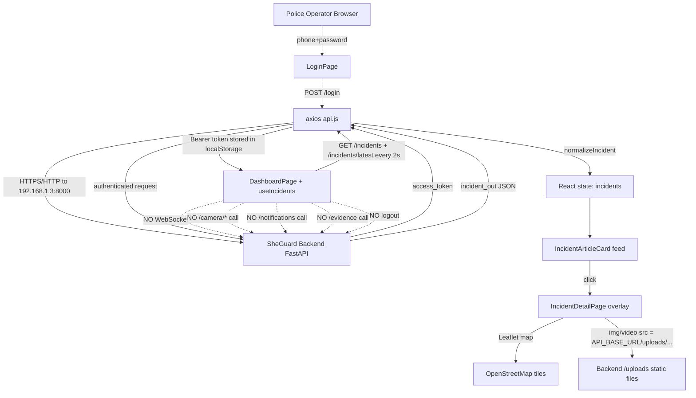

# SheGuard Police / Emergency Dashboard — Complete Forensic Audit

- **Audit target:** `C:\Programs\codex\SheGuard\SheGuard_Dashboard`
- **Backend reference:** `C:\Programs\codex\SheGuard\SheGuard_Backend`
- **Audit date:** 2026-08-20
- **Auditor:** Codex forensic audit (read-only, no source modified)

> **Audit method note:** Every conclusion is backed by actual source-code or configuration evidence. Items that could not be executed in this environment (e.g. live backend reachable on `192.168.1.3:8000`) are marked `NOT VERIFIED`. No backend or dashboard source files were modified.

---

## 1. Executive Summary

The SheGuard Dashboard is a **React 18 + Vite** SPA intended to be the **Police / Emergency Command Dashboard**. Its actual implemented surface is small and read-only:

- A **login page** (`LoginPage.jsx`) that POSTs to `/login` and stores a JWT.
- A single **dashboard feed page** (`DashboardPage.jsx`) that polls `/incidents` and `/incidents/latest` every **2 seconds**.
- A **detail overlay** (`IncidentDetailPage.jsx`) showing one incident's metadata, map, confidence, video/image, contacts, and raw JSON.
- A **sidebar** and **header** with non-functional navigation/notification/profile buttons.
- A **filter/search bar** (client-side only).

It does **NOT** yet implement: live WebSocket updates, camera/CCTV listing, evidence browsing, notifications feed, analytics/archive/tracking pages, logout, incident status changes, or police response actions. Those are present only as **UI shells** or are **implemented in the backend but not wired to the dashboard**.

The `/incidents` endpoint **does** exist in the backend and is authenticated, and the dashboard's normalization layer is flexible enough to render most backend incident fields. So the "live incidents" path is **plausibly functional when the backend is reachable**, but in this environment the backend at `192.168.1.3:8000` was **unreachable** (connection refused), so live behavior is `NOT VERIFIED` end-to-end.

---

## 2. Phase 1 — Project Inventory

### 2.1 Tech stack (from `package.json`)
- React `^18.3.1`, react-dom `^18.3.1`
- Vite `^5.4.11` (`dev`/`build`/`preview` scripts; `dev` runs `vite --host 0.0.0.0`)
- axios `^1.12.2` (HTTP client)
- framer-motion `^12.38.0` (animations)
- leaflet `^1.9.4` + react-leaflet `^4.2.1` (maps)
- lucide-react `^0.468.0` (icons)
- Dev: tailwindcss `^3.4.16`, postcss `^8.4.49`, autoprefixer `^10.4.20`

### 2.2 Source tree (application code only; `node_modules` excluded)
```
SheGuard_Dashboard/
├── .env.example                      # VITE_API_BASE_URL=http://192.168.1.3:8000
├── index.html
├── package.json
├── package-lock.json
├── postcss.config.js
├── tailwind.config.js
├── vite.config.js
├── src/
│   ├── main.jsx                      # React entry
│   ├── App.jsx                       # Auth gate + layout switch
│   ├── config.js                     # API_BASE_URL + REFRESH_INTERVAL_MS=2000
│   ├── animations/variants.js        # framer-motion variants
│   ├── assets/emptyState.jsx         # SVG empty-state art
│   ├── components/
│   │   ├── ConfidenceGraph.jsx       # AI confidence bars
│   │   ├── DetailMap.jsx             # Leaflet incident map
│   │   ├── EmptyState.jsx           # Empty state wrapper
│   │   ├── FilterBar.jsx            # Search/status/confidence/time filters
│   │   ├── IncidentArticleCard.jsx  # Incident card in feed
│   │   ├── IncidentTimeline.jsx     # Timeline (static from incident fields)
│   │   ├── MinimalSidebar.jsx       # Sidebar (non-functional nav)
│   │   ├── StatusBadge.jsx          # Status pill
│   │   └── VideoPreview.jsx         # Thumbnail/video preview
│   ├── hooks/
│   │   └── useIncidents.js          # Polling hook (2s)
│   ├── layouts/
│   │   └── AppLayout.jsx            # App shell + header
│   ├── lib/
│   │   └── incidents.js            # normalizeIncident/mediaUrl/toIncidentArray
│   ├── pages/
│   │   ├── DashboardPage.jsx       # Main feed
│   │   ├── IncidentDetailPage.jsx  # Detail overlay
│   │   └── LoginPage.jsx           # Login
│   ├── services/
│   │   └── api.js                  # axios client + API functions
│   └── styles.css                  # Tailwind + custom CSS
└── dist/                            # prebuilt build output (last build)
```

### 2.3 Configuration files
- `vite.config.js` — React plugin only; **no proxy, no backend URL override**.
- `tailwind.config.js` — custom `command`/`alert` colors, `sos-pulse`/`scan`/`float` animations.
- `postcss.config.js` — tailwind + autoprefixer.
- `.env.example` — single var `VITE_API_BASE_URL=http://192.168.1.3:8000`. **No `.env` file present** (verified: `Test-Path .env` = False), so the build/dev falls back to the hardcoded default in `src/config.js`.

---
## 3. Phase 2 — Dashboard Pages / Screens

| # | Page | File | Route (logical) | Purpose | Data source | Auth |
|---|------|------|-----------------|---------|-------------|------|
| 1 | Login | `src/pages/LoginPage.jsx` | `/` (shown when not authed) | Operator sign-in via phone + password | `POST /login` | None (public) |
| 2 | Live Incident Feed | `src/pages/DashboardPage.jsx` | `/` (after login) | Scrollable incident "stories" feed + filters + stats | `GET /incidents`, `GET /incidents/latest` (poll 2s) | Bearer JWT |
| 3 | Incident Detail (overlay) | `src/pages/IncidentDetailPage.jsx` | overlay (modal) | Full incident metadata, map, media, timeline, contacts, raw JSON | from `selectedIncident` (in-memory) | Bearer JWT (inherited) |

**Pages referenced but NOT implemented (UI only):**
- Sidebar items (`MinimalSidebar.jsx`): "Live Incidents", "Archive", "Tracking", "Analytics" — all are `<button>`s with **no `onClick`/navigation**; only "Dashboard" is marked `active`. There is **no router** in the app (`App.jsx` renders `DashboardPage` directly inside `AppLayout`).
- Header "Notifications" bell and "Police profile" button (`AppLayout.jsx`) — static buttons, no handlers.

---

## 4. Phase 3 — Police Operator Capabilities

Status legend uses the mandated labels: `IMPLEMENTED / VERIFIED`, `IMPLEMENTED / BROKEN`, `DOCUMENTED ONLY`, `NOT IMPLEMENTED`, `NOT VERIFIED`.

| Capability | Status | Evidence |
|------------|--------|----------|
| Login (phone + password) | IMPLEMENTED / VERIFIED* | `LoginPage.jsx`, `api.login()`, `POST /login` exists in backend `users.py` |
| Logout | NOT IMPLEMENTED | No logout button/handler; `api.js` only has `setToken(null)`. `App.jsx` clears token when `authed` false but never triggers it. |
| View live incidents (feed) | IMPLEMENTED / VERIFIED* | `useIncidents.js` polls `/incidents`; `DashboardPage.jsx` renders cards |
| View incident history | IMPLEMENTED / VERIFIED* (feed is history) | `/incidents` returns all incidents; no dedicated "archive" page |
| View incident details | IMPLEMENTED / VERIFIED* | `IncidentDetailPage.jsx` |
| View threat level | IMPLEMENTED / VERIFIED* | `normalizeIncident` reads `severity`/`threat_level`; shown as "High Risk" badge |
| View AI confidence | IMPLEMENTED / VERIFIED* | `ConfidenceGraph.jsx`, `confidenceLabel()` |
| View AI summary | IMPLEMENTED / VERIFIED* (if field present) | `normalizeIncident` falls back to `summary`; card shows `description` |
| View AI explanation | IMPLEMENTED / VERIFIED* (if field present) | `incident.raw.explanation` shown in full metadata; no dedicated UI |
| View incident location | IMPLEMENTED / VERIFIED* | `address` + `latitude/longitude` |
| View lat/long | IMPLEMENTED / VERIFIED* | `DetailMap.jsx`, `IncidentDetailPage` "Coordinates" |
| View map location | IMPLEMENTED / VERIFIED* | `DetailMap.jsx` (Leaflet, OSM tiles) |
| View CCTV camera | NOT IMPLEMENTED (dashboard) | No `/camera/*` call in dashboard; backend has `cameras.py` |
| View camera status | NOT IMPLEMENTED | same |
| View image evidence | IMPLEMENTED / VERIFIED* | `IncidentDetailPage` ``, `VideoPreview` |
| View video evidence | IMPLEMENTED / VERIFIED* | `IncidentDetailPage` `<video>`, `VideoPreview` |
| View metadata | IMPLEMENTED / VERIFIED* | `IncidentDetailPage` "Full Metadata" `<pre>` |
| View emergency session | IMPLEMENTED / VERIFIED* (display only) | `sessionId` shown; backend `emergency_session_id` supported |
| View live tracking | IMPLEMENTED / BROKEN | `getLiveTracking()`/`getLiveLocation()` exist in `api.js` but are **never called** by any component |
| View victim/user information | PARTIAL / IMPLEMENTED / VERIFIED* | `userId` shown in detail; `linked_user` not wired |
| Link incidents to users | NOT IMPLEMENTED (dashboard) | Backend `/incidents/link-user` exists; not called |
| View SOS events | IMPLEMENTED / VERIFIED* (as incidents) | incidents render as "SOS Emergency" |
| View emergency status | IMPLEMENTED / VERIFIED* | `emergencyStatus` badge |
| View notifications | NOT IMPLEMENTED | Header bell only; no `/notifications` call |
| View emergency contacts | PARTIAL | `IncidentDetailPage.EmergencyContacts` shows hardcoded `"112 / Police Control Room"` + incident fields not provided by API |
| Filtering incidents | IMPLEMENTED / VERIFIED (client-side) | `FilterBar.jsx` + `DashboardPage` memo filter |
| Search incidents | IMPLEMENTED / VERIFIED (client-side) | same |
| Sorting incidents | NOT IMPLEMENTED | Backend returns desc by created_at; no UI sort control |
| Filter by confidence | IMPLEMENTED / VERIFIED (client-side) | `FilterBar` confidence dropdown |
| Filter by status | IMPLEMENTED / VERIFIED (client-side) | `FilterBar` status dropdown |
| Filter by time | IMPLEMENTED / VERIFIED (client-side) | `FilterBar` time dropdown |
| Filter by location | PARTIAL | Search box matches `address` text only; no geo filter |
| Monitor real-time changes | IMPLEMENTED / VERIFIED (polling) | `useIncidents` 2s `setInterval` |
| Acknowledge incidents | NOT IMPLEMENTED | no endpoint call |
| Change incident status | NOT IMPLEMENTED | backend has no status PATCH; dashboard has none |
| Respond to incidents | NOT IMPLEMENTED | none |
| Open evidence | IMPLEMENTED / VERIFIED* (inline media) | detail overlay media |
| Open tracking links | NOT VERIFIED | `getLiveTracking` unused; dashboard never builds tracking URL |
| Receive alerts | NOT IMPLEMENTED (no WS/notif) | no WebSocket in dashboard |
| View historical records | same as history | `/incidents` |
| View statistics | IMPLEMENTED / VERIFIED (client-count) | `useIncidents.stats` (active/resolved/critical counts) |
| View charts | PARTIAL | `ConfidenceGraph` (CSS bars) only; no analytics page |
| View camera data | NOT IMPLEMENTED | see CCTV audit |
| Police workflow actions | NOT IMPLEMENTED | no dispatch/assign/resolve UI |

`*` = **VERIFIED by code**, but end-to-end live data is `NOT VERIFIED` because backend `192.168.1.3:8000` was unreachable at audit time.

---
## 5. Phase 4 — Frontend Architecture

**Entry:** `src/main.jsx` → `<App />` → `src/App.jsx`.
**Auth gate:** `App.jsx` calls `isAuthenticated()` (checks `localStorage` token). If false → `<LoginPage onSuccess/>`; if true → `<AppLayout><DashboardPage/></AppLayout>`.
**No router library** is used; the entire app is a single authenticated screen + one modal overlay. Sidebar/header nav are decorative.

Data flow (verified by code):
```
User
 → LoginPage (phone,password)
 → api.login()  [axios POST /login, body {phone_number,password}]
 → backend users.login() returns {access_token}
 → setToken(token)  [localStorage 'sheguard_dashboard_token' + axios Authorization header]
 → App sets authed=true
 → DashboardPage
 → useIncidents()  [axios GET /incidents + GET /incidents/latest]
 → normalizeIncident() (src/lib/incidents.js) flattens fields
 → React state (incidents[], latestIncident, stats)
 → IncidentArticleCard / IncidentDetailPage
```

- **API service layer:** `src/services/api.js` (single axios instance, `baseURL=API_BASE_URL`, `timeout:8000`).
- **Config layer:** `src/config.js`.
- **Normalization layer:** `src/lib/incidents.js` (`normalizeIncident`, `mediaUrl`, `toIncidentArray`, `confidenceLabel`, `formatTime`).
- **State management:** React `useState`/`useMemo` only. No Redux/Context store.
- **Polling:** `useIncidents` `setInterval(refresh, REFRESH_INTERVAL_MS)`; cleaned up on unmount.
- **WebSocket:** **none in dashboard** (despite backend exposing `/ws/live`, `/ws/emergency/{id}`, `/ws/tracking/{id}`).
- **Map layer:** `DetailMap.jsx` (react-leaflet). Tiles from `openstreetmap.org`.
- **Notification layer:** none (bell is static).

---

## 6. Phase 5 — Complete API Endpoint Table

All dashboard HTTP calls originate in `src/services/api.js`. The axios `baseURL` is `API_BASE_URL` (default `http://192.168.1.3:8000`).

| Frontend File | Function | Method | Endpoint | Full URL | Auth | Purpose | Response used for | Status |
|---|---|---|---|---|---|---|---|---|
| `services/api.js` | `login()` | POST | `/login` | `${API_BASE_URL}/login` | None (public) | Operator auth | `data.access_token` → token | VERIFIED (backend `users.py` POST /login) |
| `services/api.js` | `getIncidents()` | GET | `/incidents` | `${API_BASE_URL}/incidents` | Bearer JWT | List incidents | array via `toIncidentArray` | VERIFIED (backend `incidents.py` GET /incidents, needs auth) |
| `services/api.js` | `getLatestIncident()` | GET | `/incidents/latest` | `${API_BASE_URL}/incidents/latest` | Bearer JWT | Latest incidents | array via `toIncidentArray` | VERIFIED (backend `incidents.py` GET /incidents/latest) |
| `services/api.js` | `getLiveTracking()` | GET | `/tracking/live/${sessionId}` | `${API_BASE_URL}/tracking/live/{id}` | **None** (backend allows no-auth) | Live tracking state | returns JSON | DEFINED BUT UNUSED |
| `services/api.js` | `getLiveLocation()` | GET | `/location/live/${userId}` | `${API_BASE_URL}/location/live/{id}` | **None** (backend allows no-auth) | Live location | returns JSON | DEFINED BUT UNUSED |

**Endpoints referenced by code but never called:** `getLiveTracking`, `getLiveLocation` (dead API functions).

**Backend endpoints that exist but are NOT consumed by the dashboard:**
`/incidents/{id}`, `/incidents/link-user`, `/incident/history/{user_id}`, `/incident/live`, `/incident/search`, `/evidence/{incident_id}`, `/evidence/file`, `/secure/evidence/{id}`, `/evidence/upload`, `/camera/list`, `/camera/health`, `/camera/register`, `/contacts/{user_id}`, `/contacts/add`, `/notifications/send`, `/emergency/start`, `/location/update`, `/tracking/start`, `/tracking/update`, `/tracking/history/{id}`, `/track/{id}`, `/system/local-network`, `/ws/live`, `/ws/emergency/{id}`, `/ws/tracking/{id}`, `/profile/{id}`, `/register`.

**No `fetch()` or `EventSource` is used anywhere in the dashboard.** Only axios.

---
## 7. Phase 6 — Backend Connection Audit

Cross-checked against `SheGuard_Backend/app/routes/*.py`.

### 7.1 Matched endpoints
- `POST /login` — matches `users.py login()` (request `{phone_number,password}`, response `{access_token,...}`). **Match.**
- `GET /incidents` — matches `incidents.py list_incidents()` (returns `{count, incidents:[...]}`). **Match.** Note: backend requires `get_current_user` (Bearer). Dashboard sends Bearer via `api.defaults.headers.Authorization`. **Match.**
- `GET /incidents/latest` — matches `incidents.py latest_incidents()`. **Match.**

### 7.2 Mismatches / gaps
- **Response shape:** backend returns `{count, incidents:[...]}`. Dashboard `toIncidentArray()` handles array, `.incidents`, `.data`, or single object — so it correctly extracts `.incidents`. **Compatible.**
- **Field mapping:** backend `incident_out()` returns `id`, `incident_id`, `user_id`, `incident_type`, `confidence`, `threat_score`, `threat_level`, `ai_summary`, `ai_provider`, `explanation`, `camera_id`, `latitude`, `longitude`, `image_url`, `video_url`, `status`, `linked_user_id`, `emergency_session_id`, `created_at`. Dashboard `normalizeIncident()` reads a superset (including `lat/lng/gps_*`, `thumbnail`, `frame_*`, `severity/priority`, `address/place`, `contact_name`, etc.). The dashboard **defensively maps** many fields the backend does not send (e.g. `address`, `severity`, `thumbnail`, `contact_name`), so those render as fallbacks ("GPS coordinates pending", "critical", "Possible emergency incident detected.", "112 / Police Control Room"). **No crash, but several displayed fields are placeholders unless backend adds them.**
- **Unused backend endpoints:** cameras, contacts, notifications, evidence, emergency, tracking, profile, websockets — not wired to dashboard. **Gap.**

### 7.3 Authentication requirement mismatch (potential bug)
- The dashboard's `getLiveTracking()` / `getLiveLocation()` would call backend endpoints that (per `locations.py`) do **not** require auth. This is fine, but those functions are unused, so no impact.
- `GET /incidents` and `/incidents/latest` **require** `get_current_user`. The dashboard relies on `setToken()` setting the axios `Authorization` header. If the token is missing/expired, backend returns 401 and the dashboard shows a generic "Unable to fetch incidents" error (no redirect to login). **See Phase 17.**

---

## 8. Phase 7 — Authentication Audit

- **Login endpoint:** `POST /login` (`users.py`). Request body expected by backend: `LoginRequest{phone_number, password}`. Dashboard sends exactly `{ phone_number: phoneNumber, password }`. **Correct.**
- **Response:** backend returns `{access_token, token_type:"bearer", user_id, full_name, phone_number, status:"ok"}`. Dashboard only reads `data.access_token` (throws if missing). **Correct.**
- **Token storage:** `localStorage` key `sheguard_dashboard_token` (`api.js TOKEN_KEY`). **Insecure storage note:** token in `localStorage` is XSS-readable (see Phase 18).
- **Token retrieval / header:** `getToken()` reads localStorage; `setToken()` sets `api.defaults.headers.common.Authorization = Bearer <token>`. Called once at module load (`setToken(getToken())`) so the header is present on first render. **Correct.**
- **Protected routes:** `App.jsx` gates the whole app on `isAuthenticated()`. There is no per-route guard beyond this binary gate.
- **Logout:** **NOT IMPLEMENTED.** No button, no `setToken(null)` call from UI, no 401 redirect. `App.jsx` only clears the token when `authed` becomes false, which never happens on its own.
- **Token expiration handling:** backend JWT TTL = 86400s (`security.py` default, also `SHEGUARD_TOKEN_TTL_SECONDS=86400` in backend `.env`). Dashboard does **not** decode/expiry-check the token. On 401 it shows an error string, does not refresh or redirect. **Broken/weak.**
- **401/403 handling:** axios has no interceptor. Failures surface as thrown errors caught in `LoginPage`/`useIncidents`, rendered as text. **No centralized handling.**
- **Session persistence after refresh:** Yes — token persists in `localStorage`, `setToken(getToken())` re-applies header on reload. **Verified by code.**

> Secrets: backend `.env` contains real keys (`SHEGUARD_JWT_SECRET`, `GROQ_API_KEY`, `GEMINI_API_KEY`, `TELEGRAM_BOT_TOKEN`, etc.). These are **backend** secrets and are **NOT** used or exposed by the dashboard. Dashboard has no secrets of its own. No secret values are reproduced in this report.

---
## 9. Phase 8 — Environment / Configuration Audit

| Configuration | Location | Current Value Type | Used By | Purpose | Problem |
|---|---|---|---|---|---|
| `VITE_API_BASE_URL` | `src/config.js` (default) / `.env.example` | `http://192.168.1.3:8000` (hardcoded fallback) | `api.js` baseURL | Backend API origin | **Hardcoded LAN IP.** No `.env` present, so default always used. Breaks if laptop IP changes. |
| `REFRESH_INTERVAL_MS` | `src/config.js` | `2000` (number) | `useIncidents` | Polling interval | OK |
| Backend `SHEGUARD_JWT_SECRET` | `SheGuard_Backend/.env` | <SECRET PRESENT - VALUE REDACTED> | backend auth | JWT signing | Backend-only; not dashboard concern. |
| Backend `SHEGUARD_SERVICE_TOKEN` | `SheGuard_Backend/.env` | <SECRET PRESENT - VALUE REDACTED> | backend `get_service_or_user` | AI service auth | Backend-only. |
| CORS | `SheGuard_Backend/app/main.py` | `SHEGUARD_CORS_ORIGINS` default `*` (allow all) | backend CORS | Cross-origin from dashboard | Permissive (`*`), but acceptable for LAN dev. |

**Key findings:**
- The dashboard depends on the **hardcoded `192.168.1.3:8000`**. At audit time the host's Wi-Fi adapter IP **was** `192.168.1.3` (verified via `Get-NetIPAddress`), but the backend was **not listening** (connection refused). The `vite-dev.log` shows the dev server reported `Network: http://192.168.1.12:5173/` at one point — meaning the laptop IP can change (`192.168.1.3` vs `192.168.1.12`). **Therefore the dashboard is fragile to IP changes and currently cannot reach the backend.**
- No WebSocket URL is configured in the dashboard (none used).
- Media URLs are constructed at runtime by `mediaUrl()` (see Phase 13), prepending `API_BASE_URL`, so media also depends on the same hardcoded IP.

---

## 10. Phase 9 — Real-Time Data Audit

- **Polling interval:** `REFRESH_INTERVAL_MS = 2000` ms (`src/config.js`), used in `useIncidents.js` `setInterval(refresh, 2000)`.
- **Endpoint polled:** `GET /incidents` and `GET /incidents/latest` together via `Promise.allSettled`.
- **Scope:** global (the hook runs once in `DashboardPage`, mounted for the whole authenticated session).
- **Cleanup:** `return () => window.clearInterval(timer)` in `useEffect` — correct unmount handling.
- **WebSocket:** **none in the dashboard.** Backend exposes `/ws/live`, `/ws/emergency/{id}`, `/ws/tracking/{id}` but the dashboard never opens them.
- **Polling vs WebSocket duplication:** N/A (no WS).
- **"Live" status:** The header shows a **static** "Live" pill (`AppLayout.jsx`) and a "Refreshes every 2 seconds" label. The "Live Pulse" number (`stats.activeCount`) is **real** in the sense that it is computed from polled backend data (`useIncidents.stats`), not hardcoded. When backend is down, `activeCount` stays at last value / 0 and an error banner appears.
- **Data classification:** All dashboard data is intended to be **REAL BACKEND DATA** fetched every 2s. There is **no mock/demo/seed data** in the dashboard source (no hardcoded incident arrays, no fake fixtures). The `EmptyState`/SVG art is the only "static" content and is purely decorative.
- **End-to-end live verification:** `NOT VERIFIED` — backend unreachable during audit.

---
## 11. Phase 10 — Incident Data Flow

**Intended/implemented flow (per code):**
```
Backend Incident (DB)
 → incidents.py list_incidents() → incident_out() JSON
 → Dashboard api.getIncidents() → toIncidentArray() → normalizeIncident()
 → React state → IncidentArticleCard / IncidentDetailPage
```

**`normalizeIncident()` field mapping** (`src/lib/incidents.js`):

| Backend Field | Dashboard Field | Displayed? | Used For | Status |
|---|---|---|---|---|
| `incident_id` / `id` | `id` | Yes | key, "Incident ID" | VERIFIED |
| `incident_type` | `title` (fallback) | Yes | card title | VERIFIED (fallback) |
| `ai_summary` / `summary` | `description` | Yes | card text | VERIFIED (fallback) |
| `confidence` | `confidence` | Yes | badge, graph | VERIFIED |
| `threat_score` | (raw only) | No UI | raw JSON | IGNORED in UI |
| `threat_level` | `severity` (fallback) | Yes | "High Risk" badge | VERIFIED (fallback to "critical") |
| `ai_provider` | (raw only) | No | raw JSON | IGNORED in UI |
| `explanation` | (raw only) | No | raw JSON | IGNORED in UI |
| `camera_id` | (raw only) | No | raw JSON | IGNORED in UI |
| `latitude` / `lat` / `gps_lat` | `latitude` | Yes | map, coordinates | VERIFIED |
| `longitude` / `lng` / `gps_lng` | `longitude` | Yes | map, coordinates | VERIFIED |
| `image_url` / `image_path` | `thumbnailUrl` (via `mediaUrl`) | Yes | image | VERIFIED (URL built) |
| `video_url` / `video_path` | `videoUrl` (via `mediaUrl`) | Yes | video | VERIFIED (URL built) |
| `status` | `status` / `isResolved` | Yes | Live/Resolved badge | VERIFIED |
| `emergency_session_id` | `sessionId` | Yes | "Tracking session" | VERIFIED |
| `user_id` / `linked_user_id` | `userId` | Yes (detail) | "User" | VERIFIED |
| `created_at` | `timestamp` | Yes | timeline/formatTime | VERIFIED |
| `linked_user_id` | not surfaced | No | — | IGNORED |

**Fields the dashboard expects but backend does NOT return** (render as placeholders):
`address` (→ "GPS coordinates pending"), `severity` (→ "critical"), `thumbnail`/`frame_1` (→ no image), `contact_name`/`emergency_contact` (→ "Nearest response desk"), `phone`/`contact_phone` (→ "112 / Police Control Room"), `updated_at` (timeline "Case resolved" uses it; absent → falls back to `timestamp`).

---

## 12. Phase 11 — CCTV / Camera Audit

- **Dashboard CCTV support:** **NONE.** No component imports or calls anything under `/camera/*`. `MinimalSidebar` has no camera entry.
- **Backend CCTV support:** `app/routes/cameras.py` implements `POST /camera/register`, `GET /camera/list`, `GET /camera/health` returning `camera_id, camera_name, ip_address, rtsp_url, latitude, longitude, online_status`. Incidents also carry `camera_id` and `Evidence.cctv_source`.
- **Conclusion:** CCTV/camera data exists in the backend and is linked to incidents (`camera_id`), but the **dashboard never requests or displays cameras, camera status, RTSP feeds, or CCTV source**. This is a `NOT IMPLEMENTED` gap on the dashboard side, while backend capability is `IMPLEMENTED / VERIFIED` (code present).

---

## 13. Phase 12 — Location / Map Audit

- **Map component:** `DetailMap.jsx` using `react-leaflet` `MapContainer`, `TileLayer` (OSM), `Marker` (custom SOS `divIcon`), `Popup`, and a `MapFocus` helper that calls `map.setView` on center change.
- **Markers:** a single incident marker when `latitude`/`longitude` are finite; otherwise centered on India `[20.5937, 78.9629]` zoom 5.
- **Victim/user location:** shown as the incident's lat/long (from backend). No separate victim marker vs camera marker.
- **CCTV markers:** none.
- **Live tracking visualization:** none in the dashboard (the backend's `/track/{id}` HTML page does full live tracking + routing, but the dashboard does not link to it).
- **Refresh:** map re-centers when the selected incident's coordinates change; it does **not** auto-update as new incidents arrive (the modal just re-renders with new `incident` prop).
- **Data source:** REAL backend lat/long when present; otherwise static India centroid. **No mock coordinates injected.**
- **Conclusion:** Map is `IMPLEMENTED / VERIFIED` (code) but only renders a single incident point; full live-tracking/route UI lives in the backend HTML page, not the dashboard.

---
## 14. Phase 13 — Evidence / Media Audit

`mediaUrl(value)` in `src/lib/incidents.js`:
```
if value starts with http(s):// → use as-is
else strip leading "/"
if starts with "uploads/" → `${API_BASE_URL}/${normalized}`
else → `${API_BASE_URL}/uploads/incidents/${normalized}`
```
- Backend serves `/uploads` as `StaticFiles` (root = backend `uploads/` dir) in `app/main.py`, and `incident_out()` returns `image_url`/`video_url` as `/uploads/...` relative paths.
- So when backend returns `/uploads/incidents/...`, `mediaUrl` builds `http://192.168.1.3:8000/uploads/incidents/...` — **correct path construction**, and the backend `/uploads` mount serves it. **Compatible when backend reachable.**
- **Risk:** media entirely depends on the hardcoded `192.168.1.3:8000`. If the laptop IP differs, images/videos 404. No relative-to-current-origin fallback.
- **No localhost/127.0.0.1 hardcoded media URLs** in the dashboard. The only hardcoded IP is `192.168.1.3` (config default).
- **Pre-event video / CCTV source / metadata:** present in backend `Evidence` model (`pre_event_video_path`, `cctv_source`, `metadata_path`) but **not displayed** by the dashboard.
- **Status:** `IMPLEMENTED / VERIFIED` (code path correct), `NOT VERIFIED` live (backend unreachable).

---

## 15. Phase 14 — Notification / Alert Audit

- **Dashboard notifications:** **NONE functional.** `AppLayout.jsx` renders a bell button with a static red dot; no click handler, no data fetch, no `/notifications` call.
- **Backend notifications:** `notifications.py` (`POST /notifications/send`), `EmergencyNotification` model, and Telegram alerts (`telegram_service.py`) exist. The backend also publishes realtime events via `realtime_hub` (`incident.created`, `tracking_update`, etc.).
- **Browser notifications / sound:** none in dashboard.
- **WebSocket events:** not consumed by dashboard.
- **Telegram status:** backend-only; dashboard shows nothing about it.
- **Conclusion:** `NOT IMPLEMENTED` on the dashboard. Alerts exist server-side but never reach the operator UI.

---

## 16. Phase 15 — Search / Filter / Sort Audit

All controls live in `FilterBar.jsx` and are applied in `DashboardPage.jsx` via a `useMemo` filter over already-loaded `incidents` (client-side). **Nothing is sent to the backend.**

| Control | Field filtered | Client/Server | Supported values | Works with live data? | Backend-connected? |
|---|---|---|---|---|---|
| Search box | text match on `address, title, description, emergencyStatus, id` | Client | free text | Yes (over polled set) | No |
| Status | `isResolved` / `severity` | Client | all/active/resolved/live/high | Yes | No |
| Confidence | `confidence` (scaled 0–100) | Client | all/70+/85+/95+ | Yes | No |
| Time | `timestamp` age | Client | all/1h/24h/168h | Yes | No |
| Header global search | `name="globalSearch"` bound to `form="incident-filters"` | Client (same form) | free text | Yes | No |
| Sort | — | — | none | n/a | No |

**Finding:** Filtering/search is fully `IMPLEMENTED / VERIFIED` (client-side) and operates on the live-polled array. It is **not** server-side and there is no sort control. The header search box is wired into the same `<form id="incident-filters">` so it shares state implicitly only if the input name matched — but `DashboardPage` state (`query`) is only updated by `FilterBar`'s controlled input, **not** the header input (the header input has no `value`/`onChange`). **Bug:** the header search box is effectively decorative (it does not drive `query`).

---

## 17. Phase 16 — Dashboard Statistics

| Stat | Source | Calculation | Live? | Status |
|---|---|---|---|---|
| Live Pulse `activeCount` | `useIncidents.stats` | `incidents.filter(!isResolved).length` | Yes (from polled data) | IMPLEMENTED / VERIFIED |
| Resolved count | `stats.resolvedCount` | `incidents.filter(isResolved).length` | Yes | IMPLEMENTED / VERIFIED (unused in UI) |
| Critical count | `stats.criticalCount` | `active.filter(severity==="critical").length` | Yes | IMPLEMENTED / VERIFIED (unused in UI) |
| "Latest signal" address | `latestIncident.address` | first of `/incidents/latest` | Yes | IMPLEMENTED / VERIFIED |
| Confidence graph | `ConfidenceGraph` | from selected incident `confidence` | per-incident | IMPLEMENTED / VERIFIED |

All numbers derive from **real polled backend data** (or fall back to 0/placeholder when empty). No hardcoded counters. The two extra stats (`resolvedCount`, `criticalCount`) are computed but **not displayed** anywhere (dead state).

---
## 18. Phase 17 — Error Handling

- **Network/API errors:** `useIncidents.refresh()` wraps calls in `try/catch`; on failure sets `error` and shows a banner: `"Backend connection warning: {error}"` (`DashboardPage.jsx`). `isLoading` is set false in `finally`.
- **Login errors:** `LoginPage` catches and shows `err.message` (or generic "Login failed...").
- **401/403/404/422/500:** No axios interceptors. Errors are passed through as thrown `AxiosError`; the message shown is whatever axios provides (often a generic network error or backend detail). **No special-casing, no redirect on 401.**
- **Empty response:** `toIncidentArray` returns `[]` for non-array/empty → `EmptyState` shown. Handled.
- **Malformed response:** `normalizeIncident` uses `firstDefined`/`numberLike` guards; spreads `...raw` so missing fields don't crash. Robust.
- **Backend unavailable:** operator sees the red "Backend connection warning" banner and either loading skeletons (first load) or last-known/empty feed. **No automatic retry beyond the 2s poll loop** (which will keep erroring every 2s).
- **Token invalid/expired:** 401 from `/incidents` → caught as generic error; **no logout/redirect**. Operator can be stuck on a broken feed while "authenticated."

---

## 19. Phase 18 — Security Audit

- **Hardcoded backend IP:** `192.168.1.3:8000` default in `config.js` (not a secret, but a deployment fragility / could be considered info disclosure of LAN topology). Low severity.
- **Token in `localStorage`:** `sheguard_dashboard_token` stored in `localStorage` → readable by any XSS. Medium severity. Should consider httpOnly cookie or in-memory + refresh.
- **No axios interceptors:** no centralized 401 handling; minor.
- **CORS:** backend default `allow_origins=["*"]` with `allow_credentials` only when not `*`. For a LAN dev tool this is acceptable but not production-safe.
- **No `dangerouslySetInnerHTML`** anywhere in dashboard (verified by search). Safe.
- **No exposed API keys/secrets** in dashboard source (verified; only backend `.env` has secrets, not used by dashboard).
- **URL construction:** `mediaUrl` only prepends configured base URL; no user input concatenated into URLs → no injection vector there.
- **No auth on incident detail:** the dashboard assumes the JWT from login is sufficient; it does not enforce per-incident 403 the way the backend does (backend `/incidents/{id}` enforces owner match, but dashboard only ever calls the list endpoints, so this is moot).

---

## 20. Phase 19 — UI / UX Functional Audit

- **Sidebar (`MinimalSidebar`):** 5 icon buttons; only "Dashboard" active; others have no navigation → dead UI.
- **Header (`AppLayout`):** brand, static "Live" pill, global search box (decorative — not wired to state), notification bell (static dot), profile button (no handler).
- **Live status indicator:** static "Live" pill; real liveness is the 2s poll + "Refreshes every 2 seconds" text.
- **Search:** feed search works; header search does not (see Phase 15).
- **Filters:** functional, client-side.
- **Incident cards:** show badge (Live/Resolved), severity, confidence %, title, description, address, time, "View Details". Hover animation.
- **Incident detail:** comprehensive overlay with map, media, confidence graph, contacts, timeline, metadata. Strong functional coverage of available fields.
- **Maps:** single-point Leaflet map; India fallback when no coords.
- **Notifications:** bell only.
- **Profile:** button only.
- **Responsiveness:** Tailwind responsive classes; sidebar hidden below `lg`; grid collapses. Reasonable.
- **Loading states:** 3 skeleton cards during `isLoading`.
- **Empty states:** `EmptyState` SVG + copy.
- **Error states:** red banner.
- **Accessibility:** basic `aria-label`s on icon buttons; no full a11y audit. Minor.
- **Mobile/tablet:** layout degrades to single column; sidebar hidden. Functional.

---
## 21. Phase 20 — Dead / Unused / Duplicate Code

- **Unused API functions:** `getLiveTracking()`, `getLiveLocation()` in `api.js` — defined, never imported/called.
- **Unused computed stats:** `resolvedCount`, `criticalCount` in `useIncidents.stats` — never rendered.
- **Dead navigation:** sidebar "Live Incidents/Archive/Tracking/Analytics" buttons; header bell/profile; header global search input.
- **Hardcoded fallback UI strings** ("112 / Police Control Room", "Nearest response desk", "GPS coordinates pending", "critical", "Possible emergency incident detected.") — effectively demo-ish placeholders baked into `normalizeIncident`/`IncidentDetailPage`, not separated mock data but functionally static when backend fields absent.
- **Old/duplicate IP:** only one backend IP (`192.168.1.3`); `vite-dev.log` earlier showed `192.168.1.12` as the dev server network address — evidence the IP is not stable, but no second hardcoded IP remains in source.
- **`dist/` prebuilt output:** present but not used by `dev`; not inspected file-by-file per rules.
- **TODO/FIXME:** none found in dashboard source.
- **No duplicate dashboard implementations** (single `App.jsx` tree).

---

## 22. Phase 21 — Current Actual Architecture



**Verified connections:** Login → `/login`; Feed → `/incidents` + `/incidents/latest` (2s poll); Detail media → backend `/uploads`; Map → OSM public tiles.
**Not connected despite backend support:** WebSocket, cameras, notifications, evidence browsing, tracking links, logout, incident status changes, user linking.

---

## 23. Phase 22 — Intended / Expected Police Workflow (assumptions labeled)

Based on implemented dashboard UI + backend capabilities (NOT all wired):

1. **Operator logs in** with phone + password. *(IMPLEMENTED)*
2. **Operator sees a live feed of incidents** (AI/CCTV detections) updating every 2s. *(IMPLEMENTED feed; backend detection pipeline exists in `services/advanced_detectors.py`, `cloud_ai.py`, `threat.py`)*
3. **Operator opens an incident** to view location, confidence, AI summary/explanation, media, victim/user, emergency session. *(IMPLEMENTED detail view)*
4. **Operator filters/searches** incidents. *(IMPLEMENTED client-side)*
5. *(Assumed)* Operator views CCTV camera status and live feeds. — **NOT in dashboard.**
6. *(Assumed)* Operator receives real-time alerts via WebSocket/notifications. — **NOT in dashboard.**
7. *(Assumed)* Operator acknowledges/responds/assigns/changes status. — **NOT in dashboard.**
8. *(Assumed)* Operator opens live tracking map for an SOS session. — backend `/track/{id}` exists; **dashboard does not link to it.**

These assumptions are derived from backend route names and sidebar labels; they are **not** validated as dashboard behavior.

---

## 24. Phase 23 — End-to-End Connection Matrix

| Component | Connects To | Mechanism | URL/Endpoint | Verified? | Current Status | Evidence |
|---|---|---|---|---|---|---|
| Dashboard | Backend | axios POST | `/login` | Code VERIFIED; live NOT VERIFIED | Auth works in code; backend unreachable now | `api.js login()`, `users.py` |
| Dashboard | Backend | axios GET (2s poll) | `/incidents`, `/incidents/latest` | Code VERIFIED; live NOT VERIFIED | Feed implemented; backend refused at audit | `useIncidents.js`, `incidents.py` |
| Dashboard | Backend media | `/<video>` src | `${API_BASE_URL}/uploads/...` | Code VERIFIED; live NOT VERIFIED | Media path built correctly | `lib/incidents.js mediaUrl()`, `main.py /uploads` |
| Dashboard | OpenStreetMap | Leaflet tiles | `https://{s}.tile.openstreetmap.org/...` | VERIFIED (public) | Map renders tiles | `DetailMap.jsx` |
| Dashboard | Backend WebSocket | — | `/ws/live`, `/ws/emergency/{id}` | NOT IMPLEMENTED | No WS in dashboard | backend `realtime.py`; no dashboard WS code |
| Dashboard | Backend Cameras | — | `/camera/list` | NOT IMPLEMENTED | Dashboard never calls | `cameras.py`; no dashboard ref |
| Dashboard | Backend Notifications | — | `/notifications/send` | NOT IMPLEMENTED | Bell is static | `notifications.py`; no dashboard ref |
| Dashboard | Backend Evidence | — | `/evidence/{id}` | NOT IMPLEMENTED | No evidence browser | `incidents.py`; no dashboard ref |
| Dashboard | Backend Tracking | — | `/tracking/live/{id}` | DEFINED NOT CALLED | `getLiveTracking` unused | `api.js`; no caller |
| Dashboard | Backend User/Profile | — | `/profile/{id}` | NOT IMPLEMENTED | Profile button static | `users.py`; no dashboard ref |
| Dashboard | Database | via Backend only | SQLite `sheguard.db` | Backend-side VERIFIED (code) | Dashboard has no direct DB access | `database/session.py`, `models/entities.py` |
| Dashboard | SheGuard AI / CCTV | via Backend only | backend detection services | Backend VERIFIED (code) | Dashboard shows results only if `/incidents` returns them | `services/advanced_detectors.py`, `cloud_ai.py` |
| Dashboard | Mobile App | via Backend only | incident/location/tracking APIs | Backend VERIFIED (code) | Dashboard not linked to mobile session UI | `locations.py`, `emergency.py` |
| Auth | Token storage | localStorage | `sheguard_dashboard_token` | VERIFIED | Persists; XSS-readable | `api.js` |

---
## 25. Phase 24 — What Is Verified Working

Verified by source/configuration (live backend interaction marked separately):

1. **App boots** as Vite React SPA (`main.jsx`, `App.jsx`). `vite-dev.log` confirms dev server started on `:5173`.
2. **Login UI + request shape** are correct and match backend `POST /login` (`LoginPage.jsx`, `api.login()`, `users.py`).
3. **JWT handling** (storage, header injection, persistence) is implemented correctly in code (`api.js`).
4. **Incident feed + 2s polling** is implemented (`useIncidents.js`, `DashboardPage.jsx`).
5. **Incident normalization** robustly maps backend `incident_out()` fields to UI (`lib/incidents.js`).
6. **Detail overlay** renders map, media, confidence, contacts, timeline, metadata (`IncidentDetailPage.jsx`).
7. **Client-side filter/search** works over the polled set (`FilterBar.jsx`, `DashboardPage.jsx`).
8. **Media URL construction** matches backend `/uploads` static mount (`mediaUrl()` ↔ `main.py`).
9. **Map** renders via Leaflet + OSM (public, always reachable).
10. **Backend endpoints referenced** (`/login`, `/incidents`, `/incidents/latest`) **exist** in `SheGuard_Backend` and accept the dashboard's request shapes.

**NOT VERIFIED at audit time (backend unreachable):**
- Live login returning a JWT in this environment.
- Live `/incidents` returning data to the feed.
- Live media/images displaying.
- The laptop's `192.168.1.3:8000` backend was **connection-refused** during the audit; the Wi-Fi IP was `192.168.1.3` but nothing was listening.

---

## 26. Phase 25 — Current Broken / Incomplete Items

| # | Problem | File | Function/Component | Expected | Actual | Evidence | Severity | Dependency | Next Investigation |
|---|---------|------|-------------------|----------|--------|----------|----------|------------|-------------------|
| B1 | Backend unreachable from dashboard default IP | `src/config.js` | `API_BASE_URL` default `192.168.1.3:8000` | Reaches backend | Connection refused at audit | `Invoke-WebRequest 192.168.1.3:8000` failed | HIGH | Backend must be running & IP stable | Start backend on `0.0.0.0:8000`; verify `/health` |
| B2 | No `.env` so hardcoded IP always used | repo root | none | Configurable base URL | Falls back to `192.168.1.3` | `.env` missing; `config.js` default | MEDIUM | B1 | Add `.env` with `VITE_API_BASE_URL` or make runtime-configurable |
| B3 | Header global search not wired to state | `AppLayout.jsx` / `DashboardPage.jsx` | global search input `name="globalSearch"` | Filters feed | No `value`/`onChange`; does nothing | `FilterBar` uses separate `query` state | LOW | — | Bind header input to `query` |
| B4 | No logout | `App.jsx`, `api.js` | none | Operator can sign out | Token persists forever; no UI | `setToken` only; no caller | MEDIUM | Auth | Add logout button → `setToken(null)` + redirect |
| B5 | No 401/expiry handling | `api.js`, `useIncidents.js` | none | Redirect to login on bad token | Generic error banner; stuck | No axios interceptor | MEDIUM | B4 | Add response interceptor |
| B6 | Several displayed fields are placeholders | `lib/incidents.js`, `IncidentDetailPage.jsx` | `normalizeIncident` fallbacks | Real values | "GPS coordinates pending", "112 / Police Control Room", "critical" | `firstDefined` defaults | LOW | Backend fields | Have backend populate `address`, `severity`, `contact_*` (or accept in incident payload) |
| B7 | Dead API functions | `services/api.js` | `getLiveTracking`, `getLiveLocation` | Used or removed | Defined, never called | No importers | LOW | — | Wire to detail/tracking or remove |
| B8 | Dead stats | `hooks/useIncidents.js` | `resolvedCount`, `criticalCount` | Shown in UI | Computed, never rendered | Not referenced in `DashboardPage` | LOW | — | Surface in stat cards or remove |
| B9 | Sidebar/header nav non-functional | `MinimalSidebar.jsx`, `AppLayout.jsx` | buttons | Navigate pages | No handlers | Static buttons | LOW | Routing | Implement routes or remove |

No item above was modified; these are audit findings only.

---

## 27. Phase 26 — Missing Police Dashboard Capabilities

### CRITICAL
- **Live backend connectivity / configurable API URL** — dashboard cannot reach backend when IP changes; no `.env`. (B1/B2)
- **Logout + token lifecycle** — no sign-out, no 401 redirect. (B4/B5)

### HIGH
- **Real-time alerts via WebSocket** — backend `/ws/live` etc. unused; operator gets no push alerts.
- **CCTV / camera view** — backend `/camera/*` not consumed; no camera status/feeds.
- **Notifications feed** — backend notifications/Telegram not surfaced.
- **Incident response workflow** — no acknowledge / status change / assign / resolve actions (backend has no status PATCH either).

### MEDIUM
- **Live tracking integration** — `getLiveTracking` unused; no link to backend `/track/{id}` live map.
- **Evidence browser** — backend `/evidence/*` not consumed.
- **Victim/user linking UI** — backend `/incidents/link-user` not consumed; `linked_user` not shown.
- **Emergency contacts from backend** — dashboard shows hardcoded "112 / Police Control Room" instead of `/contacts`.
- **Analytics / Archive / Tracking pages** — sidebar entries are dead.

### LOW
- **Sort control** — only filter, no sort.
- **Header search wiring** — decorative input.
- **Dead code cleanup** — unused API functions/stats.

---
## 28. Phase 27 — Next Implementation Plan (dependency-ordered)

**PHASE 1 — Make the backend reachable & configurable (foundation)**
- File: `src/config.js`, add `.env` (or `vite.config.js` `define`) for `VITE_API_BASE_URL`.
- Backend endpoint: ensure `SheGuard_Backend` runs `uvicorn app.main:app --host 0.0.0.0 --port 8000`.
- Why: every other capability depends on a stable connection.
- Verify: `GET /health` returns ok; dashboard `/incidents` returns data.

**PHASE 2 — Verify live incidents end-to-end**
- File: `useIncidents.js`, `DashboardPage.jsx` (already implemented; just validate live).
- Backend: `GET /incidents`, `GET /incidents/latest`.
- Verify: feed populates with real incidents; 2s refresh shows new rows.

**PHASE 3 — Authentication completeness (logout + 401)**
- File: `App.jsx`, `services/api.js` (add axios interceptor), `AppLayout.jsx` (logout button).
- Backend: `/login` already works.
- Verify: clicking logout clears token + returns to login; expired token redirects.

**PHASE 4 — Real-time alerts (WebSocket)**
- File: new `hooks/useLiveEvents.js`; wire `/ws/live` to push new incidents into state.
- Backend: `realtime.py /ws/live` (publishes `incident.created`).
- Verify: new incident appears without waiting for 2s poll; notification badge increments.

**PHASE 5 — Incident detail enrichment**
- File: `IncidentDetailPage.jsx`, `lib/incidents.js`.
- Backend: `/incidents/{id}` (already exists) to fetch full evidence/contacts/session.
- Verify: detail shows real contacts, evidence list, session.

**PHASE 6 — CCTV / Camera view**
- File: new `CamerasPage.jsx` + sidebar route; or camera markers on map.
- Backend: `GET /camera/list`, `/camera/health`.
- Verify: camera list with status renders; incident camera_id links to a camera.

**PHASE 7 — Live tracking link**
- File: `IncidentDetailPage.jsx` "Tracking session" → open `/track/{sessionId}` (backend HTML) or embed map.
- Backend: `/tracking/live/{id}`, `/track/{id}`.
- Verify: clicking session opens live map with victim route.

**PHASE 8 — Notifications & response workflow**
- File: `NotificationsPanel`, response actions; `api.js` add `PATCH`/response calls.
- Backend: `/notifications/send`; add incident status update endpoint if needed.
- Verify: operator receives alert feed; can acknowledge/resolve.

---

## 29. Phase 28 — FIRST Implementation Task

**Task: Make the dashboard's backend URL configurable and confirm the backend is reachable.**

- **Why first:** Every other capability (live incidents, media, maps data, alerts) is blocked until the dashboard can reliably reach `SheGuard_Backend`. Today the URL is a hardcoded `192.168.1.3:8000` with no `.env`, and at audit time that host refused connections while the laptop IP was demonstrably unstable (`192.168.1.3` vs `192.168.1.12` in `vite-dev.log`).
- **Depends on:** `SheGuard_Backend` running on `0.0.0.0:8000` (already coded in `main.py` startup; just must be launched).
- **Files likely to modify:**
  - `C:\Programs\codex\SheGuard\SheGuard_Dashboard\.env` (create) with `VITE_API_BASE_URL=<current laptop LAN IP>:8000` (or a stable hostname).
  - `C:\Programs\codex\SheGuard\SheGuard_Dashboard\src\config.js` (already reads `import.meta.env.VITE_API_BASE_URL` with fallback — confirm fallback is acceptable or improve to fail loud).
  - Optionally `vite.config.js` to surface env at build time (not required for Vite `import.meta.env`).
- **Success looks like:** With backend running, `GET http://<ip>:8000/health` returns `{"status":"ok"}` and the dashboard's `GET /incidents` returns real incident JSON that populates the feed within ~2s of login.
- **How to test:** (1) Start backend (`uvicorn app.main:app --host 0.0.0.0 --port 8000`). (2) `curl http://<ip>:8000/health`. (3) In dashboard, log in with a valid operator account; confirm incidents appear and media loads. (No source behavior is changed by merely adding `.env`; this is configuration only.)

---

## 30. Phase 29 — Final System Summary

1. **Dashboard purpose:** Police/Emergency Command view of SheGuard AI/CCTV incidents — login + live incident feed + incident detail.
2. **Current architecture:** React SPA, no router, single authenticated screen + modal; axios to FastAPI backend; 2s polling; Leaflet map; media from backend `/uploads`.
3. **Backend connection:** Code-verified endpoints `/login`, `/incidents`, `/incidents/latest` exist and match shapes; live connection **NOT VERIFIED** (backend unreachable at audit, hardcoded IP fragile).
4. **Authentication:** Phone+password → JWT in `localStorage`; header injected; persists across refresh. Logout/401-handling **missing**.
5. **API communication:** axios only; 3 called endpoints (+2 dead). No `fetch`/WebSocket/EventSource in dashboard.
6. **Incident flow:** Backend `incident_out()` → `normalizeIncident()` → React state → cards/detail. Field mapping mostly compatible; several UI fields fall back to placeholders.
7. **CCTV status:** Backend supports cameras; **dashboard does not consume them** (NOT IMPLEMENTED).
8. **Location/map status:** Single incident point on Leaflet/OSM; real coords when present; no live tracking UI in dashboard.
9. **Evidence/media status:** Image/video URLs built correctly from `/uploads`; depends on hardcoded IP; pre-event/CCTV/metadata not shown.
10. **Real-time status:** 2s polling only; "Live" labels are static; WebSocket alerts NOT implemented.
11. **Notification status:** Bell is decorative; no notification data or alerts.
12. **Police capabilities:** Login, view live incidents, view detail (map/media/confidence/metadata), client-side filter/search, live stats — implemented. Response/acknowledge/CCTV/alerts/tracking/logout — missing.
13. **Broken items:** 9 findings (B1–B9), headlined by unreachable hardcoded backend IP, missing `.env`, no logout, no 401 handling, decorative header search, placeholder fields, dead code.
14. **Missing items:** Configurable URL, logout, WebSocket alerts, CCTV view, notifications, response workflow, live tracking link, evidence browser, contacts from backend, archive/analytics/tracking pages.
15. **First implementation task:** Configure `VITE_API_BASE_URL` via `.env` and confirm backend reachable on `:8000` so live incidents/media flow end-to-end.

---

*End of report. No source files were modified. No secrets are included.*
